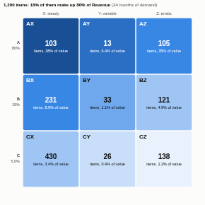

#  ABC-XYZ Analysis

Inventory classification by value and by demand variability, the standard way supply chain teams decide how to manage thousands of products. ABC ranks items by their share of value (A: the few items that make up most of it). XYZ measures how steady each item's demand is from period to period (X: steady, Y: variable, Z: erratic or sporadic). The view shows the nine classes as a matrix with their item counts and value, a Pareto curve, and a typical policy for each class.

## Use case

Stock policy and safety stock setting, forecasting effort (where to spend analyst time), replenishment automation, range reviews and delisting, warehouse slotting, spare parts management, procurement prioritisation.

## Data

Sales, issues or order lines: one row per item per transaction or per period, with a date, the units and optionally a value (revenue or cost). The view runs one aggregated query (units and value per item per period), so large transaction tables stay on the server. Periods with no demand for an item count as zero. Filters from other views apply.

## Settings

- **Items**: the product, SKU or part.
- **Dated by**: the date of each line.
- **Demand**: units sold, issued or ordered.
- **Value** (optional): revenue or cost to rank by; without it items are ranked by units.
- **Period**: month (default), week or quarter, for measuring variability.
- **A share %** and **A and B share %**: the cumulative value thresholds (default 80 and 95).
- **X up to CV** and **Y up to CV**: the coefficient of variation limits (default 0.5 and 1.0).

## How it classifies

Items are ranked by value. A items are those that make up the first 80% of value (the item that crosses the threshold is included), B items take it to 95%, and C items are the rest. For each item the coefficient of variation (standard deviation divided by mean) of demand per period is calculated over the whole date range: up to 0.5 is X, up to 1.0 is Y, above that (or no demand) is Z. The policies shown are common practice, not rules.

## Interaction

Hover a cell for its items, value, units, median variability and largest items. Click a cell to select its items (up to 3,000), so other views can list them or show their trends; click again or click empty space to clear.

## Motion

When the view first draws, and when its data, options or filters change, the cells fade in in turn. Hovering and selecting do not replay it. The animation is skipped when the viewer's system asks for reduced motion.

## Third-party libraries

Loaded from the jsDelivr CDN when the view opens, so the browser showing the report needs internet access:

- [D3](https://d3js.org) 7.9.0, ISC licence

## About this view

This view carries the `visokio-agents` tag. It is one of a set of community examples built by Visokio's agents, to extend Omniscope's core views with popular, specialist and more unusual use cases, and to show what anyone, people or agents, can build on Omniscope. It is tested by automated tests and was run on a real Omniscope server. It was not reviewed by Omniscope's core team, so it is not on a par with Omniscope's core views, which have years of manual, functional and unit tests behind them.

The sample data in `sample-data/` is invented for the demo.
