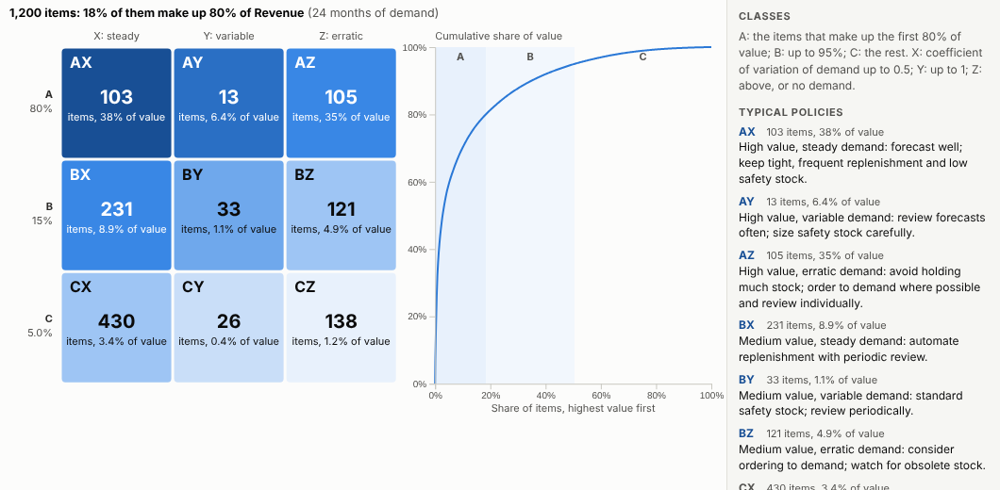
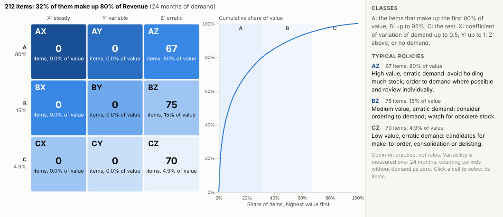
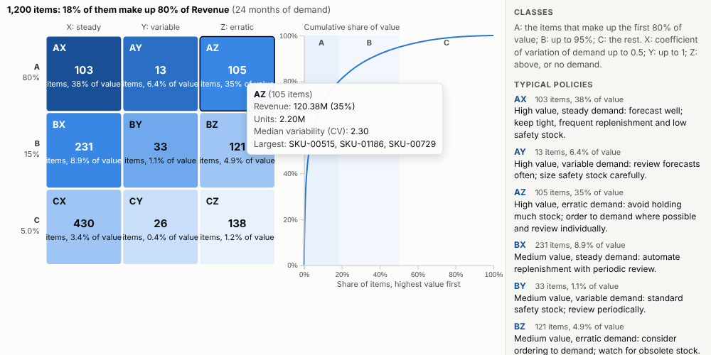
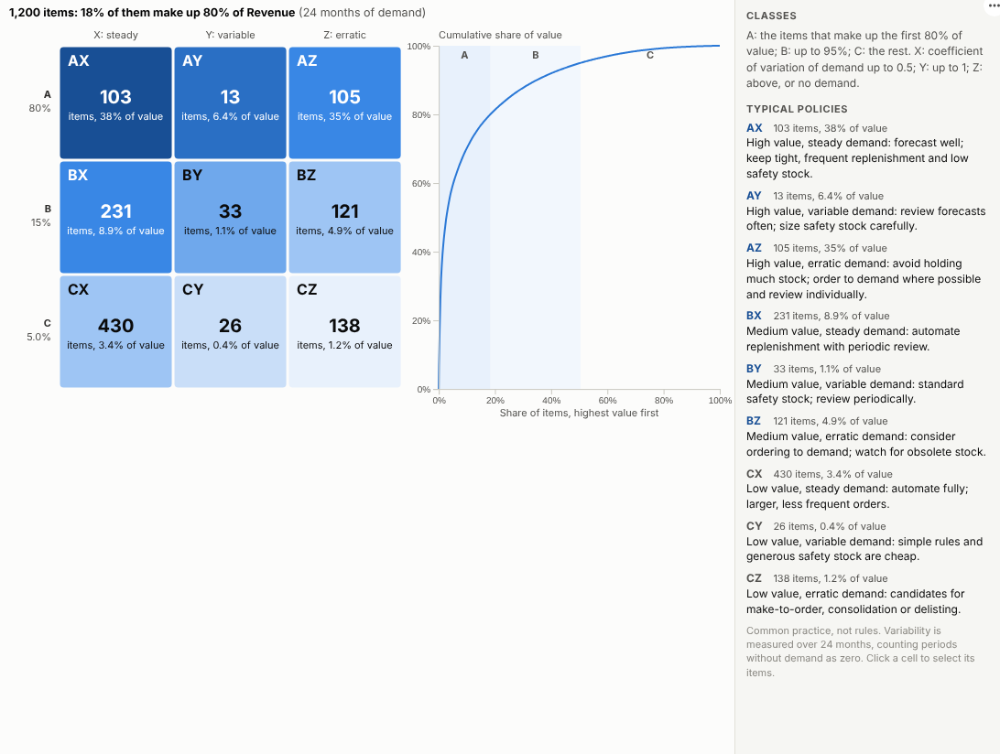

# ABC-XYZ Analysis

Thousands of products, nine ways to manage them. Classify every item by its value and by how predictable its demand is, and see where the stock, the risk and the effort should go.

## The problem it solves

A distributor or retailer may carry tens of thousands of products, and they cannot all be managed the same way. A few products carry most of the revenue; many sell steadily and can be replenished automatically; some sell rarely and unpredictably and tie up stock. ABC-XYZ analysis is the well-established way to sort them, but it is usually rebuilt in a spreadsheet every few months from an export, and is out of date by the time it is used.

The ABC-XYZ Analysis view classifies every item live from the sales or issues data, with one aggregated query. In the illustrative product range above, 18% of products make up 80% of revenue, and over a third of revenue comes from high-value items with erratic demand (AZ), the ones where stock decisions matter most and forecasts help least. Filter to one category to see its own profile:

## Where it earns its place

The examples below are illustrative.

| Business | Items | Typical decisions |
|---|---|---|
| Wholesale and distribution | SKUs | Safety stock, replenishment rules |
| Retail | Products by store or online | Range reviews, delisting, space |
| Manufacturing | Components and raw materials | Make-to-stock or make-to-order |
| Maintenance and aftersales | Spare parts | Which parts to stock and where |
| Healthcare | Medical supplies | Stock levels and ordering frequency |

## How to use it in Omniscope

1. Bring sales, issues or order lines into a workflow with item, date, units and value.
2. Connect it to a Report block, add a view and choose **ABC-XYZ Analysis**.
3. Set **Items**, **Dated by**, **Demand** and optionally **Value**.
4. Adjust the thresholds if your organisation uses different ones.
5. Click a class to select its items and review them in a table or trend view.

## Why do this in Omniscope

- **Reclassified on every refresh.** The workflow re-runs the classification on the current sales, so an item moves from AX to AZ when its demand turns erratic, with no list to re-sort by hand.
- **Totals from the engine, counts checked.** The server returns units and value per item per period, so the transactions stay on the server (tested with 10,000 items over 24 months), and the count in every class is checked against an independent calculation.
- **From a class to its items.** Selecting a class lists its items beside their history, and a filter on warehouse, category or supplier classifies just that slice.
- **Your own cut-offs.** The 80/95 value shares and the CV limits are options; if your policy needs a fourth value class, the view's code can be edited in the View Designer.

## Data and options

Transactions or periodic demand with item, date and units.

| Option | What it does |
|---|---|
| Items | Product, SKU or part |
| Dated by | Date of each line |
| Demand | Units |
| Value | Optional revenue or cost |
| Period | Month, week or quarter |
| A share %, A and B share % | Value thresholds |
| X up to CV, Y up to CV | Variability thresholds |

Tested with 10,000 items over 24 months.

## Tested

- Mock harness: the count in every class checked against an independent calculation, the selection checked to contain exactly the class's items, ranking by units with quarterly periods, hover, clearing, filtering to one category, a narrow layout, too few periods, empty data, unconfigured options, and 10,000 items.
- Real Omniscope server: installed through the Edit View API and configured in a report; identical classes.

