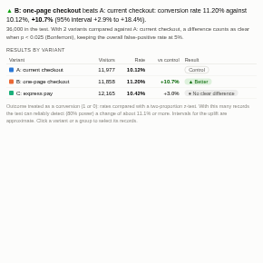

#  A/B Test

Results of an A/B (or A/B/n) test, read correctly. For each variant the view shows the conversion rate or average with its confidence interval, the uplift against the control with its interval, the p-value, the chance that it is better, and a plain verdict: better, worse, or no clear difference. An optional breakdown shows the uplift within groups such as device or customer type. All counting happens on the server in two aggregated queries, so the visitor records stay on the server.

## Use case

Website and app experiments (checkout, pricing pages, onboarding), email and campaign tests, pricing and promotion trials, operational pilots (a new process in some branches), any comparison of randomly assigned groups.

## Data

One row per visitor, customer or unit, with the variant they were given and an outcome: either 1 or 0 for a conversion, or a value such as order value (use 0 for visitors who did not buy to get revenue per visitor). Filters from other views apply.

## Settings

- **Variants**: which version each record was given (2 to 12 versions).
- **Outcome**: the 1/0 conversion flag or the value.
- **Break down by** (optional): show the uplift within each group, e.g. Device.
- **Control**: the control variant's name. By default the view picks one named like control, current, baseline or A, otherwise the first.
- **Outcome is**: automatic (outcomes that are all 0 or 1 are conversions), conversion, or value.
- **Better is**: higher (conversion, revenue) or lower (bounce rate, cost, time to complete).
- **Confidence**: 90%, 95% (default) or 99%.
- **Adjust for several variants**: Bonferroni correction when more than one variant is compared with the control.

## Statistics

Conversion rates are compared with a two-proportion z-test (pooled), and averages with a z-test on the means using unpooled (Welch) standard errors, which is appropriate for the large samples typical of online tests. Intervals for the relative uplift are approximate (the difference interval divided by the control's value). "Chance better" is the normal approximation of the probability that the variant's true value beats the control's. The note under the table gives the smallest relative change the test could reliably detect (80% power) with its current size. Results for groups in the breakdown are smaller samples with wider intervals; treat differences between groups as ideas to test.

## Interaction

Hover a variant or a group for its figures. Click a variant to select its records, or a group in the breakdown to select that group; click again or click empty space to clear.

## Motion

When the view first draws, and when its data, options or filters change, the verdict, rows and intervals appear in turn. Hovering and selecting do not replay it. The animation is skipped when the viewer's system asks for reduced motion.

## Third-party libraries

Loaded from the jsDelivr CDN when the view opens, so the browser showing the report needs internet access:

- [D3](https://d3js.org) 7.9.0, ISC licence

## About this view

This view carries the `visokio-agents` tag. It is one of a set of community examples built by Visokio's agents, to extend Omniscope's core views with popular, specialist and more unusual use cases, and to show what anyone, people or agents, can build on Omniscope. It is tested by automated tests and was run on a real Omniscope server. It was not reviewed by Omniscope's core team, so it is not on a par with Omniscope's core views, which have years of manual, functional and unit tests behind them.

The sample data in `sample-data/` is invented for the demo.
