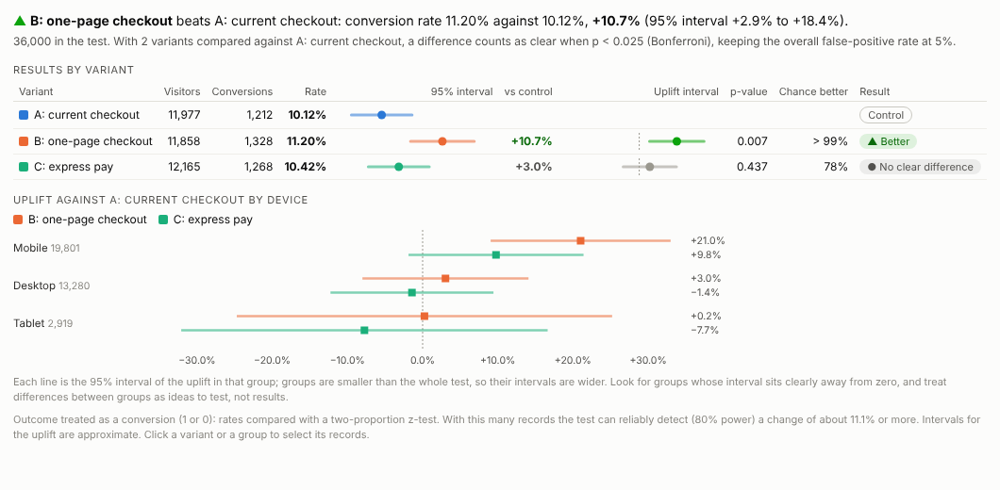
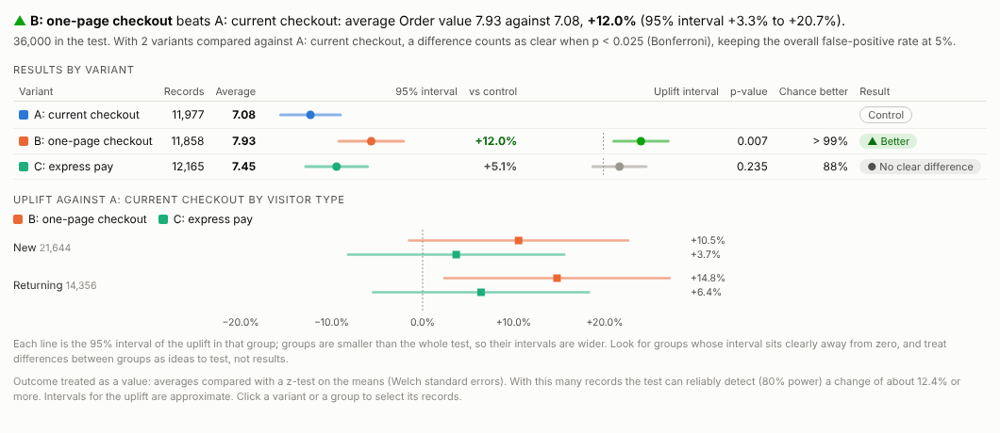
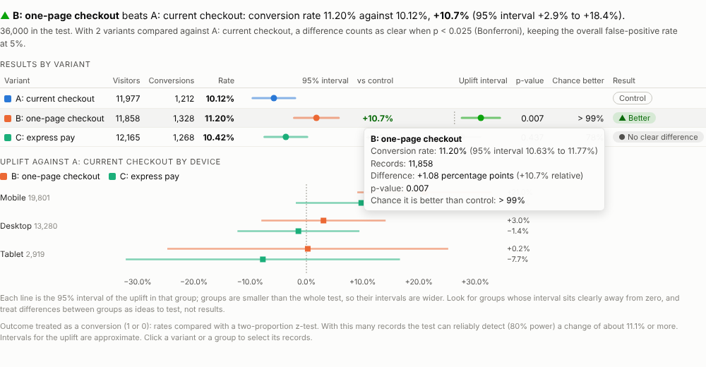
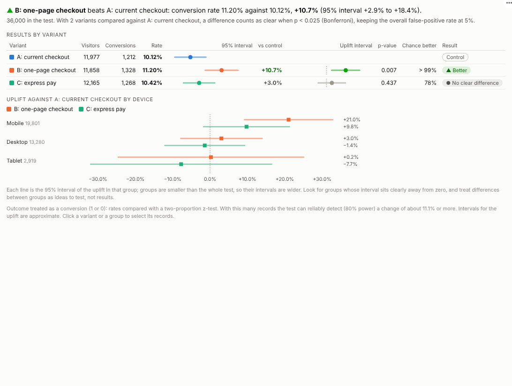

# A/B Test

Did the change work? Read experiment results correctly, with intervals, significance and a plain verdict, straight from your test data in an Omniscope report.

## The problem it solves

Teams run experiments all the time: new checkout pages, email subject lines, prices, onboarding flows, a new process in a few branches. Reading the results is where things go wrong. A 3% difference looks like a win until you see the interval; testing three variants at once raises the chance of a false winner; and a result that is significant overall may come entirely from one device or customer group. Specialist experimentation tools handle this, but the results usually live outside the reports where the rest of the business is analysed.

The A/B Test view reads the results in place. For each variant it shows the rate or average with its interval, the uplift against the control, the p-value and a verdict, corrected for the number of variants compared. In the illustrative checkout experiment above, the one-page checkout lifts conversion by about 11%, and the breakdown shows the lift is concentrated on mobile. Express pay makes no clear difference. The same test can be measured by revenue per visitor:

## Where it earns its place

The examples below are illustrative.

| Team | Experiment | Outcome |
|---|---|---|
| E-commerce | Checkout or product page designs | Conversion, revenue per visitor |
| Marketing | Email subject lines, offers, landing pages | Click-through, sign-up |
| Pricing | Price points or promotions by region | Conversion, margin per customer |
| Product | Onboarding flows, feature changes | Activation, retention |
| Operations | A new process piloted in some branches | Handling time (lower is better) |

## How to use it in Omniscope

1. Bring the experiment data into a workflow: one row per visitor or customer with the variant and the outcome (join assignments with orders or events if they are stored separately).
2. Connect it to a Report block, add a view and choose **A/B Test**.
3. Set **Variants** and **Outcome**, and optionally **Break down by**.
4. If the control is not detected automatically, type its name in **Control**; for measures where lower is better, set **Better is** to Lower.
5. Filter by date in another view to see how the result developed as the test ran.

## Why do this in Omniscope

- **Assignments and outcomes joined upstream.** Variant assignments are joined with orders or events in the workflow, so the result follows the data feed rather than a pasted export.
- **Counted on the server.** Visitors and conversions come from two aggregated queries (tested with 500,000 visitors), and the p-values for conversion and for revenue per visitor match an independent calculation.
- **What the winners did next.** Selecting a variant filters the rest of the report: what those customers bought, where they came from, how they behaved later.
- **Correction rule in the open.** The Bonferroni adjustment and the wording of the verdict are in the view's code, which your team can change if it uses another rule.

## Data and options

One row per visitor or customer with a variant and an outcome.

| Option | What it does |
|---|---|
| Variants | Which version each record was given |
| Outcome | 1/0 conversion flag, or a value |
| Break down by | Optional groups for the uplift |
| Control | Name of the control variant |
| Outcome is | Automatic, conversion or value |
| Better is | Higher or lower |
| Confidence | 90%, 95% or 99% |
| Adjust for several variants | Bonferroni correction |

Tested with 500,000 visitors.

## Tested

- Mock harness: p-values for conversions and for revenue per visitor checked against an independent calculation, verdicts, control detection, hover, selection of a variant and a group, clearing, filtering to one device, a narrow layout, a single variant, an ID field chosen as the variant, empty data, unconfigured options, and 500,000 records.
- Real Omniscope server: installed through the Edit View API and configured in a report; identical results.

