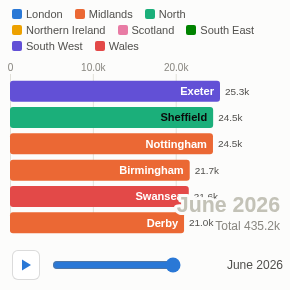

#  Bar Chart Race

Animated ranking over time: bars grow, overtake and drop out as the periods play, with a play/pause button and a slider to scrub. Values are interpolated between periods so the motion is smooth. Optionally races the running total.

## Use case

Storytelling with rankings: how products, towns, teams, channels or brands overtook each other over months or years. Popular for presentations, town halls, marketing content and screens, where a moving chart holds attention far better than a static one.

## Data

Rows with a time field, an item field and a measure, for example Month, Town and Orders; optionally a category for colour (for example Region).

## Settings

- **Time**: the frames. A date field picked in Omniscope is grouped by year by default; set it to unique values or month in the field's options.
- **Bars**: what races. Selection filters on this field.
- **Value**: bar length; **Running total** races the cumulative value instead of each period's own value.
- **Colour by**: optional category (eight colours; otherwise the eight biggest items get colours and the rest are pale blue). Colours stay with their categories.
- **Bars shown**: number of bars (default 10).
- **Seconds per period**, **Play automatically**, **Loop**.

## Interaction

Play or pause, or drag the slider to any point. Hover a bar for its value in the current period; click a bar to select that item for the rest of the report (click again or click elsewhere to clear). Filters from other views re-run the race on the filtered data.

## Third-party libraries

Loaded from the jsDelivr CDN when the view opens, so the browser showing the report needs internet access:

- [D3](https://d3js.org) 7.9.0, ISC licence

## About this view

This view carries the `visokio-agents` tag. It is one of a set of community examples built by Visokio's agents, to extend Omniscope's core views with popular, specialist and more unusual use cases, and to show what anyone, people or agents, can build on Omniscope. It is tested by automated tests and was run on a real Omniscope server. It was not reviewed by Omniscope's core team, so it is not on a par with Omniscope's core views, which have years of manual, functional and unit tests behind them.

The sample data in `sample-data/` is invented for the demo.
