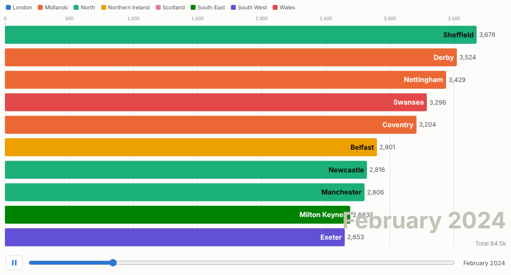
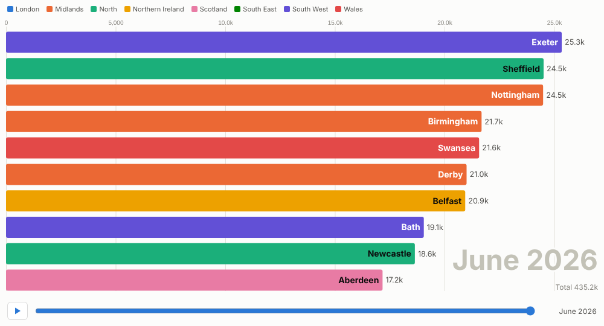
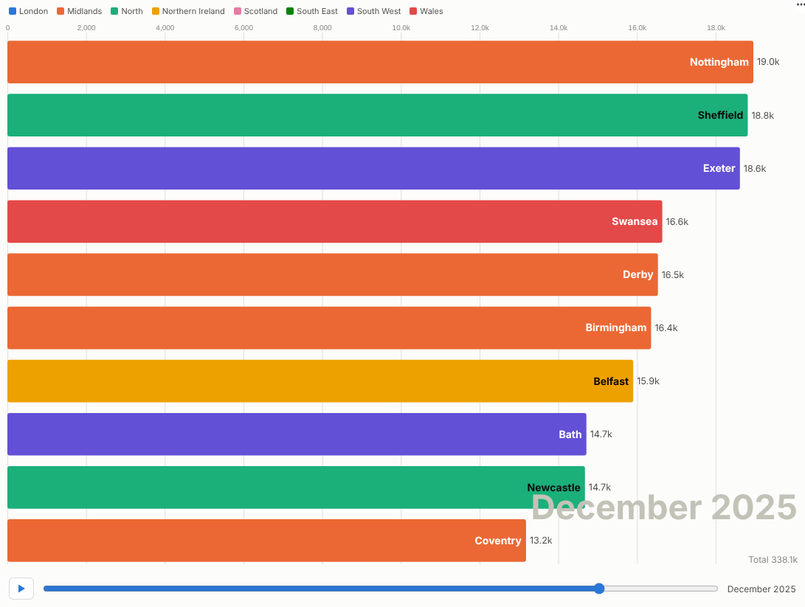

# Bar Chart Race

Turn a ranking over time into a story people watch to the end: who led, who overtook, and when.

## The problem it solves

Some of the most interesting facts in a business are changes of position: the region that overtook London, the product that came from nowhere, the channel that quietly took the lead. A static chart of the final year shows the result but not the race; a line chart of twenty items is spaghetti.

The Bar Chart Race plays the ranking period by period. Bars grow, swap places and drop out of the top ten, with the period shown large in the corner and the total beneath it. It is a familiar chart format on social media because people watch to see who wins. In Omniscope it is also interactive: pause, scrub to any month, hover for the figures, and click a bar to select that item for the rest of the report. In the illustrative data above, a few smaller towns climb past the big cities after local campaigns.

## Where it earns its place

The examples below are illustrative.

| Use | Bars | Value |
|---|---|---|
| Marketing content and launches | Products, towns, countries | Cumulative customers, orders, downloads |
| Sales kick-offs and town halls | Regions, teams, reps | Bookings or revenue this year, as a running total |
| Market and competitor reviews | Brands, competitors | Share or sales by quarter |
| Digital and media | Channels, campaigns, titles | Visits, views or sign-ups by month |
| Public sector and charities | Areas, services | Cases, donations or volunteers over time |

## How to use it in Omniscope

1. Connect data with a time field, an item and a measure to a Report block.
2. Add a view and choose **Bar Chart Race**.
3. Set **Time** (for a date, choose unique values or months), **Bars** and **Value**; optionally **Colour by** a category such as Region.
4. Switch on **Running total** to race cumulative values; set the number of bars and the speed.
5. Present it: press play, pause on the moment that matters, scrub back, and click a bar to show that item's detail elsewhere in the report.

## Why do this in Omniscope

- **Next month adds a frame.** The race is drawn from the workflow's current output, so when next month's file is appended the race gains a period with nothing to re-render.
- **Presented live.** Pause on the overtaking moment, scrub back, and click a bar to show that item's detail in the rest of the report.
- **Filter and replay.** A filter in another view re-runs the race on that subset, and colours stay with their categories (tested with 500 items over 120 periods).
- **Motion you can retune.** Bars shown and seconds per period are options; the interpolation between periods lives in the view's code if you want the bars to move differently.

## Data and options

A time field, an item field and a measure; optionally a colour category.

| Option | What it does |
|---|---|
| Time, Bars, Value | Frames, items and bar length |
| Colour by | Category colours (eight, then pale blue) |
| Running total | Race cumulative values |
| Bars shown, Seconds per period | Size and speed |
| Play automatically, Loop | Playback |

Tested with 500 items over 120 periods.

## Tested

- Mock harness: the final frame, playing and pausing, scrubbing, bar selection and clearing, filtering to one region, a small view, per-period values without colours, empty data, unconfigured options, and 500 items over 120 periods.
- Real Omniscope server: installed through the Edit View API and configured in a report.

