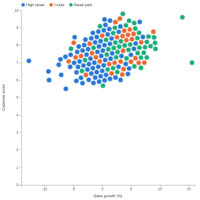

#  Beeswarm

One dot per item, placed by its value and pushed aside so that no dot hides another. Where a scatter plot or a strip of dots would pile points on top of each other, a beeswarm shows every one: the shape of the swarm is the distribution, and each dot can still be hovered and selected.

## Use case

Distributions where each item matters: sales growth per store, salary per employee, delivery time per order, score per student. Colour by a category (region, department, format) to see how the groups sit within the whole. With a second measure on the vertical axis it becomes a scatter plot without overlaps.

## Data

Records with an identifying field for the dots (Store, Employee) and one or two numeric fields. Omniscope aggregates by the Split grouping, so with one record per item each dot shows that record's values. The view shows up to 1,000 dots.

## Settings

- **Split**: one dot per value of this grouping, for example Store.
- **X** (optional): position along the horizontal axis, for example the sum of Sales growth (%). If it is empty, the dots are packed around the centre.
- **Y** (optional): position along the vertical axis, for example the mean of Customer score. If it is empty, the dots spread around the middle line.
- **Colour** (optional): colours the dots by category. Use a text field with the **Singleton** function (for example Region), which gives each dot its one value, or blank when a dot's records have several.
- **Tooltip** (optional): text shown first in a dot's tooltip, for example a name field with the Singleton function. If it is empty, the Split value is shown.
- **Pane X**, **Pane Y** (optional): one chart per value, side by side or one above the other.

## How the dots are placed

Each dot is pulled towards its value and pushed away from its neighbours until none overlap, so a dot can sit slightly off its exact value in a crowded area; the tooltip has the exact figures. Dots are up to 16 pixels across and get smaller when many share a small view. Axes start at zero unless the data has negative values.

Colours follow the category's name, not its rank, so filtering the report does not recolour the dots. A key above the chart lists up to 10 categories, when there is room for it.

## Interaction

Hover a dot for its Split value and figures. Click a dot to select its Split value (for a histogram grouping, the dot's range); the other dots fade. Click it again, or click away from the dots, to clear the selection.

## Third-party libraries

Loaded from the jsDelivr CDN when the view opens, so the browser showing the report needs internet access:

- [D3](https://d3js.org) 4.13.0, BSD 3-Clause licence

The sample data in `sample-data/` is invented for the demo.
