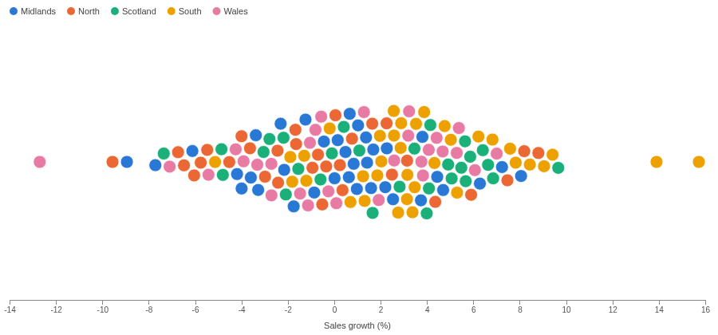
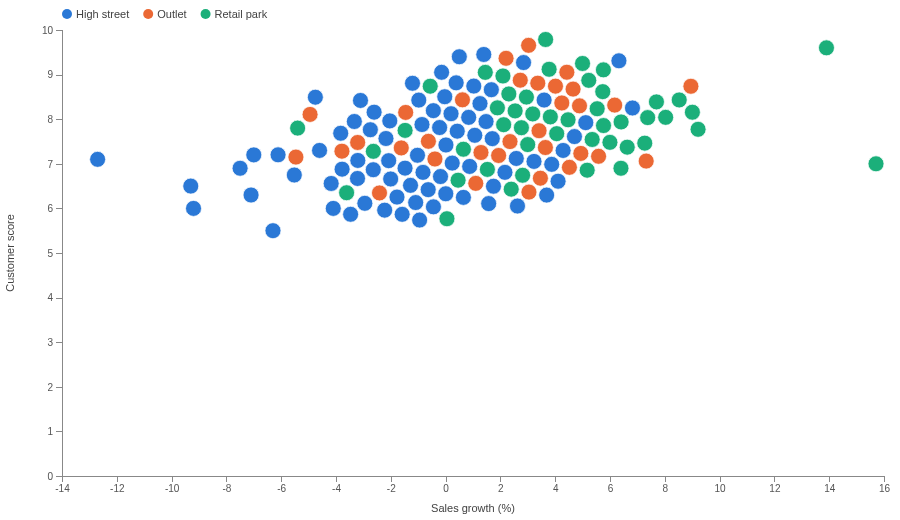
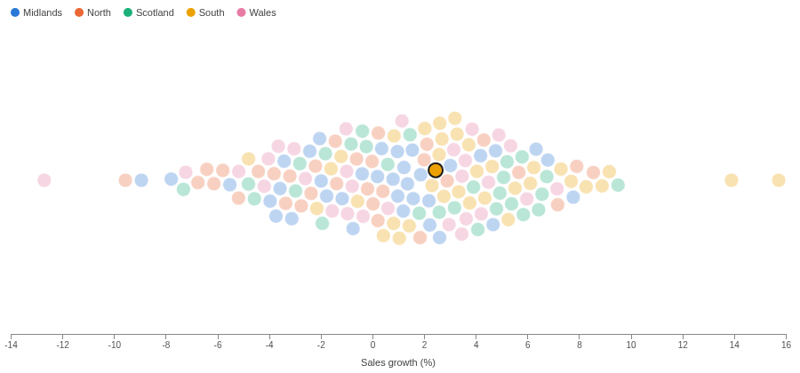

# Beeswarm

Every item as its own dot, none hidden behind another. The shape of a distribution, without losing the individual stores, people or orders that make it.

## The problem it solves

A histogram shows the shape of a distribution but hides the items in its bars. A strip of dots or a scatter plot keeps the items, but where values are close the dots pile up and the crowd looks smaller than it is.

A beeswarm pushes the dots aside until none overlap, so the width of the swarm shows where the values gather and every dot can still be hovered and clicked. In the illustrative chain above (invented figures), most stores grew between -4% and 8%, with a few outliers at each end; colour shows that the South sits further right. With customer score on the vertical axis it becomes a scatter plot where no store is hidden:

## Where it earns its place

Omniscope's Scatter view and the Distribution view in this gallery cover nearby ground: the Scatter view lets close points overlap, and the Distribution view summarises the values as a histogram. Use the beeswarm when there are tens to hundreds of items and each one matters.

The examples below are illustrative.

| Team | One dot per | Position | Colour |
|---|---|---|---|
| Retail | Store | Sales growth | Region, format |
| HR | Employee | Salary | Department, grade |
| Operations | Order | Delivery time | Carrier |
| Education | Student | Score | Class |

## How to use it in Omniscope

1. Bring the data into a workflow and connect it to a Report block.
2. Add a view and choose **Beeswarm**.
3. Set **Split** to the item, for example Store, and **X** to its value, for example the sum of Sales growth (%).
4. Optionally set **Y** to a second measure, **Colour** to a category with the Singleton function, and **Tooltip**.
5. Click a dot to select its item in the rest of the report.

## Why do this in Omniscope

- **Redrawn from the workflow.** The swarm is placed again when the workflow's data changes or the report is filtered, so there is no script to re-run and no image to replace.
- **Colours tied to names.** Each region keeps its colour when a filter removes the others, so swarms filtered different ways can be compared side by side.
- **Dot to record.** Clicking a store selects it in the other views of the report; with a histogram grouping, a dot selects its range.
- **Packing you can adjust.** The dot size limit, the 10-category key and the way dots are pushed aside are all in the view's code, ready to change if your items need it.

## Data and options

An item field and one or two numeric fields; up to 1,000 dots.

| Option | What it does |
|---|---|
| Split | One dot per value |
| X, Y | Position; either can be left empty |
| Colour | Category colour, with a key |
| Tooltip | First line of the tooltip |
| Pane X, Pane Y | One chart per value |

## Tested

Mock harness: one dot per store, the colour key, axis titles, the tooltip's figures, selecting a store and a histogram range, clearing by clicking the dot again and by clicking away, filtering to one region (colours unchanged), a 260 by 170 pane (smaller dots), 1,000 stores with two measures, empty data and no Split grouping.

