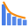
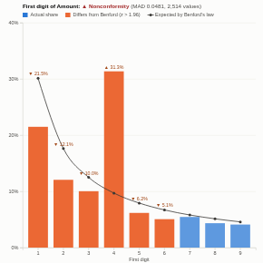

#  Benford Analysis

Benford's law screening for audit, fraud and data-quality work. In many naturally occurring sets of amounts (payments, invoices, expense claims, transactions) the leading digit is 1 about 30% of the time and 9 under 5%. Departures from that pattern can point to invented, rounded, duplicated or threshold-dodging amounts. The view tests the first digit, the first two digits or the second digit, rates conformity with the standard mean-absolute-deviation thresholds, flags the digits that stand out, and ranks suppliers, approvers or branches by how far they depart from the law.

## Use case

Internal audit and forensic accounting (payments, expense claims, journal entries, credit notes), fraud screening, procurement reviews, checking that reported figures have not been made up, data-quality checks on imported financial data.

## Data

One row per amount. The view fetches up to 500,000 values through the Query API by default (up to 1,000,000 with **Values used**); filters from other views apply. Benford's law needs many values (ideally thousands) that span several orders of magnitude and are not assigned (prices, IDs, capped or minimum amounts do not follow it); the panel warns when the values span less than two orders of magnitude.

## Settings

- **Amounts**: the values to test.
- **Compare by** (optional): rank groups, e.g. Supplier, Approver, Branch, by their deviation.
- **Test**: first digit, first two digits (the most precise, good at spotting amounts kept under a limit) or second digit.
- **Ignore values below**: small values are usually excluded (default 10).
- **Include negatives**: test negative values by their absolute size.
- **Minimum values per group**: groups with fewer values are not ranked (default 100).
- **Values used**: maximum records fetched.

## Reading the chart

Bars show the actual share of each digit and the line shows the share Benford's law expects. Orange bars differ from it by more than chance would explain (z-statistic above 1.96, with continuity correction). The heading gives the overall verdict from the mean absolute deviation (MAD), using Nigrini's thresholds for close, acceptable and marginally acceptable conformity. The chi-square test is shown too, but with large samples it flags even trivial differences, which is why the MAD is the usual guide. A departure is a prompt to look closer, not proof of wrongdoing.

## Interaction

Hover a bar for counts, the expected count and the z-statistic. Click a bar to select the records with that digit (as value ranges, so other views can list them); click a group in the panel to compare it with the law and select its records, then click a bar to narrow to that group's digit. Click empty space to clear.

## Motion

When the view first draws, and when its data, options or filters change, the digit bars grow up and the expected line draws across. Hovering and selecting do not replay it. The animation is skipped when the viewer's system asks for reduced motion.

## Third-party libraries

Loaded from the jsDelivr CDN when the view opens, so the browser showing the report needs internet access:

- [D3](https://d3js.org) 7.9.0, ISC licence

## About this view

This view carries the `visokio-agents` tag. It is one of a set of community examples built by Visokio's agents, to extend Omniscope's core views with popular, specialist and more unusual use cases, and to show what anyone, people or agents, can build on Omniscope. It is tested by automated tests and was run on a real Omniscope server. It was not reviewed by Omniscope's core team, so it is not on a par with Omniscope's core views, which have years of manual, functional and unit tests behind them.

The sample data in `sample-data/` is invented for the demo.
