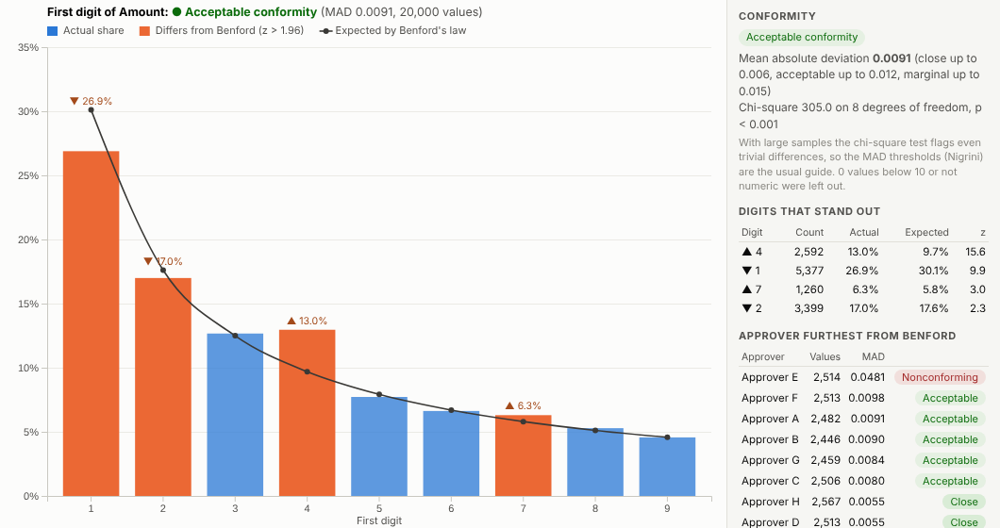
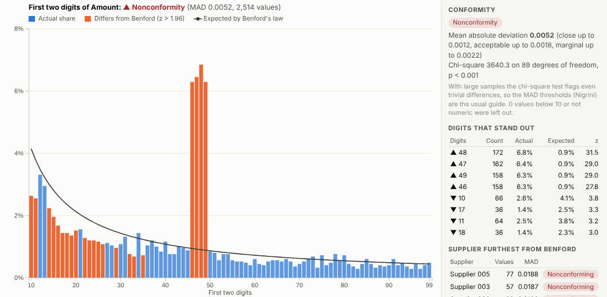
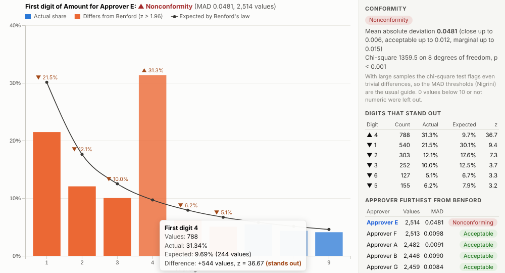
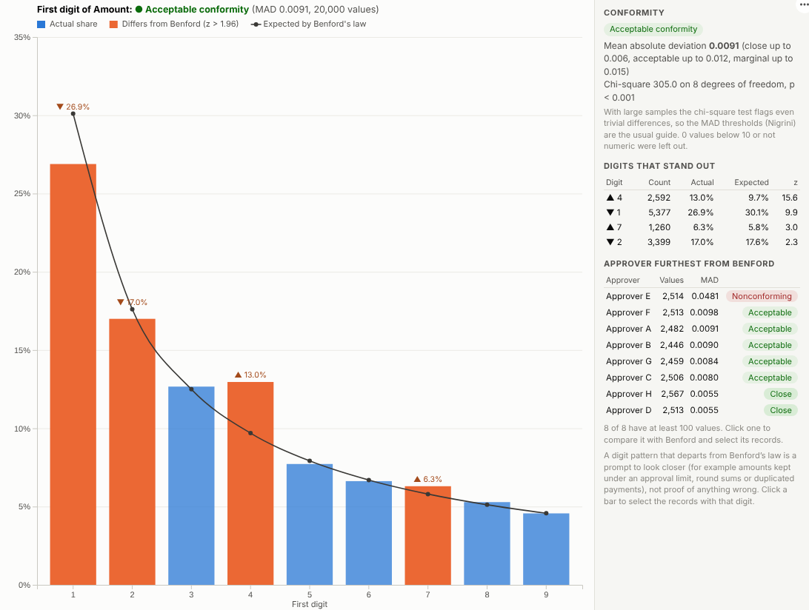

# Benford Analysis

Spot the numbers that do not look natural. Benford's law screening for payments, invoices and expense claims, with the groups that stand out and the records behind them one click away.

## The problem it solves

Auditors and fraud teams cannot check every payment. They need ways to find the few that deserve a closer look. One long-established test is Benford's law: in many real-world sets of amounts the leading digit is 1 about 30% of the time and 9 less than 5% of the time. Invented figures, amounts split to stay under an approval limit, and round sums all leave traces in the digits. The test is well known in audit, but it is usually run in specialist audit software or a spreadsheet, away from the rest of the data.

The Benford Analysis view runs it in an Omniscope report. It tests the digits, rates conformity with the standard thresholds, and ranks suppliers, approvers or branches by how far they depart. In the illustrative supplier payments above, the overall picture is acceptable, but one approver is far from the law. Filter to that approver and use the first-two-digits test, and the reason is plain: a spike at 46 to 49, just under a 5,000 approval limit.

## Where it earns its place

The examples below are illustrative.

| Team | Amounts | Looking for |
|---|---|---|
| Internal audit | Supplier payments, journal entries | Threshold avoidance, invented entries |
| Expenses and travel | Expense claims | Round or repeated amounts, split claims |
| Procurement | Invoices by supplier | Suppliers with unusual billing patterns |
| Insurance | Claim amounts | Claims kept under a referral limit |
| Finance and data teams | Imported figures | Data-entry and conversion problems |

## How to use it in Omniscope

1. Bring the transactions into a workflow, one row per amount, with the fields you want to compare by (supplier, approver, branch).
2. Connect it to a Report block, add a view and choose **Benford Analysis**.
3. Set **Amounts** and, optionally, **Compare by**.
4. Click the group that stands out, switch the **Test** to first two digits, and click the spiking digits to select those records.
5. List them in a table view next to it, with dates, suppliers and descriptions, for follow-up.

## Why do this in Omniscope

- **Same test every load.** The test runs on the workflow's current payments with the same thresholds each time, so the monthly review is re-run after each load rather than rebuilt.
- **Bars that match the payments.** Digit counts and the mean absolute deviation are tested against a separate calculation, and a click on a bar selects exactly the payments counted in it.
- **Approvers ranked for you.** Every supplier, approver or branch with enough values is scored, so the review starts with the most unusual.
- **Cautious verdicts.** The heading uses Nigrini's thresholds, explains them, and says plainly that a departure is a reason to look, not a finding.
- **Room for another digit test.** First, first-two and second digit tests are built in; the source can take a last-two-digits test if round sums are your concern.

## Data and options

One row per amount.

| Option | What it does |
|---|---|
| Amounts | The values to test |
| Compare by | Groups to rank by deviation |
| Test | First digit, first two digits, second digit |
| Ignore values below | Exclude small values |
| Include negatives | Test negative values by size |
| Minimum values per group | Groups with fewer values are not ranked |
| Values used | Maximum records fetched |

Tested with 500,000 values in 400 groups.

## Tested

- Mock harness: digit counts and the mean absolute deviation checked against an independent calculation, the selection filter checked to match exactly the records counted in a bar, the anomalous group ranked first, focusing on a group, hover, selection, clearing, filtering to one cost centre, a narrow layout, all three tests, too few values, empty data, unconfigured options, and 500,000 values.
- Real Omniscope server: installed through the Edit View API and configured in a report; identical results.

