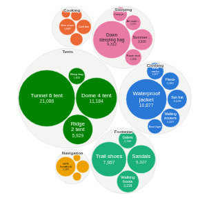

#  Bubble Chart

Packed bubbles: one circle per value of a field, its area in proportion to a measure, packed together so that the big ones stand out at a glance. Optionally the bubbles are grouped into one larger circle per category and coloured by it.

## Use case

Seeing which items make up most of a total, when the exact ranking matters less than the overall picture: revenue by product, spend by supplier, headcount by team, visits by page. Grouped by a category (product category, department, site) it shows both how the groups compare and which items make up each group.

## Data

Records with a field for the bubbles (for example Product), a numeric field to size them by (for example Revenue) and, optionally, a category field to group them by. Omniscope aggregates the records for each bubble, so the data can be one record per order or one per item. The view shows up to 2,000 bubbles.

## Settings

- **One bubble per**: one bubble for each value of this field, for example Product.
- **Size**: the measure the bubble's area is proportional to, for example the sum of Revenue, or Record count.
- **Group and colour by** (optional): packs the bubbles into one circle per value of this field, for example Category, and colours them by it. If it is empty, the bubbles are packed together and each is coloured by its own name, from a palette of 10 colours.
- **Labels**: "Name and value" (the default), "Name" or "None".
- **Pane X**, **Pane Y** (optional): one chart per value, side by side or one above the other.

## How the bubbles are drawn

The largest bubbles are packed first, near the centre. A bubble's name is written inside it when there is room, on two lines if that helps, and cut short with "..." when it is too long; the value is added underneath in larger bubbles. Text is dark on light colours and white on dark ones.

Bubbles with an empty, zero or negative size are left out (an area can't be negative); a note at the bottom says how many. Colours follow the value's name, not its rank, so filtering the report doesn't recolour the bubbles.

When the options or the filter change, the bubbles grow into place; this is skipped when the system asks for reduced motion.

## Interaction

Hover a bubble for its name, group, value and share of the total. Click a bubble to select it in the rest of the report (with grouping, the item within its group); the other bubbles fade. Click a group's circle to select the whole group. Click the selected bubble again, or empty space, to clear the selection.

## Third-party libraries

Loaded from the jsDelivr CDN when the view opens, so the browser showing the report needs internet access:

- [D3](https://d3js.org) 7.9.0, ISC licence

The sample data in `sample-data/` is invented for the demo.
