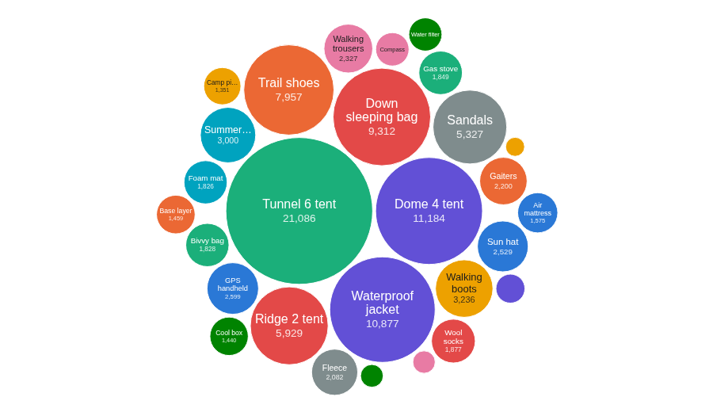
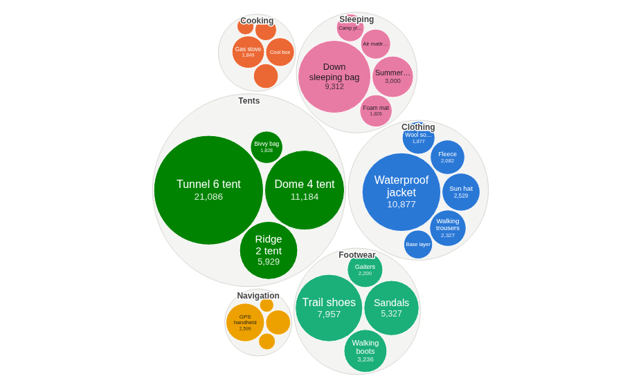
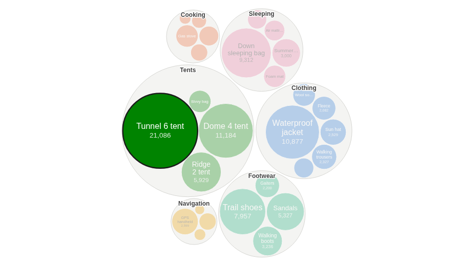

# Bubble Chart

Which few items make up most of the total? Packed bubbles sized by a measure, optionally grouped by category, so the big contributors stand out at once.

## The problem it solves

A long bar chart ranks every item exactly, but with dozens of items the eye has to read down the list to see which ones matter. A packed bubble chart trades exact comparison for an overall picture: each item is a circle whose area follows its value, so a handful of large bubbles among many small ones shows at once where most of the total comes from.

In the illustrative shop above (invented figures), one tent brings in about a fifth of the revenue. Grouping the bubbles by category adds a second level: how the categories compare, and which products make up each one.

## Where it earns its place

Omniscope's Packed bubble view draws the same kind of chart and is better integrated with the report; this view is a short D3 file that is easy to change. Use a bar chart when the exact ranking or small differences matter. Use the bubble chart when there are tens to hundreds of items, a few of them much larger than the rest, and the question is "where does most of it come from?", with a category grouping when the items belong to groups.

The examples below are illustrative.

| Team | One bubble per | Size | Grouped by |
|---|---|---|---|
| Retail | Product | Revenue | Category |
| Procurement | Supplier | Spend | Spend category |
| HR | Team | Headcount | Department |
| Digital | Page | Visits | Site section |

## How to use it in Omniscope

1. Bring the data into a workflow and connect it to a Report block.
2. Add a view and choose **Bubble Chart**.
3. Set **One bubble per**, for example Product, and **Size**, for example the sum of Revenue.
4. Optionally set **Group and colour by**, for example Category, and choose what **Labels** show.
5. Click a bubble or a group to select it in the rest of the report.

## Why do this in Omniscope

- **Sized by the same engine as the table next to it.** Each bubble's value is aggregated by Omniscope's query engine from the workflow's output, so the tooltip's figure and share of the total match a table of the same data, and are recomputed on every refresh.
- **Part of the report.** The bubbles follow the report's filters, keep their colours when filtered, and a click on a bubble or a whole category filters the other views.
- **A starting point for your own packed layout.** The view is a short HTML file using D3's pack layout; open it in the View Designer to change the grouping levels, the labels or the colours.

## Data and options

A field for the bubbles, a measure to size them and, optionally, a category; up to 2,000 bubbles.

| Option | What it does |
|---|---|
| One bubble per | One bubble per value |
| Size | The bubble's area; zero, negative and empty values are left out |
| Group and colour by | One circle per category, holding its bubbles, and their colour |
| Labels | Name and value, name only, or none |
| Pane X, Pane Y | One chart per value |

## Tested

Mock harness: one bubble per product (28), the largest bubble and its tooltip checked against the source data (21,086), the category totals (Tents: 40,026), one colour per category, selecting a bubble and a group, clearing by clicking the bubble again and by clicking empty space, filtering to one category (the bubble's colour unchanged), changing the Size measure and the labels, a 200 by 140 pane (every bubble inside the view, no label wider than its bubble), 1,500 bubbles with 15 negative values left out, 2,500 bubbles refused with a message, empty data and unset options.

