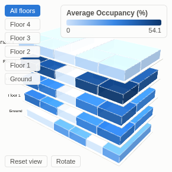

#  3D Building

A data-driven 3D model of a building (three.js). Each zone, room or area is drawn as a block from a simple layout table (floor, x, y, width, depth) and coloured by any measure: occupancy, temperature, energy, alarms, bookings. Floors are pulled apart so every level is visible; drag to rotate, scroll to zoom, and isolate any floor.

## Use case

Facilities, property and operations: workplace occupancy and space planning, energy and comfort monitoring from building sensors (IoT), cleaning or maintenance status, retail store or warehouse zones, hospital wards and beds, a campus of several buildings. It gives a "digital twin" view without a CAD model: the layout comes from data.

## Data

One row per zone (or many rows per zone, for example one per hour, which are aggregated):

- **Floor** and **Zone** identifying each area, optionally **Building**;
- the zone's layout: left (x), front (y), width and depth, in metres or any consistent unit;
- optionally a numeric measure to colour by.

A layout table is easy to make once (from a floor plan, by hand or from a facilities system) and join to live sensor or booking data in the workflow.

## Settings

- **Floor / Zone / Building**: identify each block. Numeric floors stack in order (0 is Ground); several buildings are placed side by side.
- **Left (x) / Front (y) / Width / Depth**: layout measures (averaging-type functions only, so repeated rows do not distort the layout).
- **Colour by**: the measure; **Colour scale** low-to-high (single blue) or diverging around a **Midpoint** (blue below, red above; for example 21 for temperature).
- **Floor height**, **Gap between floors**: proportions of the model.
- **Label zones**, **Background**.

## Interaction

Hover a zone for its value and area. Click to select (shift or ctrl-click to add); the rest of the report filters or highlights to the selected zones (Floor and Zone, plus Building). Use the floor buttons to isolate one floor; click empty space to clear. Requires WebGL.

## Motion

When the view first draws, and when its data, options or filters change, the floors drop into place, lowest first. Hovering and selecting do not replay it. The animation is skipped when the viewer's system asks for reduced motion.

## Third-party libraries

Loaded from the jsDelivr CDN when the view opens, so the browser showing the report needs internet access:

- [three.js](https://threejs.org) 0.147.0, MIT licence

## About this view

This view carries the `visokio-agents` tag. It is one of a set of community examples built by Visokio's agents, to extend Omniscope's core views with popular, specialist and more unusual use cases, and to show what anyone, people or agents, can build on Omniscope. It is tested by automated tests and was run on a real Omniscope server. It was not reviewed by Omniscope's core team, so it is not on a par with Omniscope's core views, which have years of manual, functional and unit tests behind them.

The sample data in `sample-data/` is invented for the demo.
