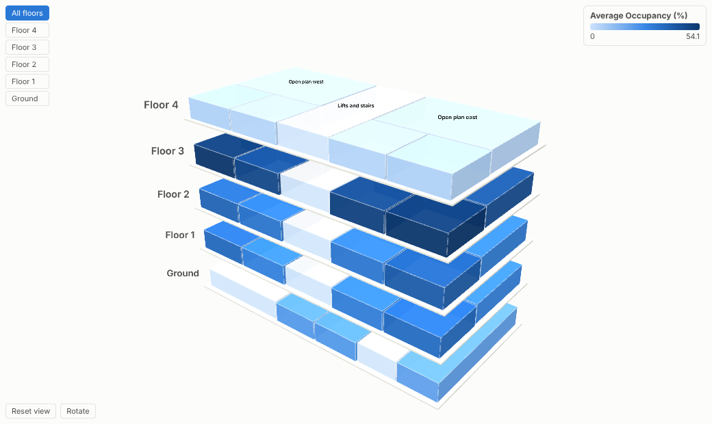
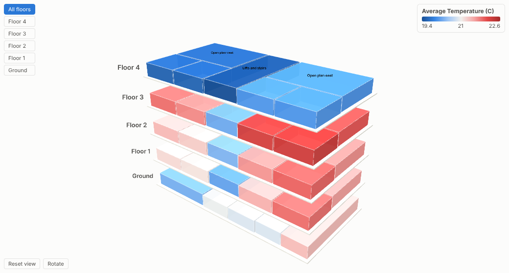
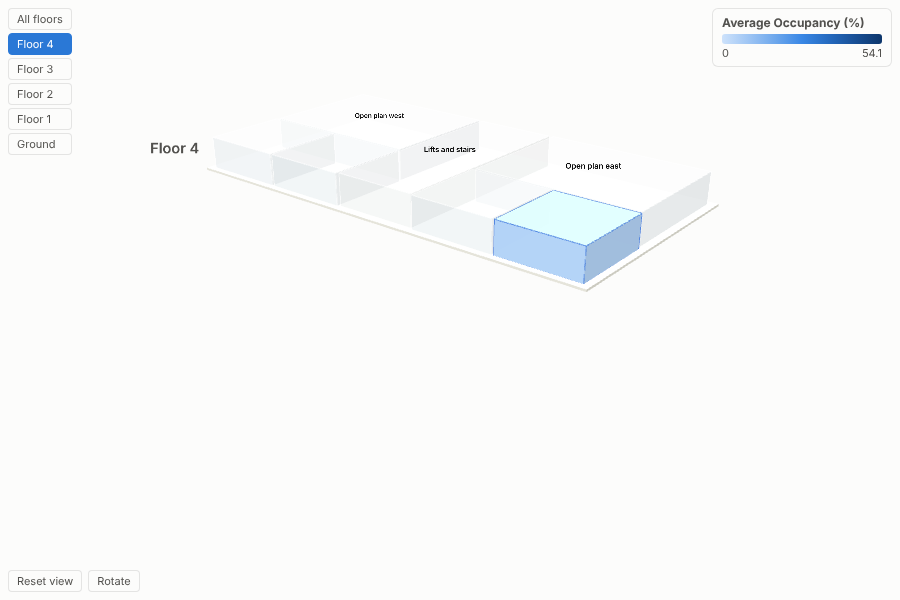
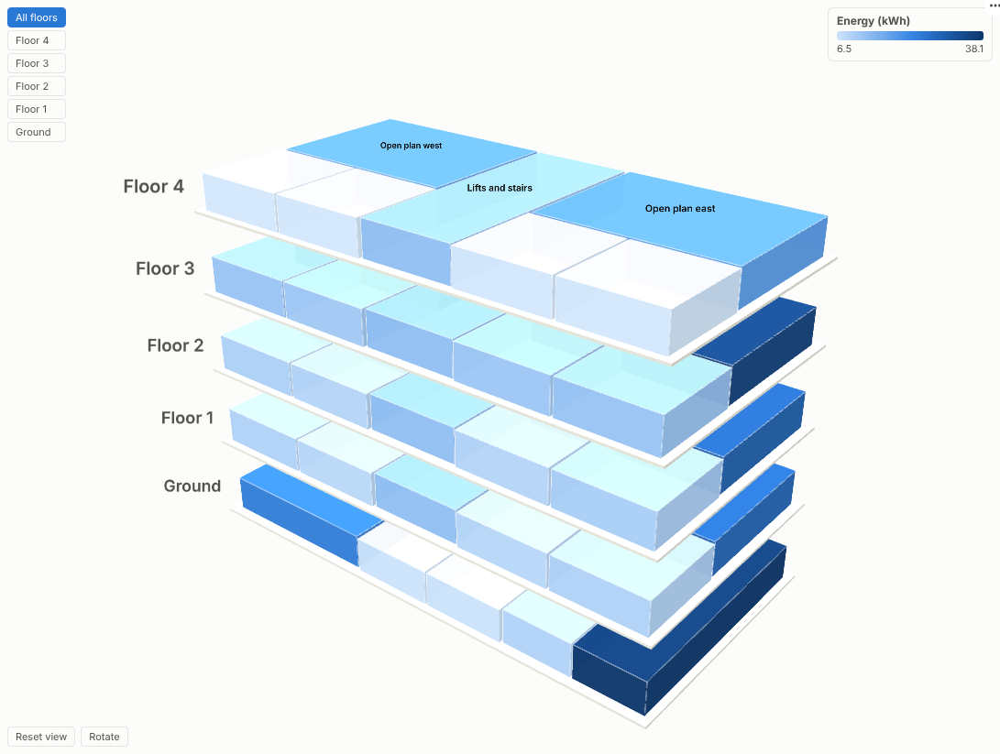

# 3D Building

A live 3D model of your buildings, built from data: every floor and zone coloured by occupancy, temperature or energy, and one click from the readings behind it.

## The problem it solves

Facilities and workplace teams sit on rich data (desk bookings, badge swipes, occupancy sensors, temperature, energy meters) and report it as tables by floor code and room number. Nobody outside the team can picture it. Questions such as "which floors could we consolidate?" or "why is the east side always too warm?" need a spatial view, and a full digital-twin platform is a large project.

The 3D Building view needs only a simple layout table. Each zone is a block placed by its x, y, width and depth, stacked by floor, and coloured by any measure from the workflow. In the illustrative office above, floor 3 is crowded and floor 4 is almost empty all day, which is a space-planning conversation. Switch the colour to temperature with a diverging scale around 21 C and the afternoon heat on the east side is obvious:

## Where it earns its place

The examples below are illustrative.

| Sector | Zones | Colour by | Question |
|---|---|---|---|
| Workplace and property | Floors, neighbourhoods, meeting rooms | Occupancy, bookings, no-shows | Which floors are under-used, and when? |
| Facilities and energy | Zones, plant rooms | Temperature, energy, CO2 | Where are we heating or cooling empty space? |
| Retail and leisure | Store areas, departments | Footfall, sales per square metre | Which areas earn their space? |
| Healthcare | Wards, bays, theatres | Bed occupancy, cleaning status | Where is capacity right now? |
| Logistics and manufacturing | Warehouse aisles, production cells | Utilisation, alarms, throughput | Which cells are bottlenecks today? |

## How to use it in Omniscope

1. Build a layout table once: one row per zone with floor, zone name, x, y, width and depth (from a floor plan or a facilities system).
2. In the workflow, join it to live data (sensor readings, bookings, meter data) on the zone key, and connect the result to a Report block. Schedule the workflow to refresh.
3. Add a view and choose **3D Building**; set **Floor**, **Zone**, the four layout measures and **Colour by**.
4. Choose the colour scale (diverging around 21 for temperature, low-to-high for occupancy or energy).
5. Add a time filter or slider elsewhere in the report to watch the building through the day; click zones to drill into their readings.

## Why do this in Omniscope

- **Model from a table.** The building is generated from a layout table in the workflow, so moving a partition is an edit to a row, not a redraw.
- **Sensor feeds joined to zones.** Bookings, badge swipes and meter readings are joined to the layout on the zone key and aggregated in the workflow, and each refresh recolours the model.
- **Zone to readings.** Selecting zones filters the readings table, the trend chart and the alerts list beside the model.
- **Real sites, other shapes.** Tested with 2,000 zones on 40 floors; zones are drawn as boxes, and the view's code can be changed if your site needs other shapes.

## Data and options

One row per zone (or many, aggregated): floor, zone, x, y, width, depth and a measure.

| Option | What it does |
|---|---|
| Floor, Zone, Building | Identify each block; buildings sit side by side |
| Left (x), Front (y), Width, Depth | Layout of each zone |
| Colour by, Colour scale, Midpoint | Measure and colour scale |
| Floor height, Gap between floors | Proportions |
| Label zones, Background | Presentation |

Tested with 2,000 zones on 40 floors.

## Tested

- Mock harness: occupancy and temperature (diverging) models, clicking a zone, hover, isolating a floor, clearing, filtering to the afternoon, a small view, a dark model coloured by energy, empty data, unconfigured options, and 2,000 zones.
- Real Omniscope server: installed through the Edit View API and configured in a report.

