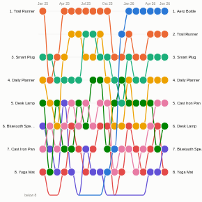

#  Bump Chart

Rank over time. Each line is one item (a product, store, team, keyword or supplier) and its position in each period, so rises, falls and new entrants are obvious in a way that a line chart of raw values hides.

## Use case

League tables and leader boards: top products or stores by month, search terms by week, sales reps by quarter, suppliers by on-time performance, share-of-voice rankings, any "who is top, and who is climbing?" question.

## Data

Rows with a time field, an item field and a measure, for example Month, Product and Units sold. Many rows per item and period are aggregated. The time can be a date (use unique values or a monthly or quarterly grouping), a number or text; dates and numbers are sorted automatically.

## Settings

- **Time**: the periods. A date field picked in Omniscope is grouped by year by default; set it to unique values or choose month or quarter in the field's options.
- **Ranked items**: what is ranked. Selection filters on this field.
- **Rank by**: the measure; highest is 1st unless **Rank order** is Lowest first (for cost, delays, defects).
- **Ranks shown**: how many ranks appear (default 10). Items outside them drop to a "below" line.
- **Items shown**: those in the top at the latest period, or any item that reached the top at any time.
- **Highlight**: an item to emphasise (shown in the strongest colour, others muted).
- **Show rank numbers**: rank inside each point when there is room.
- **Pane X / Pane Y**: one chart per region, channel or category.

## Interaction

Hover a line or point to follow that item and see its rank, value, change from the previous period and best rank. Click a line or a name to select the item, or a point to select the item in that period; other views filter or highlight to match. Click empty space to clear. Colours stay with their items while filtering.

## Motion

When the view first draws, and when its data, options or filters change, the rank lines draw across and the points pop in. Hovering and selecting do not replay it. The animation is skipped when the viewer's system asks for reduced motion.

## Third-party libraries

Loaded from the jsDelivr CDN when the view opens, so the browser showing the report needs internet access:

- [D3](https://d3js.org) 7.9.0, ISC licence

## About this view

This view carries the `visokio-agents` tag. It is one of a set of community examples built by Visokio's agents, to extend Omniscope's core views with popular, specialist and more unusual use cases, and to show what anyone, people or agents, can build on Omniscope. It is tested by automated tests and was run on a real Omniscope server. It was not reviewed by Omniscope's core team, so it is not on a par with Omniscope's core views, which have years of manual, functional and unit tests behind them.

The sample data in `sample-data/` is invented for the demo.
