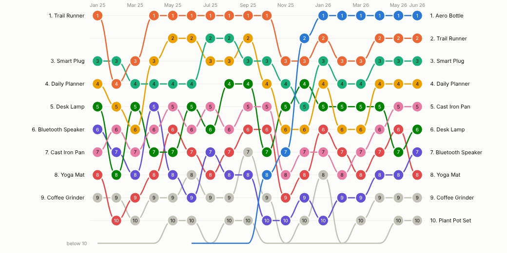
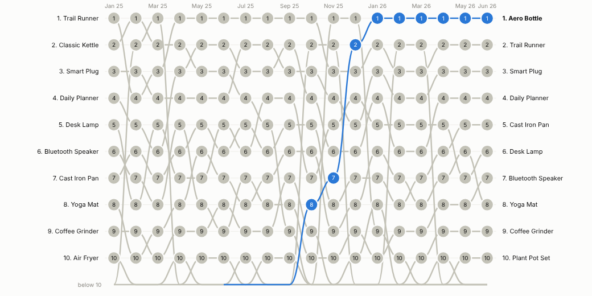
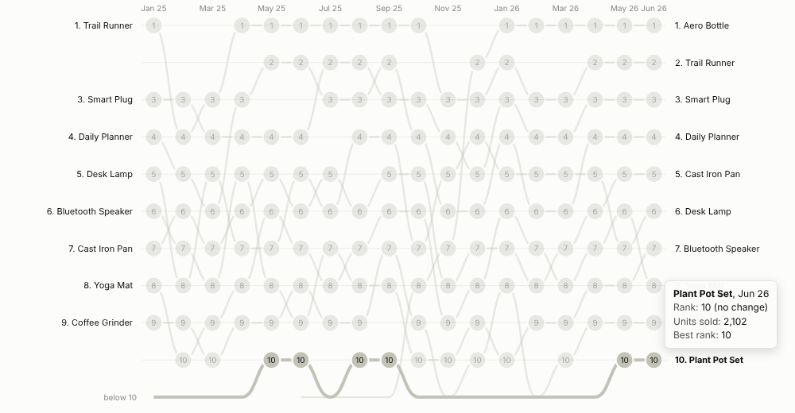
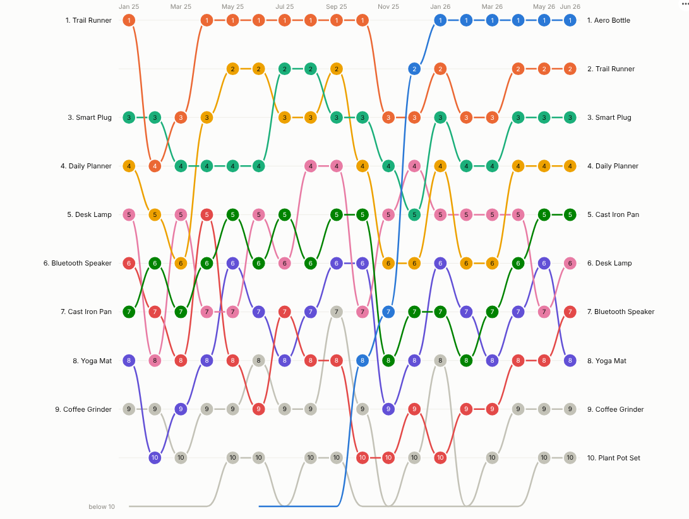

# Bump Chart

Who is top, who is climbing, who is slipping: the league table of anything, over time, in one picture.

## The problem it solves

Rankings matter to people: best-selling products, top stores, leading search terms, the sales team leader board. A line chart of raw values gets crowded and hides position; a table for each month makes people compare columns by eye. Neither shows the story everyone actually wants: which items are rising and falling, and when a newcomer broke into the top.

The Bump Chart draws each item's rank in each period as a smooth line. Rises and falls are immediate, new entrants climb in from "below 10", and fading items drop out. In the illustrative data above, a product launched in June 2025 climbs from outside the top 10 to first place by January 2026. Highlighting it makes the story the whole chart:

## Where it earns its place

The examples below are illustrative.

| Function | Ranked items | Rank by | Question |
|---|---|---|---|
| Retail and e-commerce | Products, categories, stores | Units, revenue, margin | Which products are breaking through, and which are fading? |
| Marketing and SEO | Keywords, campaigns, channels | Clicks, conversions, share of voice | Which terms are gaining ground week by week? |
| Sales | Reps, territories, accounts | Bookings, pipeline | Who leads this quarter, and who is improving? |
| Operations and procurement | Sites, suppliers, carriers | On-time rate, cost (lowest first) | Is any supplier slipping down the table? |
| Sport and media | Teams, titles, artists | Points, audience | How did the table change over the season? |

## How to use it in Omniscope

1. Connect data with a time field, an item and a measure to a Report block (for example monthly sales by product from a database or a set of monthly files appended in the workflow).
2. Add a view and choose **Bump Chart**.
3. Set **Time** (for a date, choose unique values, months or quarters), **Ranked items** and **Rank by**.
4. Choose how many **Ranks shown**, whether to show items in the latest top or anyone who ever made it, and optionally a **Highlight**.
5. Hover to follow a line; click to select an item or an item in one period for the rest of the report. Add Pane X to get one chart per region.

## Why do this in Omniscope

- **Ranks recomputed from the rows.** Filter to a region, a channel or a customer segment and every rank is recalculated from the filtered data, not re-sorted from the national chart.
- **Fed by the workflow.** Monthly files are appended, product names cleaned and hierarchies joined upstream; the chart aggregates many rows per item and period (tested with 300 items over 104 weeks).
- **Drill into the movers.** Select a climbing product's line, or one point on it, and the rest of the report shows its regions, customers and trend for that period.
- **Newcomers your way.** Lowest-first ranking and the "below 10" line are options, and the view's code is there to change the highlight or how entrants climb in.

## Data and options

A time field, an item field and a measure; many rows per item and period are aggregated.

| Option | What it does |
|---|---|
| Time, Ranked items, Rank by | Periods, items and the ranking measure |
| Ranks shown, Items shown | Size of the table and which items get lines |
| Rank order | Highest or lowest value first |
| Highlight, Show rank numbers | Emphasis and labels |
| Pane X, Pane Y | One chart per region or category |

Tested with 300 items over 104 weeks.

## Tested

- Mock harness: monthly ranking, highlight with every item that reached the top 10, hover tooltip, item and item-in-period selection, clearing, filtering to one region, a small view, quarterly date grouping, empty data, unconfigured options, and 300 items over 104 weeks.
- Real Omniscope server: installed through the Edit View API and configured in a report.

