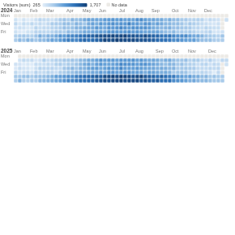

#  Calendar

Yearly calendars with each day coloured by a measure: one row of weeks per year, Monday to Sunday down the side, lighter for lower values and darker for higher. Every year from the first date to the last is shown, including years without data, and days without records are grey.

## Use case

Daily patterns over a year or more: visitors, orders, support tickets, website sessions, energy use, incidents. Weekly rhythms, seasons, holidays, closures and one-off peaks show up at once.

## Data

A date field and a measure, aggregated by Omniscope per day, so the records can be individual events, orders or readings, or one row per day. Up to 20 years are shown; beyond that the view asks for a filter.

## Settings

- **Date**: the date of each record.
- **Colour**: the measure that colours each day, for example Record count or the sum of Sales.

## How the colours are worked out

The colour scale runs from the lowest to the highest daily value shown, from light to dark blue; the key at the top gives both ends. Days with no records are grey. When every day has the same value they all take the middle colour.

## Interaction

Hover a day for its date and value. Click a day to select its records in the rest of the report (other days fade); click it again, or click empty space, to clear. The days are sized to fit 53 weeks across the view; with many years the view scrolls down.

## Third-party libraries

None: the view draws its own SVG and needs nothing beyond Omniscope's custom view API.

The sample data in `sample-data/` is invented for the demo.
