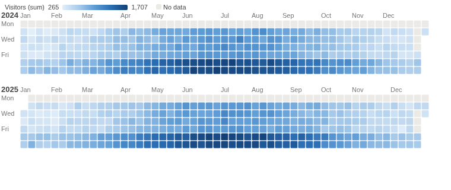
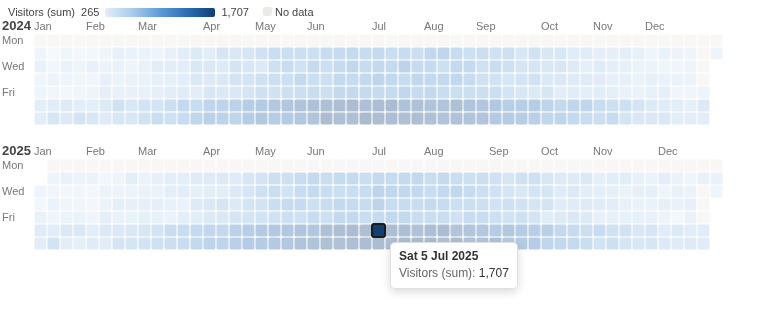

# Calendar

A year at a glance: every day coloured by a measure, for spotting weekly rhythms, seasons and one-off peaks.

## The problem it solves

Daily figures over a year are 365 numbers. A line chart shows the trend but blurs the week: which weekday is busiest, when the closures were, whether a peak was a Saturday or a holiday. A calendar keeps each day in its place in the week and the year.

The Calendar view draws one row of weeks per year, each day coloured by the measure. In the illustrative museum above (invented figures), the weekends are darker, the summer is busier, and the grey Mondays and Christmas closures stand out. Click a day to see its records in the other views:

## Where it earns its place

Omniscope's line and bar charts show a daily measure as a trend. This view lays the same days out as a calendar, so the day of the week and the time of year are read together.

The examples below are illustrative.

| Team | Date | Colour |
|---|---|---|
| Visitor services | Visit date | Visitors |
| Sales | Order date | Sum of sales |
| Support | Ticket opened | Record count |
| Facilities | Reading date | Energy used |

## How to use it in Omniscope

1. Bring the data into a workflow with a date field, and connect it to a Report block.
2. Add a view and choose **Calendar**.
3. Set **Date**, and **Colour**, for example the sum of Visitors.
4. Hover a day for its value; click it to filter the other views to that day.

## Why do this in Omniscope

- **Daily totals from the engine.** Each day's colour is Omniscope's aggregation of that day's records, the same figure a table grouped by day shows, recomputed on every refresh.
- **A day filters the report.** Clicking a day selects its records, so the other views show what happened on it; filtering the report to a product or site recolours the calendar for just that.
- **Open to change.** One HTML file with no libraries: in the View Designer you could start weeks on Sunday, change the colour ramp, or mark public holidays.

## Data and options

A date field and a measure.

| Option | What it does |
|---|---|
| Date | The date of each record |
| Colour | The measure that colours each day |

## Tested

Mock harness: daily visitors checked against the source data (620 open days, 525,528 visitors), closed days grey, hover, selecting a day (the selection is that day, start to start of the next), clicking again and clicking a closed day to clear, filtering to one gallery and one year, a 220 by 120 pane, ten years of daily data (scrolls), dates spanning more than 20 years (a message), empty data and unconfigured options.
