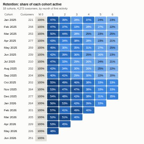

#  Cohort Retention

Cohort analysis from raw activity data. Give it a customer field and a date: the view groups customers by the period of their first activity (their cohort) and shows, for each period after that, how many are still active, as a triangle heatmap with retention curves alongside. Revenue metrics show revenue per cohort and cumulative revenue per acquired customer.

## Use case

Retention and churn for subscriptions, e-commerce, apps, memberships and B2B accounts; checking whether customers acquired after a change (a new channel, onboarding, pricing or loyalty scheme) stay longer; early lifetime-value estimates.

## Data

Row-level activity: one row per order, visit, login or payment, with a customer identifier and a date. Optionally a numeric value per row. No preparation is needed: the view queries distinct customer and period pairs through the Query API and computes the cohorts itself.

## Settings

- **Customer**: field identifying each customer.
- **Activity date**: date of each activity; the first one defines the cohort.
- **Value**: optional amount per row, for the revenue metrics.
- **Period**: month, week or quarter.
- **Show**: Retention (% of the cohort active), Active customers, Revenue, or Cumulative revenue per customer.
- **Periods after acquisition**: number of columns (default 12).
- **Show average row**: average across cohorts, weighted by cohort size, using the cohorts that have reached each step.
- **Show retention curves**: one line per cohort (older cohorts lighter), with the average dashed.

## Interaction

Hover a cell for counts, retention and revenue. Click a cell to select that cohort's activity in that period, or a cohort name to select all of its customers' activity (up to 3,000 customers); other views filter or highlight to match. Hover a cohort name to highlight its curve. Filters from other views (for example by channel) recalculate the cohorts.

## Motion

When the view first draws, and when its data, options or filters change, the cells appear in turn and the curves draw across. Hovering and selecting do not replay it. The animation is skipped when the viewer's system asks for reduced motion.

## Third-party libraries

Loaded from the jsDelivr CDN when the view opens, so the browser showing the report needs internet access:

- [D3](https://d3js.org) 7.9.0, ISC licence

## About this view

This view carries the `visokio-agents` tag. It is one of a set of community examples built by Visokio's agents, to extend Omniscope's core views with popular, specialist and more unusual use cases, and to show what anyone, people or agents, can build on Omniscope. It is tested by automated tests and was run on a real Omniscope server. It was not reviewed by Omniscope's core team, so it is not on a par with Omniscope's core views, which have years of manual, functional and unit tests behind them.

The sample data in `sample-data/` is invented for the demo.
