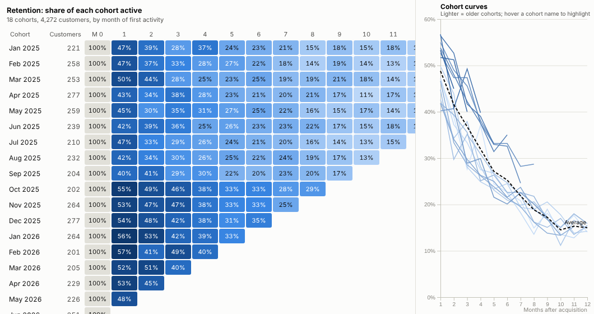
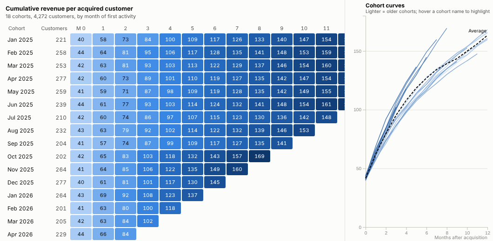
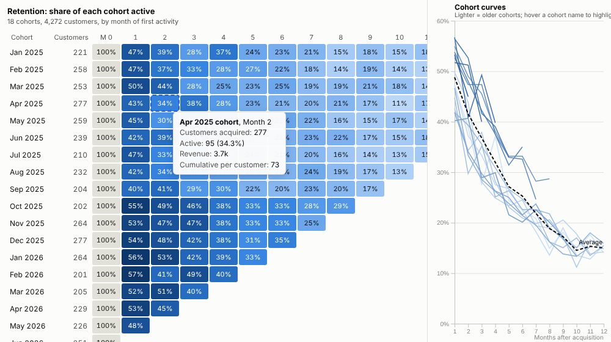
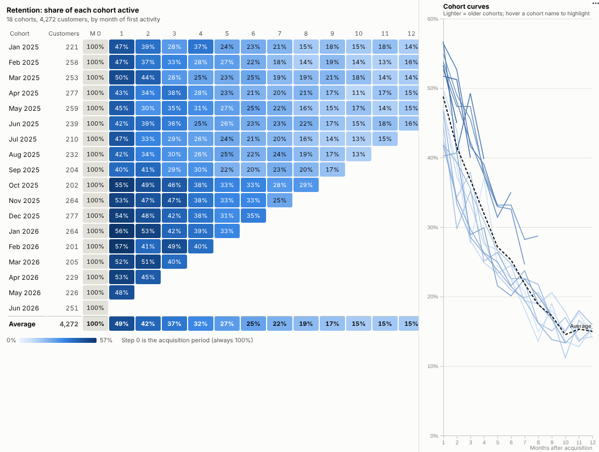

# Cohort Retention

Find out whether the customers you win this month are worth more than the ones you won last year. Point it at raw orders or logins; the cohorts, retention and lifetime value are worked out for you.

## The problem it solves

Headline numbers hide churn. Active customers can rise while each new intake leaves faster than the last, because acquisition is papering over it. The standard way to see this is a cohort table: group customers by when they started, and track what share is still active one, two, three periods later. Each row is an intake, each column a step in its life, and improvements show up as rows that stay darker for longer.

Building that table usually means a data analyst, a notebook and a monthly export. The Cohort Retention view builds it live from row-level activity: a customer field and a date are all it needs. It asks the Query API for each customer's active periods, computes the cohorts in the browser, and draws the triangle with the retention curves beside it. In the illustrative data above, the cohorts acquired from October 2025 onwards (when a loyalty scheme starts) are visibly darker: about half are still buying the month after they join, against about 45% before.

The same cohorts can be shown as revenue, or as cumulative revenue per acquired customer, an early read on lifetime value that can be compared with acquisition cost:

## Where it earns its place

The examples below are illustrative.

| Business | Activity | Question |
|---|---|---|
| Subscription and SaaS | Payments, logins, active seats | Are new sign-ups churning faster or slower than last year's? |
| E-commerce and retail | Orders | How many first-time buyers come back, and how much do they spend in their first year? |
| Apps and media | Sessions, plays | Did the new onboarding flow improve week-one retention? |
| Financial services | Card spend, deposits | Which acquisition campaigns bring customers who stay? |
| Membership and charities | Renewals, donations | How long do members acquired through each channel last? |

## How to use it in Omniscope

1. Connect row-level activity data (orders, logins, payments) to a Report block. A database connection, files or an API all work; no aggregation is needed.
2. Add a view and choose **Cohort Retention**.
3. Set **Customer** and **Activity date**, and optionally **Value**.
4. Choose the **Period** (month, week or quarter) and what to **Show**.
5. Add a filter or another view for channel, region or plan: selecting a channel recalculates every cohort for those customers. Click a cell to select that cohort's activity for the rest of the report.

## Why do this in Omniscope

- **Cohorts from raw activity.** A customer field and a date are all it needs: the view queries each customer's active periods from the engine, so this month's intake appears when the orders land (tested with about 190,000 order rows and 40,000 customers over 36 months).
- **One customer definition.** The customer key, dates and exclusions are set in the workflow that cleans the orders, so every team reads the same cohort table.
- **Re-cut by channel.** A filter on channel, region or product recalculates every cohort, and clicking a cohort name selects its customers' activity in the other views.
- **Your idea of "retained".** A customer counts as active with any activity in the period; if yours needs a purchase above a minimum value, that rule is in the view's code.

## Data and options

Row-level activity with a customer field and a date; optionally a value.

| Option | What it does |
|---|---|
| Customer, Activity date | Who and when; the first activity defines the cohort |
| Value | Amount per row for the revenue metrics |
| Period | Month, week or quarter |
| Show | Retention, active customers, revenue, or cumulative revenue per customer |
| Periods after acquisition | Number of columns |
| Show average row, Show retention curves | Weighted average and the cohort curves panel |

Tested with about 190,000 order rows and 40,000 customers over 36 months.

## Tested

- Mock harness: monthly retention, cumulative revenue per customer, weekly active customers, cell and cohort selection, curve highlighting, clearing, filtering by channel, a narrow view, the missing-value message, empty data, unconfigured options, and 190,000 rows.
- Real Omniscope server: installed through the Edit View API and configured in a report on the same orders.

