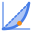
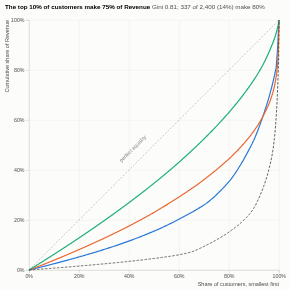

#  Concentration

How concentrated is the total? A Lorenz curve of any measure over any items (revenue over customers, spend over suppliers, sales over products), with the Gini coefficient, the share of the top 1%, 10% and 20%, the number of items that make up 80%, and the Herfindahl-Hirschman index. Compare groups with one curve each, and select the largest items with one click.

## Use case

Customer and revenue dependency (how exposed are we to our largest accounts?), supplier concentration risk, product range rationalisation, sales territory balance, wealth or income distribution, market share concentration.

## Data

Items and a measure, aggregated by Omniscope (up to 200,000 items). Negative values are left out and counted. Optionally a grouping for one curve per group.

## Settings

- **Items**: what the total is spread over, e.g. Customer.
- **Measure**: e.g. sum of Revenue.
- **Compare by** (optional): one curve per group, e.g. Segment (the 8 largest).

## Reading the chart

The Lorenz curve ranks items from smallest to largest and plots the cumulative share of the total against the cumulative share of items. The diagonal is perfect equality; the further the curve bows below it, the more concentrated the total. The Gini coefficient is twice the area between the diagonal and the curve: 0 when every item is equal, approaching 1 when one item has everything. The HHI is the sum of squared percentage shares (10,000 when one item has everything). With groups, the combined curve is dashed.

## Interaction

Hover the chart for the share of the total held by the smallest and largest items at that point, for every curve. Use the buttons to select the top 1%, 5%, 10% or 20% of items, or the items that make up 80% of the total (up to 3,000 items), or click a group's row to select that group; click again or click empty space to clear.

## Motion

When the view first draws, and when its data, options or filters change, the Lorenz curves draw from left to right. Hovering and selecting do not replay it. The animation is skipped when the viewer's system asks for reduced motion.

## Third-party libraries

Loaded from the jsDelivr CDN when the view opens, so the browser showing the report needs internet access:

- [D3](https://d3js.org) 7.9.0, ISC licence

## About this view

This view carries the `visokio-agents` tag. It is one of a set of community examples built by Visokio's agents, to extend Omniscope's core views with popular, specialist and more unusual use cases, and to show what anyone, people or agents, can build on Omniscope. It is tested by automated tests and was run on a real Omniscope server. It was not reviewed by Omniscope's core team, so it is not on a par with Omniscope's core views, which have years of manual, functional and unit tests behind them.

The sample data in `sample-data/` is invented for the demo.
