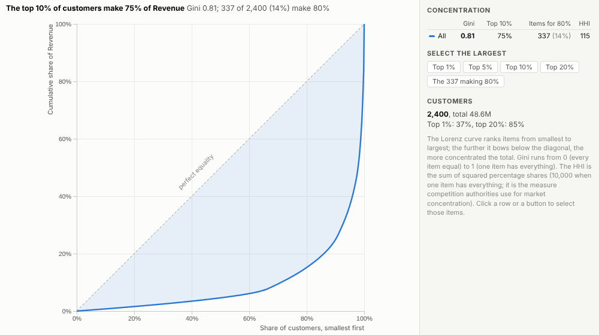
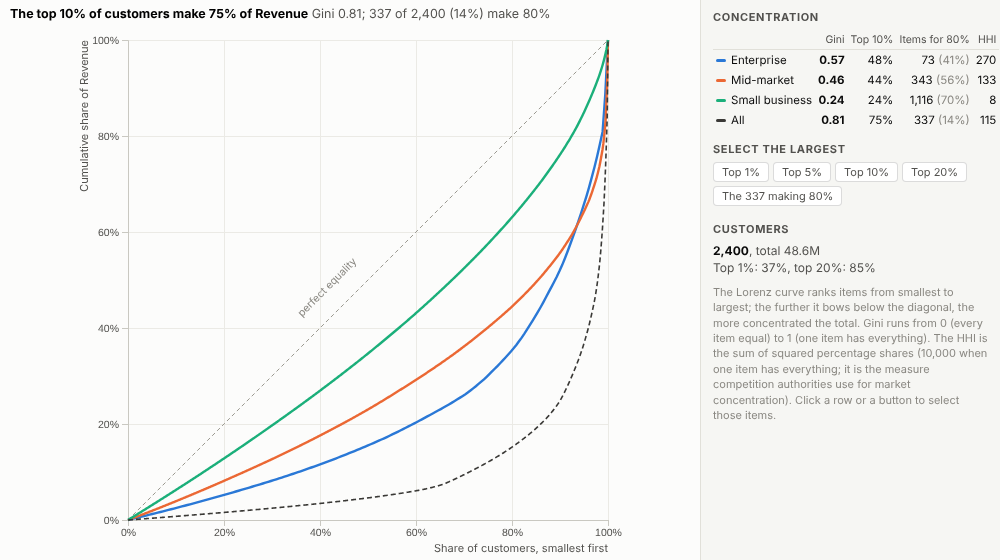
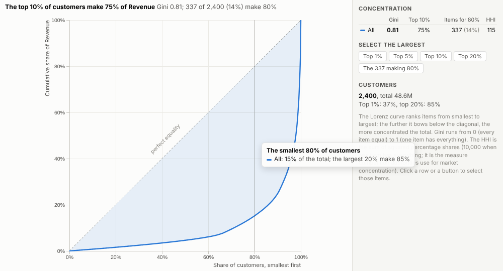
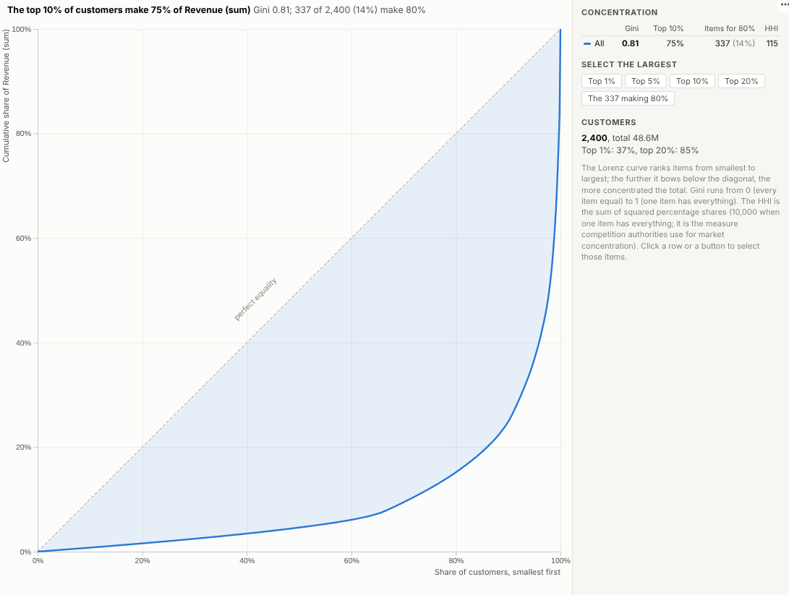

# Concentration

How much depends on how few? A Lorenz curve and the standard concentration measures for any total, with the largest items one click away.

## The problem it solves

Most businesses depend on a few customers, suppliers or products more than they realise. A Pareto chart shows the ranking but not how concentrated the total is overall, and comparing concentration between segments, regions or years needs a single, well-understood number. The Lorenz curve and the Gini coefficient are the standard tools (they are how income inequality is measured), and the Herfindahl-Hirschman index is the standard measure of market concentration.

The Concentration view shows all of them together. In the illustrative customer base above, the top 10% of customers make three quarters of revenue and 337 customers out of 2,400 make 80% of it. One curve per segment shows that enterprise revenue is far more concentrated than small business revenue:

## Where it earns its place

The examples below are illustrative.

| Team | Items | Question |
|---|---|---|
| Finance and risk | Customers | How exposed are we to our largest accounts? |
| Procurement | Suppliers | Where are we dependent on a few suppliers? |
| Merchandising | Products | How much of the range does the business really rely on? |
| Sales operations | Territories, reps | How evenly is revenue spread? |
| Strategy | Competitors' shares | How concentrated is the market? |

## How to use it in Omniscope

1. Bring the data into a workflow with an item field and a measure.
2. Connect it to a Report block, add a view and choose **Concentration**.
3. Set **Items** and **Measure**, and optionally **Compare by**.
4. Use the buttons to select the largest items and list them in a table view.
5. Filter by year or region to see how concentration changes.

## Why do this in Omniscope

- **Measures with their curve.** Gini, top shares, items for 80% and HHI sit beside the Lorenz curve that explains them, and the Gini and top-10% share are tested against an independent calculation.
- **Segments on one chart.** One curve per segment, region or year, so "enterprise revenue is more concentrated" is visible rather than inferred from two numbers.
- **From a share to a customer list.** One click selects the top 10% (checked to be exactly 10% of the items) or the items that make up 80%, and the rest of the report lists them.
- **Recalculated on refresh or filter.** The workflow's refresh and the report's filters both drive the numbers (tested with 150,000 items), and further measures such as a Theil index can be added in the view's source.

## Data and options

Items and a measure.

| Option | What it does |
|---|---|
| Items | What the total is spread over |
| Measure | The total |
| Compare by | Optional groups |

Tested with 150,000 items.

## Tested

- Mock harness: the Gini coefficient and the top 10% share checked against an independent calculation, the top 10% selection checked to contain exactly 10% of the items, groups, hover, clearing, filtering to one region, a narrow layout, empty data, unconfigured options, and 150,000 items.
- Real Omniscope server: installed through the Edit View API and configured in a report.

