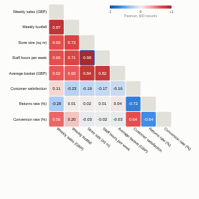

#  Correlation Matrix

Pairwise correlations of numeric fields as a heatmap (blue negative, red positive), with fields grouped so related measures sit together. Click any cell to see that pair as a scatter plot with a fitted line, and drag across the scatter plot to select records.

## Use case

Finding drivers and redundancies before modelling or reporting: which operational measures move with sales, which survey answers go together, which sensor readings track each other, which KPIs are really the same thing. A natural companion to the Covariance and Regression blocks.

## Data

Row-level data with two or more numeric fields. The view fetches up to the configured number of records (default 20,000) through the Query API and calculates correlations in the browser; pairs use every record where both values are present.

## Settings

- **Numeric fields**: the fields to correlate.
- **Method**: Pearson (linear relationship) or Spearman (rank; any steadily rising or falling relationship, robust to outliers).
- **Order**: group related fields (a greedy chain by strongest correlation) or keep the listed order.
- **Show**: lower triangle or full matrix.
- **Show values**: coefficients in the cells (when there is room).
- **Rows used**: maximum records fetched (default 20,000).

## Interaction

Hover a cell for the coefficient, its strength in words and the number of records. Click a cell to plot that pair; drag a rectangle on the scatter plot to select those records (other views filter or highlight to match). Click the matrix background to clear. Filters from other views recalculate the matrix.

## Motion

When the view first draws, and when its data, options or filters change, the matrix cells appear in turn and the scatter points pop in. Hovering and selecting do not replay it. The animation is skipped when the viewer's system asks for reduced motion.

## Third-party libraries

Loaded from the jsDelivr CDN when the view opens, so the browser showing the report needs internet access:

- [D3](https://d3js.org) 7.9.0, ISC licence

## About this view

This view carries the `visokio-agents` tag. It is one of a set of community examples built by Visokio's agents, to extend Omniscope's core views with popular, specialist and more unusual use cases, and to show what anyone, people or agents, can build on Omniscope. It is tested by automated tests and was run on a real Omniscope server. It was not reviewed by Omniscope's core team, so it is not on a par with Omniscope's core views, which have years of manual, functional and unit tests behind them.

The sample data in `sample-data/` is invented for the demo.
