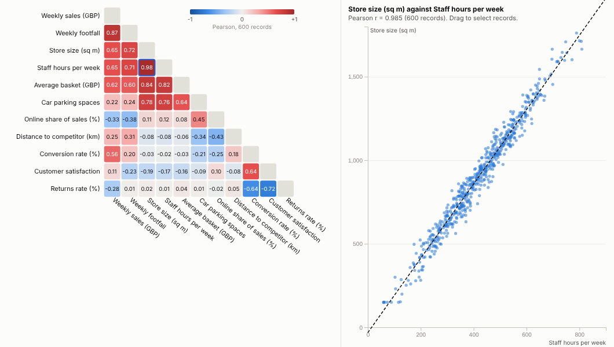
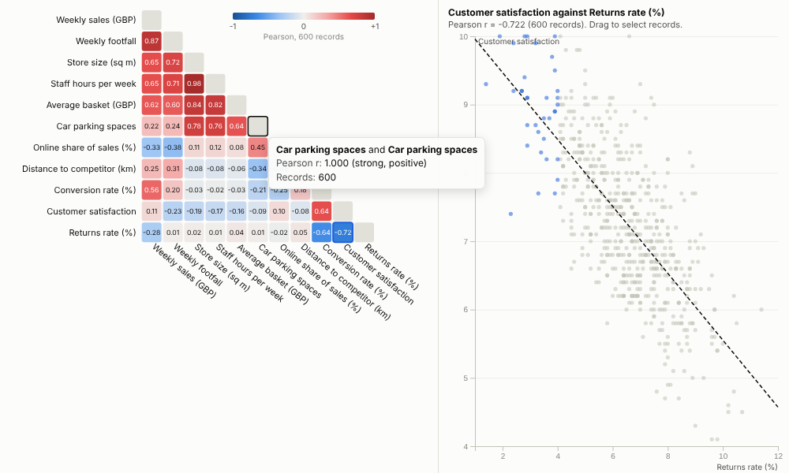
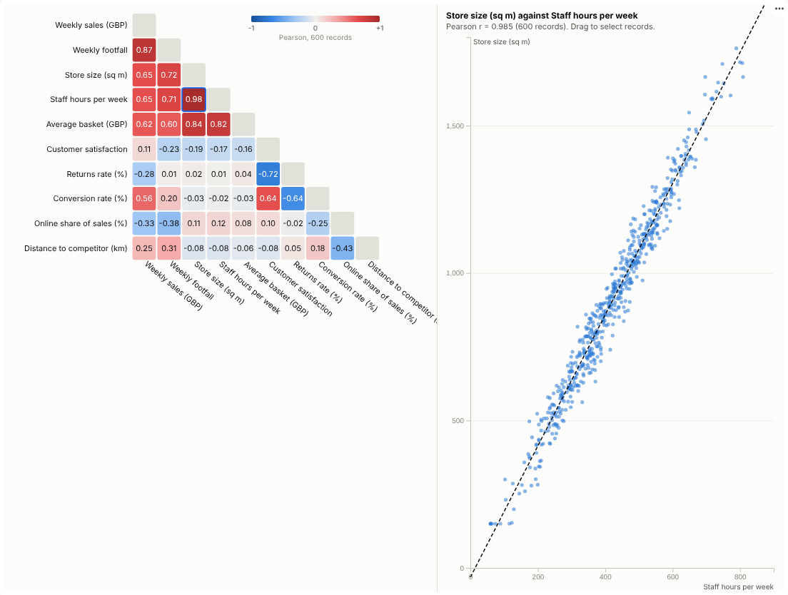

# Correlation Matrix

Which of your measures move together? See every relationship at once, then click into any pair to look at the records behind it.

## The problem it solves

Businesses collect dozens of measures per store, customer, machine or survey response, and the first analytical question is always the same: what relates to what? Which levers go with sales, which metrics duplicate each other, which survey questions measure the same thing? Checking pairs one scatter plot at a time does not scale past a handful of fields.

The Correlation Matrix computes every pair in one go and shows them as a heatmap, red for positive and blue for negative, with related fields grouped together so the structure is visible. In the illustrative store data above, three families appear at once: size-related measures (floor area, staff hours, parking, basket size), the trading measures (footfall and sales), and service (conversion up with satisfaction, returns down). Clicking a cell opens the scatter plot for that pair, because a coefficient alone can hide outliers or curves, and dragging across it selects those stores for the rest of the report.

## Where it earns its place

The examples below are illustrative.

| Industry | Fields | Question |
|---|---|---|
| Retail and hospitality | Store size, staffing, footfall, conversion, satisfaction | What goes with high sales, and what is redundant? |
| Customer insight | Survey scores, usage, spend, tenure | Which experiences move together? |
| Manufacturing and IoT | Temperatures, pressures, vibration, yield | Which readings track each other or the defect rate? |
| Finance | Asset returns, rates, spreads | How diversified is the portfolio really? |
| Marketing | Spend by channel, visits, leads, sales | Which channels move with outcomes? |

## How to use it in Omniscope

1. Connect row-level data with numeric fields to a Report block (one row per store, customer, reading or response).
2. Add a view and choose **Correlation Matrix**, then add the **Numeric fields** to compare.
3. Choose **Pearson** for straight-line relationships or **Spearman** for ranked relationships that resist outliers; keep **Group related fields** on.
4. Click the strongest cells to check the scatter plots; drag to select interesting groups of records and examine them in other views.
5. Use other views to filter by region, period or segment; the matrix recalculates for that subset.

## Why do this in Omniscope

- **Same rows as the report.** The matrix runs on the workflow's output with the report's filters, so the coefficients match the other views and are recomputed as the data changes (tested with 50,000 rows by 15 fields).
- **Coefficient to scatter to stores.** Clicking a cell plots the pair, and a box on that plot selects the stores, showing whether a correlation is real, driven by outliers, or different for one group.
- **Next step in the same workflow.** The fields it pairs up can become the inputs to a Regression or Prediction block downstream, published with the model.
- **More coefficients if needed.** Pearson and Spearman are built in; a partial correlation, for instance, could be added to the open code.

## Data and options

Two or more numeric fields; one row per record.

| Option | What it does |
|---|---|
| Numeric fields | The fields to correlate |
| Method | Pearson or Spearman |
| Order | Group related fields or keep listed order |
| Show, Show values | Lower triangle or full; coefficients in cells |
| Rows used | Maximum records fetched (default 20,000) |

Tested with 50,000 rows and 15 fields.

## Tested

- Mock harness: eleven store metrics, hover, choosing a pair, box selection on the scatter plot, clearing, filtering to one region, a narrow layout, Spearman with the full matrix, a single field (message), empty data, and 50,000 rows by 15 fields.
- Real Omniscope server: installed through the Edit View API and configured in a report.

