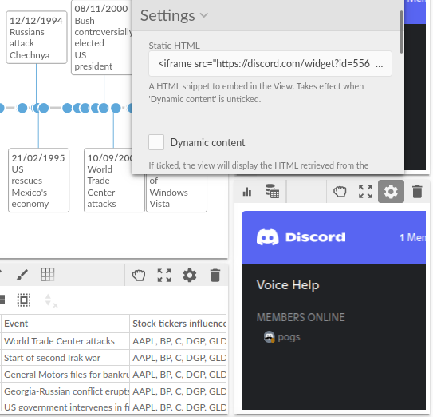

#  Custom HTML

Shows HTML in a report: either a snippet typed into the view's settings, such as an embedded widget, a note or a set of links, or HTML held in the data, which then follows the report's filters and selections.

## Use case

- **Static**: embed a third-party widget given as an iframe snippet (a community channel, a booking form, a video), or put formatted notes and links on a dashboard.
- **From the data**: show a ready-made HTML card, description or message stored with each record, for the record the viewer has filtered or selected, or one card per product, customer or case.

## Data

For static HTML, none. For HTML from the data, a text field holding HTML, chosen as a measure with a function that gives one value, usually **Singleton** (the value when all the records agree, empty otherwise), or Mode, Min or Max.

## Settings

- **Static HTML**: the HTML to show when Show HTML from the data is off.
- **Show HTML from the data**: when on, the view shows the HTML value instead.
- **HTML value**: the field holding HTML, with its function, for example Card (singleton).
- **One block per** (optional): one block of HTML per value of this field, one under the other, for example one card per Product. Up to 200 blocks are shown.
- **Pane X**, **Pane Y** (optional): one view per value.

With Singleton and no One block per, the view shows HTML only when the records in view hold the same value, typically after filtering or selecting one record; otherwise it says so.

## Interaction

The HTML is shown as it is, and links and embedded content work as usual. Any click in the view, on the HTML or around it, also clears the report's selection. The view replaces the HTML only when it changes, so resizing the report does not reload an embedded video or widget. The view scrolls when the HTML is bigger than the view.

## Security

The HTML is inserted into the page without filtering, so only use HTML you trust: from your own settings, or from data your organisation controls. `<script>` tags in it do not run; inline event handlers and embedded frames do.

## Third-party libraries

None: the view needs nothing beyond Omniscope's custom view API. Any widget embedded in the HTML loads its own content from its own servers.

The sample data in `sample-data/` is invented for the demo.
