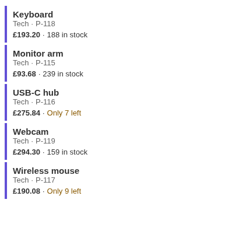
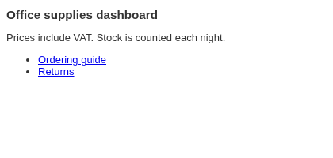

# Custom HTML

Your own HTML in a report: an embedded widget, formatted notes, or HTML cards held in the data that follow the filters.

## The problem it solves

Some things a dashboard needs are already HTML: a widget from another service given as an iframe embed snippet, a block of links and notes, or a description that a workflow has assembled as a formatted card for each product, customer or case. They need a place in the report.

The Custom HTML view shows HTML typed into its settings, or HTML taken from the data. In the illustrative catalogue above (invented products), each product has a ready-made card, and the view shows one card per product for the products in view, here filtered to the Tech category. Typed into the settings instead, the HTML stays the same whatever is filtered:

## Where it earns its place

Omniscope's Content view is the better choice for text and figures written in the report itself. This view is for HTML that already exists: an embed snippet from another service, or HTML produced by the workflow and stored as a field.

The examples below are illustrative.

| Team | Static HTML | HTML from the data |
|---|---|---|
| Marketing | Community channel widget | Campaign card per campaign |
| Sales | Booking form | Account summary card per customer |
| Support | Links to guides | Formatted case notes per case |
| Product | Release notes | Product card per product |

## How to use it in Omniscope

1. For static HTML: add a view, choose **Custom HTML** and paste the HTML into **Static HTML**.
2. For HTML from the data: build the HTML in the workflow (for example with a formula), connect the data to a Report block, and add a **Custom HTML** view.
3. Turn on **Show HTML from the data** and set **HTML value** to the HTML field with the Singleton function.
4. Optionally set **One block per**, for example Product, to show a card per value.
5. Filter or select in the other views to choose which HTML is shown.

## Why do this in Omniscope

- **HTML that follows the dashboard.** With HTML from the data, the cards shown are those of the records in view: select a product in a table and its card appears beside it.
- **Cards built by the workflow.** The HTML can be assembled in the workflow from the latest data (prices, stock, status), so the cards are up to date after each refresh, with no separate page to publish.
- **Widgets beside the data.** An embed snippet from another service sits in the same report as the views it relates to, and keeps playing when the report is resized.

## Data and options

None for static HTML; a text field holding HTML for HTML from the data.

| Option | What it does |
|---|---|
| Static HTML | HTML typed into the settings |
| Show HTML from the data | Shows the HTML value instead of Static HTML |
| HTML value | The HTML field, with a function such as Singleton |
| One block per | Optional: one block per value, one under the other |

## Tested

Mock harness: one card per product, filtered to one category (5 cards); static HTML; Singleton empty for several products, then one product after filtering; the HTML not reloaded on resize; a click clearing the selection; switching back to static HTML; a 160 by 100 pane (the content scrolls); 10,000 records in 250 groups (the first 200 blocks shown, with a note); empty data and unconfigured options.
