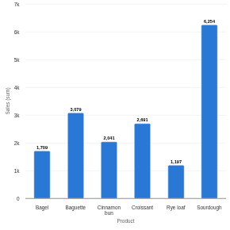

#  Custom View Demo

A worked example of a custom view: a bar chart drawn with the Highcharts library from a query the view runs itself, with bars that select records in the report. Its `index.html` is commented step by step, as a starting point for your own view.

## What it shows you how to do

- **Read the view's options**: the Split and Measure the user picked, defined in `manifest.json`.
- **Query the data yourself**: the manifest turns `autoQuery` off, and the view builds a Query API request (one grouping, one measure) and passes the report's filter with it, so the chart follows the other views' filters.
- **Use a charting library**: Highcharts draws the bars; the view hands it the query result.
- **Redraw only when needed**: a new query on `load` and `update`, only a resize on `resize`.
- **Send a selection back**: clicking a bar sets the view's selection to "Split = that value" and tells Omniscope, so the other views filter or highlight; a click on the background is a whitespace click, which clears it.
- **Handle the awkward cases**: options not set yet, no data after filtering, a failed query.
- **Let Omniscope draw panes**: with `autoPane` on and the `paneX`/`paneY` options, Omniscope draws one chart per value without any code in the view.

For a view that uses Omniscope's automatic query instead, see the KPI (custom view demo) view in this repository (`kpi`).

## Data

A text field to split by and a numeric field to measure (or Record count).

## Settings

- **Measure**: the height of each bar, for example the sum of Sales. Internally `measures`.
- **Split**: one bar per value of this text field, for example Product. Internally `split`.
- **Pane X** and **Pane Y** (optional): one chart per value, side by side or one above the other. Internally `paneX` and `paneY`, the names Omniscope's automatic panes need.

## Interaction

Hover a bar for its value. Click a bar to select its records in the report (the bar turns dark blue); click it again, or click the chart's background, to clear.

## Third-party libraries

Loaded from the jsDelivr CDN when the view opens, so the browser showing the report needs internet access:

- [Highcharts](https://www.highcharts.com/) 13.1.1. Highcharts is not open source: it is free for personal, non-commercial use, and other use, including use within a business, needs a licence from Highsoft (see the [Highcharts licence](https://www.highcharts.com/license)). When you copy this view, you can replace it with any charting library; only the `render` function uses it.

The sample data in `sample-data/` is invented for the demo.
