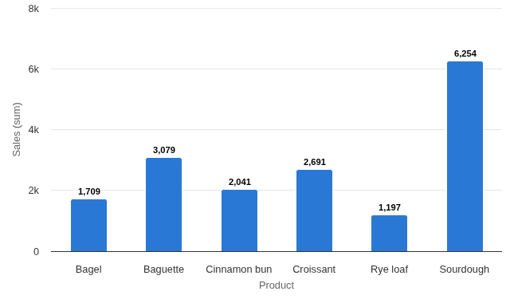
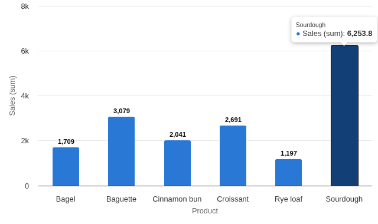

# Custom View Demo

A bar chart in under 200 commented lines: the worked example to read before writing your own custom view.

## The problem it solves

Omniscope's custom view API lets you add any chart or tool to a report, but a first view raises the same questions: where do the user's settings come from, how do I get the data, how do the other views' filters reach me, and how do I make a click select something?

This view answers them in one commented file. It reads its Split and Measure options, runs its own query with the report's filter, hands the result to a charting library, and turns a click on a bar into a selection the rest of the report follows. In the illustrative bakery sales above (invented figures), each bar is a product; clicking Sourdough selects its sales:

## Where it earns its place

As a chart, Omniscope's built-in Bar view does more. The point of this view is its code: it is meant to be opened, read and changed.

| You want to learn | Where to look in `index.html` |
|---|---|
| Reading options | `context.options.items` in `query()` |
| Querying with the report's filter | the `queryRequest` object |
| Drawing with a library | `render()` |
| Selecting records | `select()` |

## How to use it in Omniscope

1. Connect data with a text field and a numeric field to a Report block.
2. Add a view and choose **Custom View Demo**; set **Split** and **Measure**.
3. Open the view in the View Designer to see `index.html` and `manifest.json`.
4. Change the drawing, add an option in `manifest.json` and read it in `query()`, then reload the view to see the change.

## Why do this in Omniscope

- **A chart becomes part of a report with one file.** The few lines that pass the report's filter and send a selection back are all it takes for a library chart to filter, and be filtered by, the built-in views beside it.
- **The query engine does the sums.** The view asks for one grouping and one measure and gets back the same totals a built-in Bar view of the same data shows; it never handles the raw records.
- **Changed in the View Designer, tried on real data.** Edit `index.html` in the project's View Designer and the report's own data, filters and selections exercise the change straight away; no separate test page or exported sample.

## Data and options

A text field and a measure.

| Option | What it does |
|---|---|
| Split | One bar per value |
| Measure | The height of each bar |
| Pane X, Pane Y | Optional: one chart per value |

## Tested

Mock harness: the sum per product checked against the source data, record count across all 300 sales, filtering to one shop, selecting a bar, clicking it again and clicking the background to clear, a 200 by 140 pane, 20,000 records (total 1,010,000), empty data and unconfigured options.
