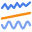
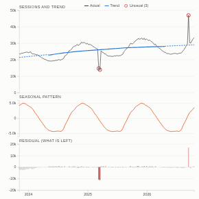

#  Seasonal Decomposition

Split a time series into its trend, its repeating seasonal pattern and what is left over, and see which periods were genuinely unusual once the season is taken into account. Three stacked panels share the time axis: the actual values with the trend, the seasonal pattern, and the residual, with unusual periods flagged in red and listed with their actual and expected values.

## Use case

Separating real change from seasonal swings (is the business growing, or is it just December?), finding outages, campaign effects and data problems, explaining KPI movements in monthly reviews, and checking a series before forecasting it.

## Data

Records with a date and a measure. The view runs one aggregated query per period. At least two full seasons are needed (for example 105 weeks, or 25 months). Missing periods count as zero. Filters from other views apply.

## Settings

- **Dated by**: the date field.
- **Measure**: what to decompose, e.g. sum of Sessions (default: number of records).
- **Period**: week (default), month, day or quarter.
- **Season length**: periods in one cycle (default 52 weeks, 12 months, 7 days or 4 quarters).
- **Season**: additive (the seasonal swing stays the same size) or multiplicative (it grows with the level).
- **Unusual beyond**: the threshold for flagging, in robust standard deviations (default 3).

## How it works

Classical decomposition, made robust. The trend is a centred moving average over one season, extended as a straight line over the first and last half-season (drawn dashed). The seasonal pattern is the average of the detrended values at each position in the cycle (lightly smoothed for long weekly seasons). The residual is what remains. Two passes are made: periods flagged in the first are left out of the seasonal averages and bridged in the trend, so an outage or a campaign does not distort either. A period is flagged when its residual is more than the threshold in robust standard deviations (based on the median absolute deviation) from typical, or 2.5 times that where the trend is only extended. The panel gives the change in trend over the last season, the seasonal peak and low, and the strength of seasonality (1 minus the variance of the residual over the variance of seasonal plus residual).

## Interaction

Hover anywhere for the actual, trend, seasonal and expected values and the residual. Click a period, or a row in the list of unusual periods, to select it, so other views show what happened then; click again or click empty space to clear.

## Motion

When the view first draws, and when its data, options or filters change, the trend, seasonal and residual lines draw from left to right. Hovering and selecting do not replay it. The animation is skipped when the viewer's system asks for reduced motion.

## Third-party libraries

Loaded from the jsDelivr CDN when the view opens, so the browser showing the report needs internet access:

- [D3](https://d3js.org) 7.9.0, ISC licence

## About this view

This view carries the `visokio-agents` tag. It is one of a set of community examples built by Visokio's agents, to extend Omniscope's core views with popular, specialist and more unusual use cases, and to show what anyone, people or agents, can build on Omniscope. It is tested by automated tests and was run on a real Omniscope server. It was not reviewed by Omniscope's core team, so it is not on a par with Omniscope's core views, which have years of manual, functional and unit tests behind them.

The sample data in `sample-data/` is invented for the demo.
