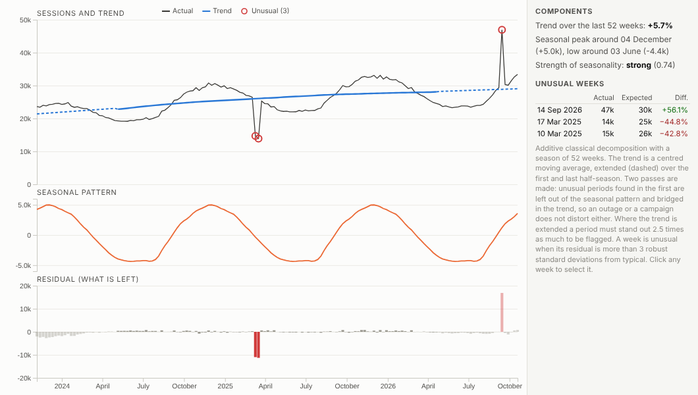
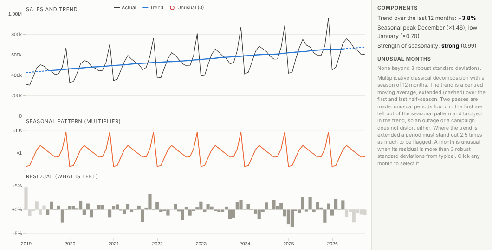
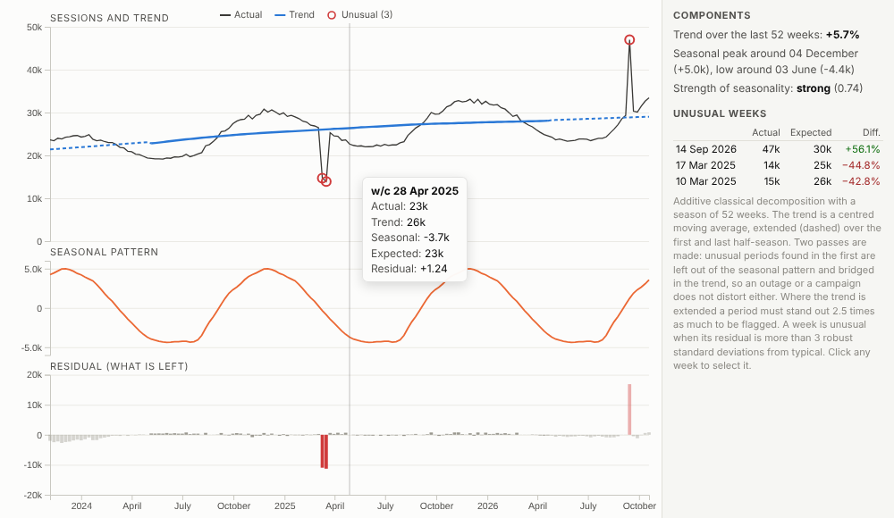
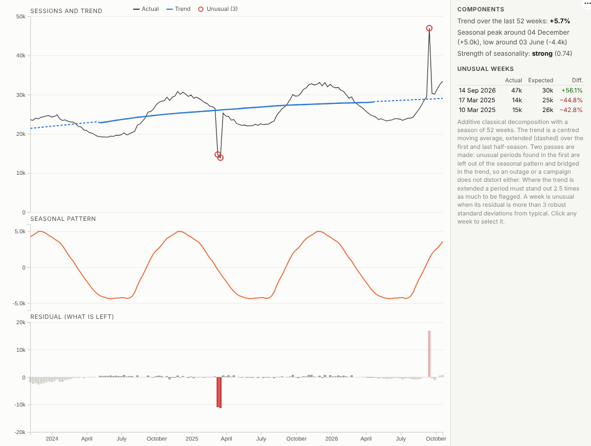

# Seasonal Decomposition

Is it growth, or is it just the season? Split any time series into trend, seasonal pattern and what is left over, and find the periods that were genuinely unusual.

## The problem it solves

Most business measures move with the calendar: retail peaks in December, travel in summer, B2B dips in August. That makes it hard to answer simple questions. Is this month's rise real growth or the usual seasonal lift? Was last week's drop a problem or a normal quiet week? Seasonal decomposition is the standard technique, but it is usually done in a statistics package, not in the dashboard where the questions are asked.

The Seasonal Decomposition view does it in the report. In the illustrative website traffic above, the yearly pattern (a winter high and a summer low) is separated from a steady upward trend, and the residual picks out the weeks that really were unusual, above all a two-week outage in March 2025 and a campaign in September 2026. The method is robust, so those weeks do not distort the seasonal pattern itself. Monthly data with a seasonal swing that grows with the business uses the multiplicative form:

## Where it earns its place

The examples below are illustrative.

| Team | Series | Question |
|---|---|---|
| Digital and marketing | Weekly sessions, leads | Was the campaign or the outage real, and how big? |
| Retail | Monthly sales | Underlying growth after the Christmas peak |
| Operations | Daily calls or orders | Which days were out of pattern |
| Finance | Monthly revenue or costs | Explaining variances in a monthly review |
| Utilities | Daily consumption | Unusual usage after allowing for the season |

## How to use it in Omniscope

1. Bring the history into a workflow with a date and a measure.
2. Connect it to a Report block, add a view and choose **Seasonal Decomposition**.
3. Set **Dated by**, **Measure** and the **Period**.
4. Choose a multiplicative season if the seasonal swing grows with the level.
5. Click an unusual period to select it and see what happened in other views.

## Why do this in Omniscope

- **Periods summed by the engine.** Records are aggregated to weeks or months on the server (tested with 400,000 records aggregated to weeks), so only the series reaches the browser.
- **Any slice.** Filter to a channel, region or product and decompose just that, from the same data as the other views.
- **Unusual weeks named.** The trend change, seasonal peak and low and the flagged periods are stated in plain language; on a real server it flagged exactly the planted outage and campaign, and clicking one shows what happened that week in the other views.
- **Same method each reload.** When the workflow reloads, the decomposition is re-run with the same robust two-pass method, and the view's code is open if you need another, such as STL.

## Data and options

A date and a measure, with at least two full seasons.

| Option | What it does |
|---|---|
| Dated by | The date field |
| Measure | What to decompose |
| Period | Week, month, day or quarter |
| Season length | Periods in one cycle |
| Season | Additive or multiplicative |
| Unusual beyond | Flagging threshold |

Tested with 400,000 records aggregated to weeks.

## Tested

- Mock harness: the trend checked against an independent moving average, the planted outage and campaign found, monthly multiplicative seasonality with no false flags, daily periods, hover, selecting a period and an unusual period, clearing, filtering to one source, a narrow layout, too short a series, empty data, unconfigured options, and 400,000 records.
- Real Omniscope server: installed through the Edit View API and configured in a report; the same components, flagging exactly the outage and the campaign.

