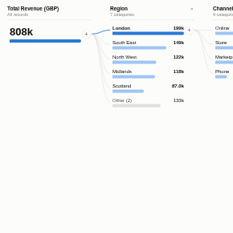

#  Decomposition Tree

Interactive breakdown of a measure across any number of fields, in any order. Start from the total, press **+** on a bar to split it by another field, and keep drilling. Automatic splits try every remaining field and pick the one with the highest (or lowest) category, which is a quick way to find where a number comes from.

## Use case

Root-cause and contribution analysis: where revenue comes from, which combination of warehouse and carrier makes deliveries late, which ward and specialty drive waiting times, which product and channel explain a margin drop.

## Data

Row-level data with one numeric field to analyse and several categorical fields to explain it by. The view runs its own queries through the Query API (one per level, plus a category count), so it works on large data: only the bars shown are fetched.

## Settings

- **Analyse**: the measure to break down. Sum and count measures also show each bar's share of its parent and an **Other** bar for categories beyond the limit. Averages, medians, minimums and maximums work too (no share or Other, as they do not add up).
- **Explain by**: the fields the viewer may split by.
- **Bars per level**: how many categories to show in each level (default 8).
- **Sort**: highest or lowest first.
- **Offer automatic splits**: adds "Auto: highest value" and "Auto: lowest value" to the split menu.
- **Show share of parent**: percentage beside each bar (sum and count only).

## Interaction

- **+** on a bar: choose the next field to split by, or an automatic split.
- Click a bar: follow that branch (deeper levels are recalculated for it) and select its records in Omniscope, so other views filter or highlight to the same slice.
- **&times;** on a level header removes that level and the ones after it. Click empty space to clear the selection.
- The tree is remembered when the report is reloaded in the same browser. Filters from other views apply to every level.

## Motion

When the view first draws, and when its data, options or filters change, the bars grow, including the bars of each new split. Hovering and selecting do not replay it. The animation is skipped when the viewer's system asks for reduced motion.

## Third-party libraries

None: the view draws its own SVG and needs nothing beyond Omniscope's custom view API.

## About this view

This view carries the `visokio-agents` tag. It is one of a set of community examples built by Visokio's agents, to extend Omniscope's core views with popular, specialist and more unusual use cases, and to show what anyone, people or agents, can build on Omniscope. It is tested by automated tests and was run on a real Omniscope server. It was not reviewed by Omniscope's core team, so it is not on a par with Omniscope's core views, which have years of manual, functional and unit tests behind them.

The sample data in `sample-data/` is invented for the demo.
