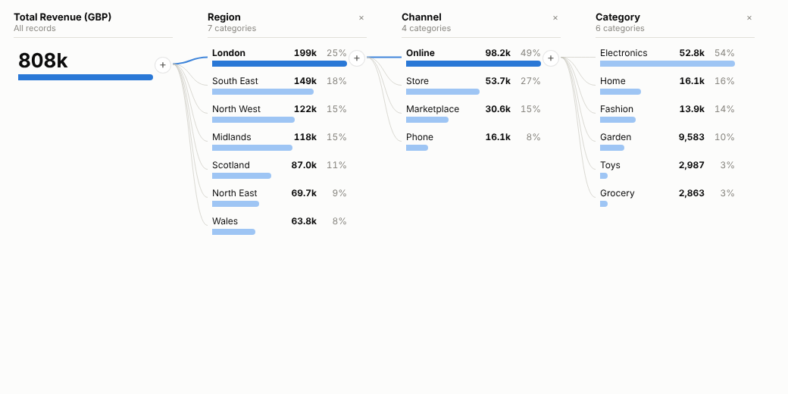
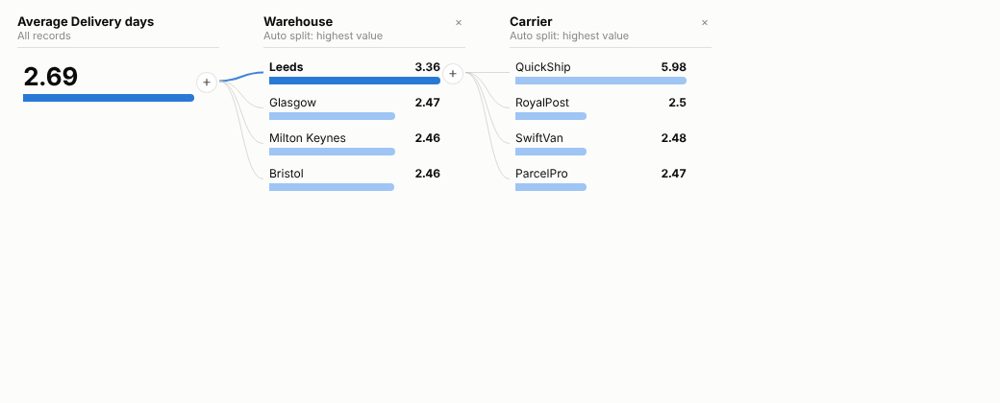
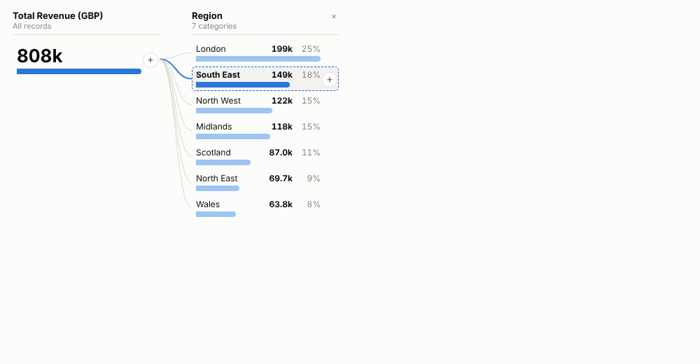
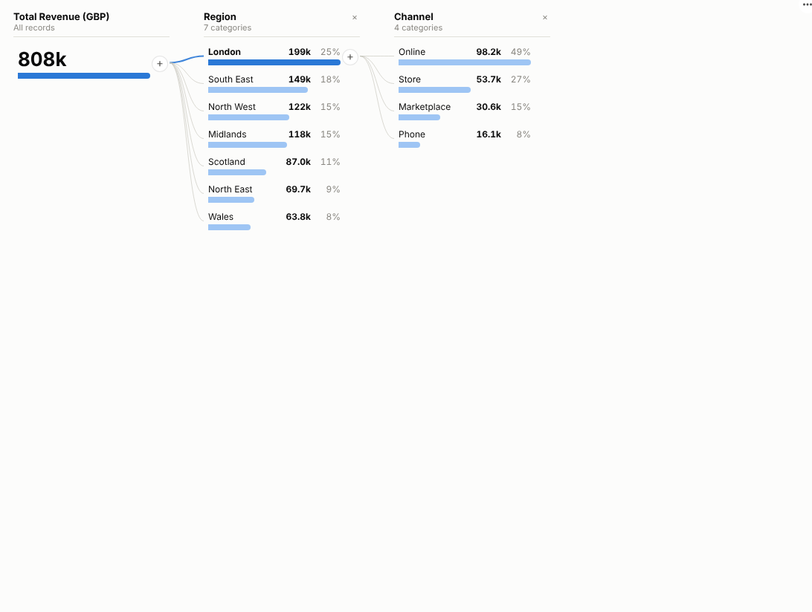

# Decomposition Tree

Ask "where does this number come from?" and answer it in clicks: split any total by any field, in any order, and let the view find the split that matters most.

## The problem it solves

Every management meeting asks the same follow-up questions. Revenue is up: which regions, which channels, which products? Deliveries are late: which warehouse, which carrier, which day? Answering them usually means a stack of pre-built charts, one per field and combination, or a request to an analyst and a wait.

The Decomposition Tree turns the follow-up into an interaction. The total sits on the left. Press **+** on it and choose a field; the bars show how it splits. Press **+** on any bar and split that slice by another field, then another. Change your mind at any level and the deeper levels recalculate for the new branch. Or let the view choose: the automatic split tries every remaining field and picks the one with the highest (or lowest) category, which is often the fastest way to the cause.

Each level is a live query against the data, so it scales to large tables; only the bars on screen are fetched. And because it is an Omniscope view, clicking a bar selects exactly that slice, so the table of orders, the map and the trend chart on the same page show the records behind it.

In the example above (illustrative data), two automatic "highest value" splits on average delivery days go straight from the overall average to the Leeds warehouse and then to one carrier, QuickShip, whose deliveries from Leeds take more than twice as long as the rest.

## Where it earns its place

The examples below are illustrative.

| Industry | Measure | Explain by | Typical finding |
|---|---|---|---|
| Retail and e-commerce | Revenue, margin, returns | Region, store, channel, category, customer type | Which combination drives growth or a margin drop |
| Logistics and fulfilment | Average delivery days, late orders | Warehouse, carrier, service level, region, day of week | The site and partner behind late deliveries |
| Healthcare | Waiting time, length of stay | Trust or site, specialty, referral source, age band | Where waits concentrate, and for whom |
| Financial services | Arrears, claims cost | Product, branch, broker, risk band | Which book of business explains a loss ratio |
| Manufacturing | Scrap rate, downtime minutes | Plant, line, shift, product, supplier | The line and shift with the worst rate |

## How to use it in Omniscope

1. Connect row-level data to a Report block (one row per order, claim, patient episode or batch).
2. Add a view and choose **Decomposition Tree**.
3. Set **Analyse** to the measure (for example the sum of Revenue or the mean of Delivery days) and add the fields people may split by to **Explain by**.
4. In the view, press **+** on the total and pick a field, or choose **Auto: highest value**. Keep drilling; click any bar to select that slice for the rest of the report.
5. Save the report. The tree the author built is remembered when the report is reopened in the same browser, and viewers can explore their own way.

## Why do this in Omniscope

- **A live query per level.** Every level is a Query API call against the workflow's output with the report's filters, so only the bars on screen are fetched (tested with 120,000 rows) and a drill on today's data matches the other views.
- **The viewer chooses the path.** No chart per field and combination to pre-build; the automatic split tries every remaining field, and the tree is restored when the report is reopened.
- **From the cause to the orders.** A click selects the slice in every other view: the slow Leeds deliveries by one carrier, the customers behind a margin drop.
- **Split ranking you can change.** Automatic splits pick the highest or lowest category; ranking fields another way, for example by the gap between categories, is an edit to the view's code.

## Data and options

Row-level data: one numeric field to analyse and any number of fields to explain it by.

| Option | What it does |
|---|---|
| Analyse | The measure: sum, count, mean, median, min or max |
| Explain by | Fields available for splitting, in any order |
| Bars per level | Categories shown per level (default 8); the rest become Other for sums and counts |
| Sort | Highest or lowest first |
| Offer automatic splits | Adds Auto: highest value and Auto: lowest value |
| Show share of parent | Percentage of the parent bar (sums and counts) |

Tested with 120,000 rows and a 60-value field.

## Tested

- Mock harness: three-level breakdown, two automatic splits finding the planted cause, clicking through branches with selection, clearing, filtering from another view, resizing, reload with the tree restored, empty data, unconfigured options, and 120,000 rows.
- Real Omniscope server: installed through the Edit View API, configured in a report and expanded; see below.

