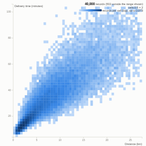

#  Density Scatter

A scatter plot for big data. Instead of drawing every point, the Query API bins the records into a two-dimensional grid (a histogram grouping on both axes) and the view draws each cell's count as a colour, so a million records render quickly (tested with one million). Optionally colour each cell by the average of a third field, for example a 1/0 flag to show a rate. Marginal histograms show each axis on its own.

## Use case

Seeing relationships and clusters in large tables where an ordinary scatter plot turns into a solid blob: delivery distance against time, price against size, claim value against days to settle, sensor readings against each other, transaction amount against hour. Colouring by a mean shows where an outcome (late, fraud, churn, defect) concentrates.

## Data

Row-level data with two numeric fields; optionally a third numeric field to average per cell. Only binned counts travel from the server, so the browser never receives the individual records.

## Settings

- **X axis**, **Y axis**: the numeric fields.
- **Colour by mean of**: optional numeric field averaged per cell (for example Late as 1/0 gives the late rate).
- **Grid size**: cells across each axis, rounded to tidy widths (default 80).
- **Log colour scale for counts**: show sparse areas as well as dense ones.
- **Trim extreme values**: axis ranges from the quartiles (three interquartile ranges beyond them).
- **Show marginal histograms**.
- **Minimum records per cell**: hide sparse cells, useful with means.

## Interaction

Hover a cell for its ranges, count and mean. Drag a box to select those records; other views filter or highlight to match. Click without dragging to clear. Filters from other views re-bin the grid.

## Motion

When the view first draws, and when its data, options or filters change, the density and marginal bars fade in. Hovering and selecting do not replay it. The animation is skipped when the viewer's system asks for reduced motion.

## Third-party libraries

Loaded from the jsDelivr CDN when the view opens, so the browser showing the report needs internet access:

- [D3](https://d3js.org) 7.9.0, ISC licence

## About this view

This view carries the `visokio-agents` tag. It is one of a set of community examples built by Visokio's agents, to extend Omniscope's core views with popular, specialist and more unusual use cases, and to show what anyone, people or agents, can build on Omniscope. It is tested by automated tests and was run on a real Omniscope server. It was not reviewed by Omniscope's core team, so it is not on a par with Omniscope's core views, which have years of manual, functional and unit tests behind them.

The sample data in `sample-data/` is invented for the demo.
