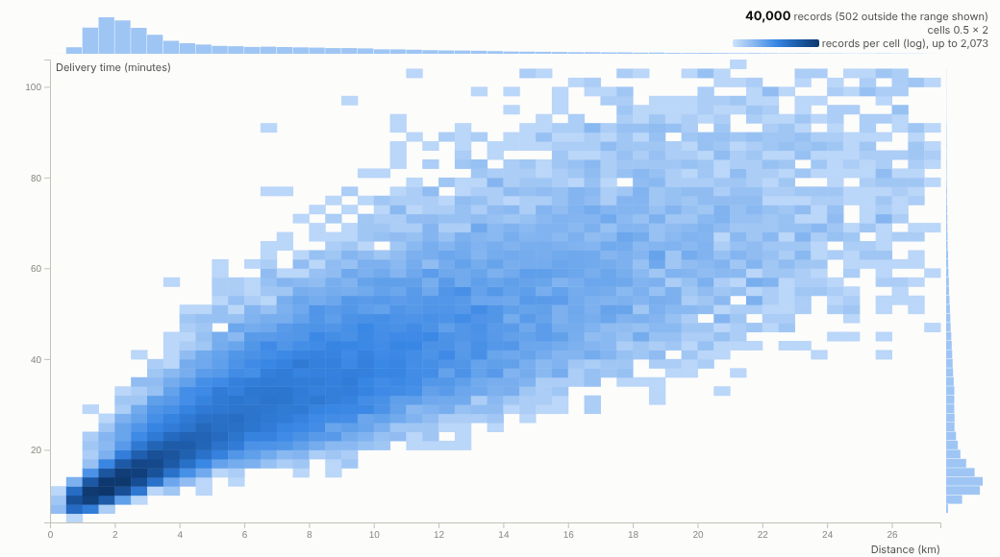
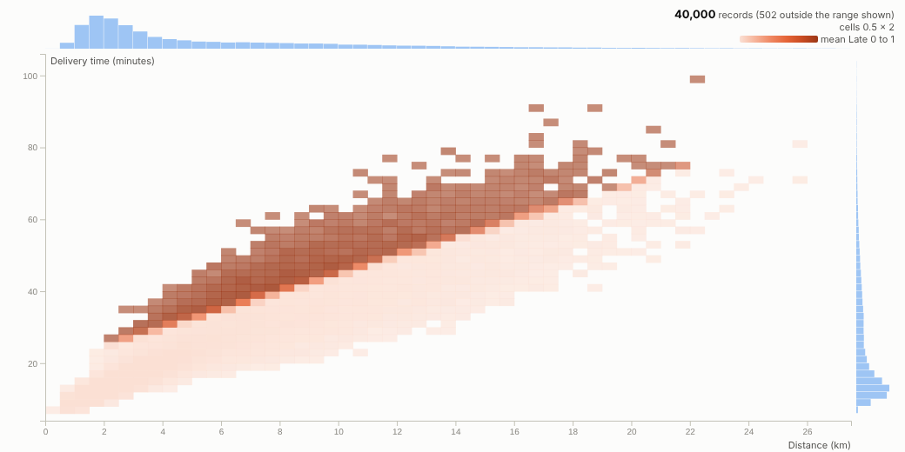
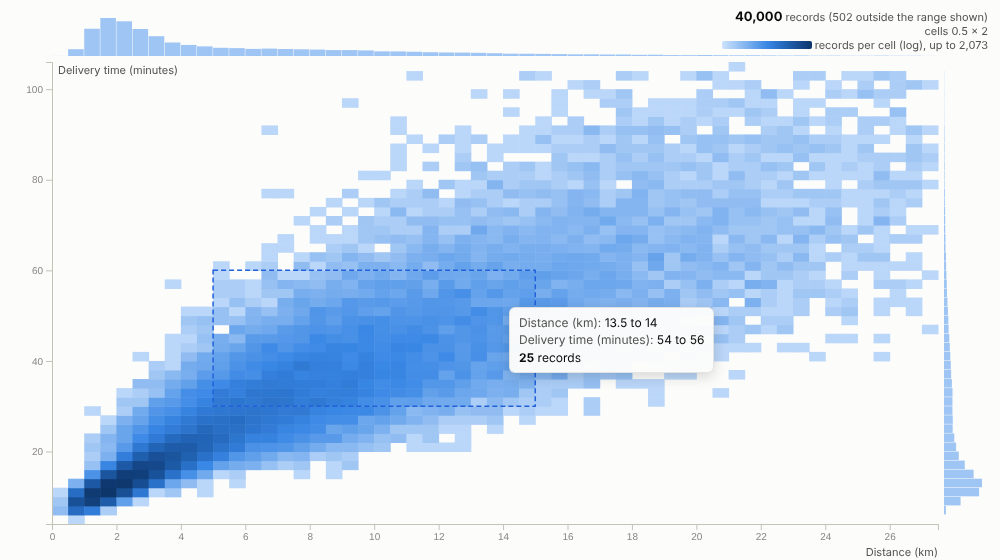
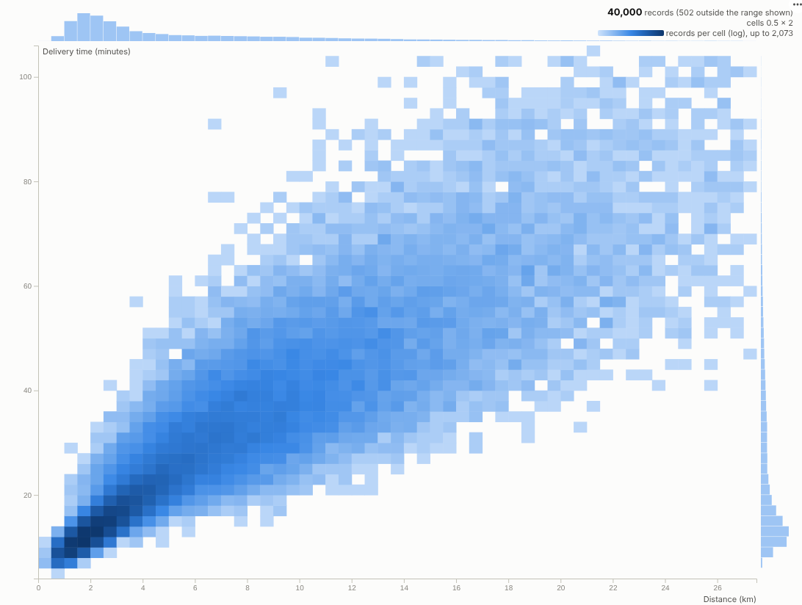

# Density Scatter

A scatter plot that stays readable at a million rows: the server bins the points, the view shows where they really are, and a box selects them.

## The problem it solves

Scatter plots are the natural way to look at two measures together, and they break with real data volumes. Past a few thousand points everything overlaps into a solid blob; past a few hundred thousand the browser struggles to draw it at all. Sampling hides exactly the rare cases people are looking for.

The Density Scatter asks the Query API for counts in a two-dimensional grid and draws the grid, so it shows the true shape of very large tables quickly. In the illustrative delivery data above, two fleets appear as two distinct clouds: e-bikes on short, quick, consistent trips and vans on longer, slower, more variable ones. Colour the same grid by the share of late deliveries and the problem area appears at once, with a clear boundary where the promised time runs out:

## Where it earns its place

The examples below are illustrative.

| Industry | X and Y | Colour by mean of |
|---|---|---|
| Logistics and delivery | Distance, delivery time | Late flag (late rate), rating |
| Property and retail | Floor area, price | Days on market, discount |
| Insurance and banking | Claim or transaction amount, days to settle or hour | Fraud flag, complaint flag |
| Manufacturing and IoT | Two sensor readings | Defect flag, yield |
| Digital and telecoms | Session length, pages or data used | Conversion or churn flag |

## How to use it in Omniscope

1. Connect row-level data to a Report block; it can be very large, because only binned counts are queried.
2. Add a view and choose **Density Scatter**, then set **X axis** and **Y axis**.
3. Optionally set **Colour by mean of** a 1/0 outcome to see rates, with **Minimum records per cell** to hide noisy cells.
4. Hover cells for counts; drag a box around an interesting region to select those records and inspect them in other views.
5. Filter by segment, region or period elsewhere in the report and the grid re-bins for that subset.

## Why do this in Omniscope

- **The engine does the binning.** Counts in a two-dimensional grid come from the Query API, so a million records are never sent to the browser and no sampling hides the rare cases (tested with one million records).
- **Where outcomes happen.** Averaging a 1/0 flag per cell turns density into a rate, such as the boundary where deliveries start to arrive late.
- **Box to deliveries.** Dragging a box selects those records for every other view, and filters set there re-bin the grid.
- **Different cells if you prefer.** Grid size, log colour and trimming are options; hexagonal cells or another colour scale are a change to the view's code.

## Data and options

Row-level data with two numeric fields; optionally a third to average.

| Option | What it does |
|---|---|
| X axis, Y axis | The numeric fields |
| Colour by mean of, Minimum records per cell | Rate or average per cell |
| Grid size, Log colour scale, Trim extreme values | Binning and colour |
| Show marginal histograms | Axis distributions |

Tested with 1,000,000 records.

## Tested

- Mock harness: 40,000 deliveries as counts and as a late rate, hover, box selection, filtering to one fleet, a small view, a linear untrimmed grid, empty data, unconfigured options, and one million records.
- Real Omniscope server: installed through the Edit View API and configured in a report.

