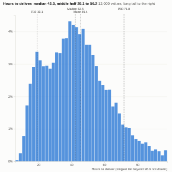

#  Distribution

The shape of any number: a histogram with the median, mean and 10th and 90th percentiles marked, a plain-language headline (median, middle half, skew), and a summary table of percentiles, spread and outliers. Compare groups as outlines on a shared scale of shares. By default the far tail beyond the outlier fence is not drawn, so the main shape stays visible, while the statistics still use every value.

## Use case

Delivery and handling times, order values, response times, ages, prices, waiting times, sensor readings: anywhere an average hides the story and the spread, the tail or the difference between groups matters (service levels, pricing, capacity).

## Data

One row per record with a numeric field. The view fetches up to 500,000 values through the Query API; filters from other views apply.

## Settings

- **Values**: the numeric field.
- **Compare by** (optional): one outline per group (the 6 largest; the table shows the first three and All).
- **Bars**: approximate number of bars (default 40).
- **Height**: share of records (default, comparable across groups) or number of records.
- **Trim the far tail**: do not draw values beyond the upper outlier fence (Q3 plus 1.5 times the interquartile range).
- **Values used**: maximum records fetched.

## Interaction

Hover a bar for its count, share and the cumulative share at or below it. With a single distribution, click a bar to select the records in that range, so other views show them; click again or click empty space to clear.

## Motion

When the view first draws, and when its data, options or filters change, the bars grow up and the curves draw across. Hovering and selecting do not replay it. The animation is skipped when the viewer's system asks for reduced motion.

## Third-party libraries

Loaded from the jsDelivr CDN when the view opens, so the browser showing the report needs internet access:

- [D3](https://d3js.org) 7.9.0, ISC licence

## About this view

This view carries the `visokio-agents` tag. It is one of a set of community examples built by Visokio's agents, to extend Omniscope's core views with popular, specialist and more unusual use cases, and to show what anyone, people or agents, can build on Omniscope. It is tested by automated tests and was run on a real Omniscope server. It was not reviewed by Omniscope's core team, so it is not on a par with Omniscope's core views, which have years of manual, functional and unit tests behind them.

The sample data in `sample-data/` is invented for the demo.
