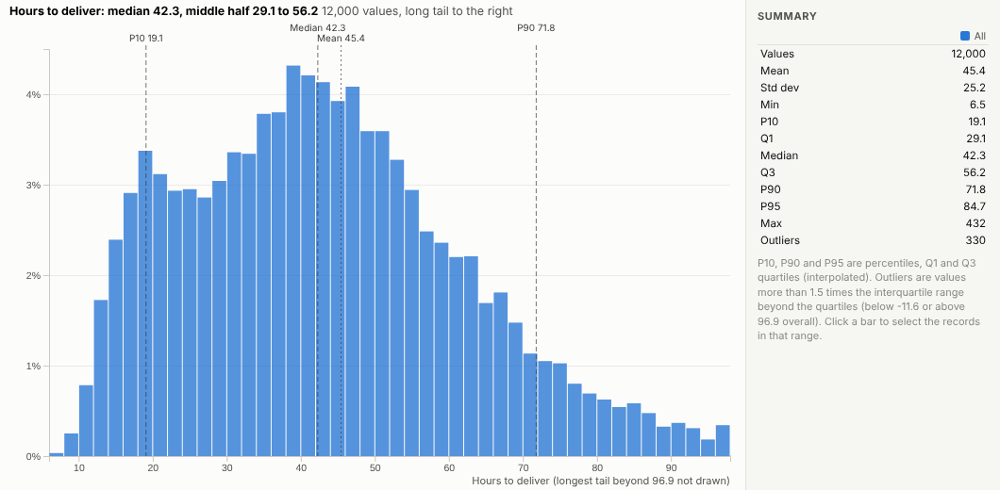
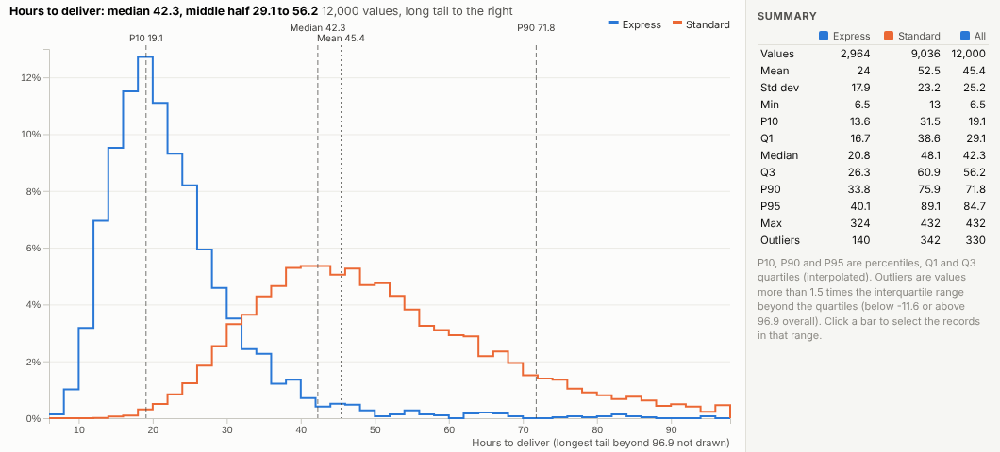
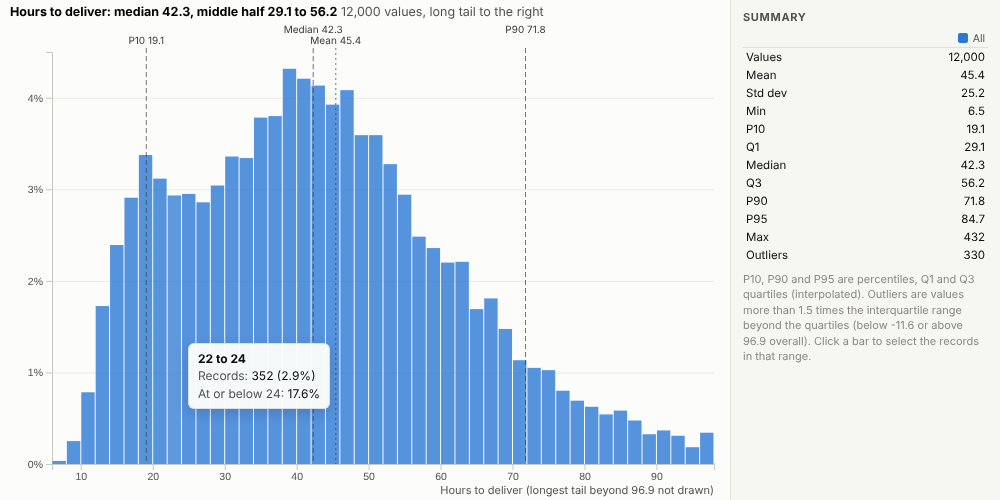
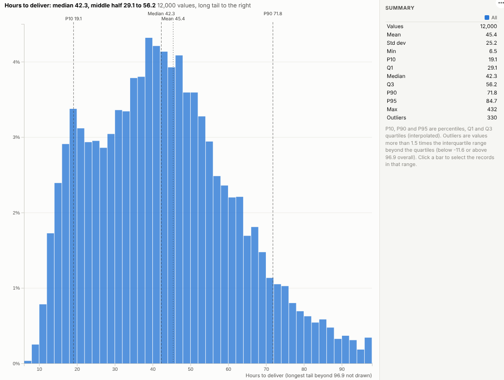

# Distribution

Averages hide the story. See the whole shape of any number, with the median, percentiles, tail and outliers spelled out.

## The problem it solves

"Average delivery time is 45 hours" says little about the customer whose parcel took four days. Service levels, prices and waiting times are about spread and tails: what most people get, what the unlucky 10% get, and how groups differ. A plain bar chart of a binned field gets part of the way, but the percentiles, the skew and the outliers have to be worked out separately.

The Distribution view puts them together. In the illustrative deliveries above, the median is 42 hours and the middle half of deliveries take 29 to 56 hours, but the tail is long: one in ten takes more than 72 hours. Comparing service levels shows two quite different shapes:

## Where it earns its place

The examples below are illustrative.

| Team | Values | Compare by |
|---|---|---|
| Logistics | Hours to deliver | Carrier, service, region |
| Customer service | Time to resolve | Channel, team |
| Sales | Order value | Segment, channel |
| Healthcare operations | Waiting time | Site, pathway |
| IT | Response time | Service, release |

## How to use it in Omniscope

1. Bring the records into a workflow with the numeric field.
2. Connect it to a Report block, add a view and choose **Distribution**.
3. Set **Values** and optionally **Compare by**.
4. Read the median, quartiles and P90 from the markers and the table.
5. Click a bar to select the records in that range, for example the slowest deliveries.

## Why do this in Omniscope

- **The statistics people ask for.** Median, middle half, percentiles, skew and outliers are written out, and the median, mean and skew are checked against an independent calculation.
- **Service levels side by side.** Groups are drawn as shares on one scale, so a small group's shape compares directly with a large one's.
- **From the tail to the parcels.** Clicking a bar in the long tail selects the deliveries in that range for the rest of the report.
- **Refreshes with the data.** Filters and the workflow's refresh update the distribution (up to 500,000 values fetched), and summaries such as the 99th percentile can be added to the view's code.

## Data and options

One numeric field, optionally a group.

| Option | What it does |
|---|---|
| Values | The numeric field |
| Compare by | Optional groups |
| Bars | Number of bars |
| Height | Share or count |
| Trim the far tail | Hide the extreme tail in the drawing |
| Values used | Maximum records fetched |

## Tested

- Mock harness: the median, mean and skew checked against an independent calculation, groups, counts with no trimming, hover, selecting a range, clearing, filtering to one carrier, a narrow layout, too few values, empty data and unconfigured options.
- Real Omniscope server: installed through the Edit View API and configured in a report; identical figures.

