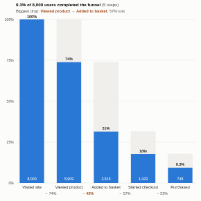

#  Event Funnel

Conversion funnels computed from a raw event log, the way product analytics tools do it. Give it who did what and when: the view follows each user through the funnel steps in order (optionally within a time window), counts how many reach each step, shows where they drop off and how long each step takes, and compares groups such as channel or device.

## Use case

Web and app conversion (visit to purchase, sign-up to activation), onboarding and trial journeys, lead-to-customer pipelines, application and claims processes, any sequence of events where people fall away between steps.

## Data

An event log: one row per event with a user (visitor, customer, account or session), the event name and a timestamp. The view fetches only the events of the funnel steps, sorted by user and time, up to 500,000 events. Filters from other views apply.

## Settings

- **Users**, **Events**, **Ordered by**: the who, what and when of the log.
- **Funnel steps**: the events in order, separated by commas. Left blank, the view proposes a funnel from the most common events, ordered by when they usually first happen.
- **Within days** (optional): a step counts only if it happens within this many days of the first step.
- **Compare by** (optional): one funnel per group, using the value on each user's first event (the six largest groups are shown).
- **Show one funnel**: with Compare by set, draw the combined funnel and keep the groups in the panel.
- **Events used**: maximum events fetched.

## How it counts

Each user starts the funnel at their first occurrence of the first step. The view then looks for the second step after that, the third after the second, and so on, so steps must happen in order; repeated events and events in between are ignored. A user counts once at every step they reach. Conversion is the share of the previous step; the median time is between consecutive steps. The step with the lowest conversion is highlighted as the biggest drop.

## Interaction

Hover a bar for users, conversion and median time, or a pale cap for the users who dropped off before that step. Click a bar to select the users who reached the step, or a cap to select those who stopped just before it (up to 3,000 users), so other views can show who they are; click again or click empty space to clear.

## Motion

When the view first draws, and when its data, options or filters change, the stage bars grow up. Hovering and selecting do not replay it. The animation is skipped when the viewer's system asks for reduced motion.

## Third-party libraries

Loaded from the jsDelivr CDN when the view opens, so the browser showing the report needs internet access:

- [D3](https://d3js.org) 7.9.0, ISC licence

## About this view

This view carries the `visokio-agents` tag. It is one of a set of community examples built by Visokio's agents, to extend Omniscope's core views with popular, specialist and more unusual use cases, and to show what anyone, people or agents, can build on Omniscope. It is tested by automated tests and was run on a real Omniscope server. It was not reviewed by Omniscope's core team, so it is not on a par with Omniscope's core views, which have years of manual, functional and unit tests behind them.

The sample data in `sample-data/` is invented for the demo.
