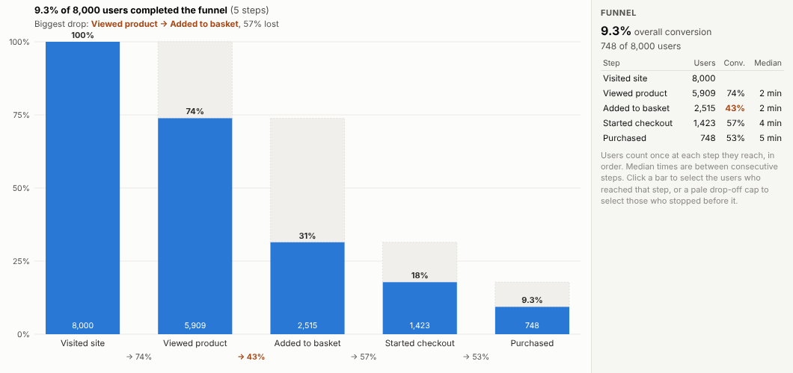
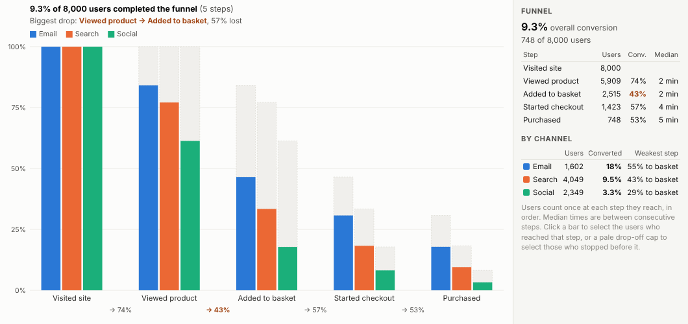
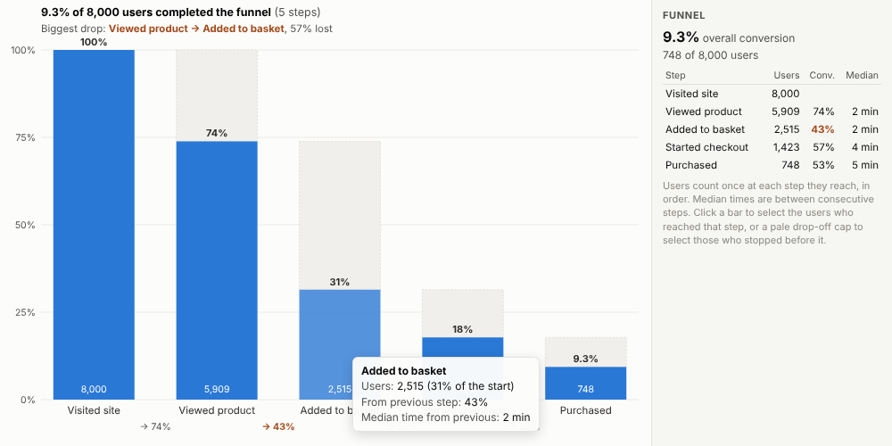
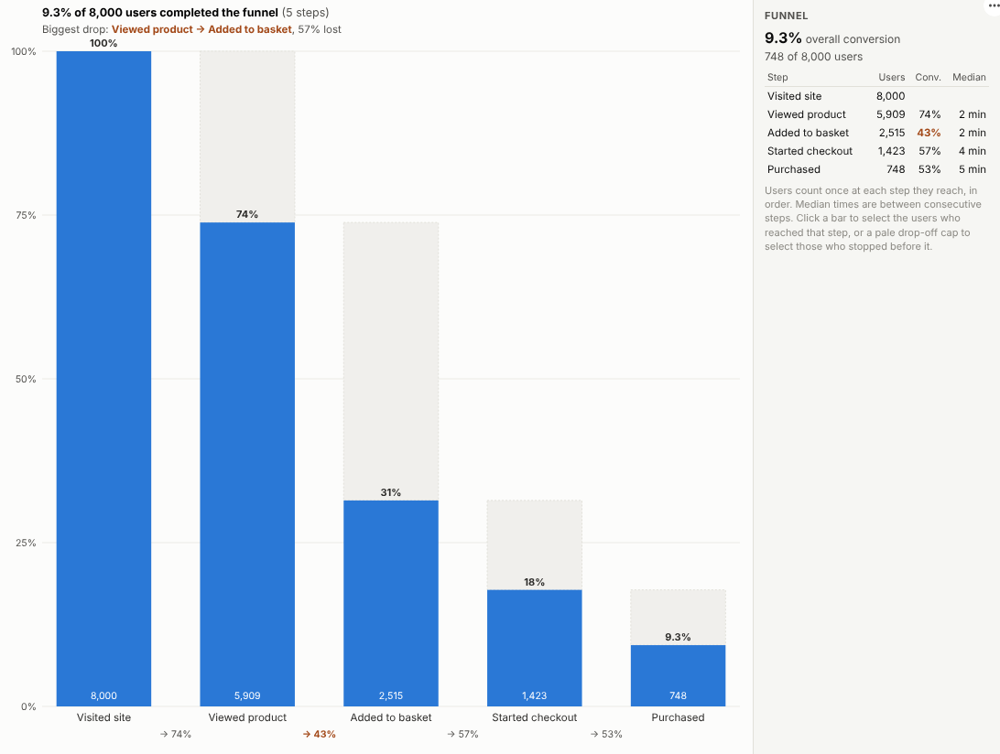

# Event Funnel

Where do people drop out? Conversion funnels from your raw event data, with drop-off, time between steps and comparisons by channel or device, in an Omniscope report.

## The problem it solves

Every digital journey is a funnel: visit, view, add to basket, check out, buy; sign up, verify, activate; apply, submit, approve. The data is an event log of who did what and when. Turning it into a funnel means following each person through the steps in order, which is awkward in SQL and impractical in a pivot table, so teams rely on separate product analytics tools whose numbers can differ from the rest of the reporting.

The Event Funnel view computes the funnel in the report itself from the event log. In the illustrative web shop above, 9% of visitors buy, and the biggest drop is between viewing a product and adding it to the basket. Comparing channels shows email visitors converting several times better than visitors from social media:

## Where it earns its place

The examples below are illustrative.

| Journey | Steps | Compare by |
|---|---|---|
| Online shopping | Visit, product, basket, checkout, purchase | Channel, device, campaign |
| Software trials | Sign up, verify, first project, invite, subscribe | Plan, source |
| Lending and insurance | Quote, application, documents, approval | Product, broker |
| Recruitment | Applied, screened, interviewed, offered, hired | Role, source |
| Public services | Started form, submitted, verified, completed | Service, channel |

## How to use it in Omniscope

1. Bring the event log into a workflow (web analytics export, application database, CRM history) with user, event and timestamp.
2. Connect it to a Report block, add a view and choose **Event Funnel**.
3. Set **Users**, **Events** and **Ordered by**, then list the **Funnel steps** in order (or leave them blank for a proposal).
4. Optionally set **Within days** and **Compare by**.
5. Click a drop-off cap to select the users who stopped there and look at them in other views.

## Why do this in Omniscope

- **Same event table as the reporting.** Funnels are built from the event log in the workflow, joined with whatever it adds (customer value, region, product), so the numbers agree with the rest of the reports.
- **Counts pinned by tests.** Step counts with and without a time window are checked against an independent calculation (about 410,000 events from 120,000 users), with identical counts on a real Omniscope server.
- **From drop-off to people.** Clicking the pale cap above a step selects exactly who stopped before it, ready to profile or contact in the other views.
- **Your funnel rule.** Steps and the time window are options; the in-order rule is in the view's code if your funnel allows steps in any order.

## Data and options

An event log: user, event and timestamp.

| Option | What it does |
|---|---|
| Users, Events, Ordered by | The who, what and when |
| Funnel steps | The events in order |
| Within days | Optional time window from the first step |
| Compare by | Optional groups |
| Show one funnel | Combined funnel with groups in the panel |
| Events used | Maximum events fetched |

Tested with about 410,000 events from 120,000 users.

## Tested

- Mock harness: step counts with and without a time window checked against an independent calculation, the selection checked to contain exactly the users who completed, drop-off selection, automatic steps, steps that do not exist, hover, clearing, filtering to one device, a narrow layout, empty data, unconfigured options, and about 410,000 events.
- Real Omniscope server: installed through the Edit View API and configured in a report, with the steps typed into the text option; identical counts.

