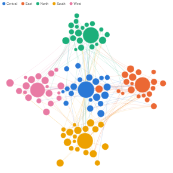

#  Force Coordinate Graph

A network drawn at coordinates you already have: each node sits at its own X and Y position (a map location, or a layout worked out in a workflow), nodes that would overlap are pushed slightly apart, and the links between them are bundled so that links running the same way merge into visible flows.

## Use case

Networks whose layout is known in advance: depots and the routes between them on a map, offices and the calls between them, clusters of customers placed by a similarity score and the referrals between them. Bundling turns hundreds of crossing lines into a few main flows, and hovering a node shows just its own links.

## Data

One record per link, from a node to another node, with the node's coordinates on the record. Each node also needs at least one record of its own, with the "to" field empty if it has no links (or only incoming ones), so that it has coordinates.

| Depot | Linked depot | Region | East (km) | North (km) | Capacity | Shipments |
|---|---|---|---|---|---|---|
| Stanmouth | | North | 280 | 706 | 1162 | |
| Stanmouth | Penley Hub | North | 280 | 706 | 1162 | 351 |
| Stanmouth | Oakham | North | 280 | 706 | 1162 | 19 |

Omniscope groups the records by From node and To node. A node's position, colour, size, tooltip and picture are taken from its first record that has them, so the node's own columns can simply repeat on every record. Links to a value that has no record of its own are not drawn. The view draws up to 5,000 nodes.

## Settings

- **From node**: one node per value, for example Depot.
- **To node**: the node at the other end of the record's link, for example Linked depot. Empty: the record only places the node.
- **X position**, **Y position**: the node's coordinates, for example the mean of East (km) and the mean of North (km). The two axes are scaled separately to fill the view.
- **Keep nodes apart** (on by default): nodes that would overlap are pushed a little away from their coordinates.
- **Colour** (optional): a text field with the **Singleton** function (for example Region) gives each category a colour and a key; a number (for example the mean of Capacity) gives a colour scale from dark purple to yellow. Links take the colour of the node they start from.
- **Size** (optional): node area follows this value, for example the mean of Capacity. Empty: all nodes the same size, smaller when there are many.
- **Tooltip** (optional): first line of a node's tooltip. Empty: the From node value.
- **Image URL** (optional): a picture drawn inside the node, from a text field with the Singleton function. The browser showing the report must be able to load it.
- **Link weight** (optional): thicker lines for heavier links, for example the sum of Shipments; it also decides which links are kept when there are more than Links shown.
- **Bundle links** (on by default): curve links that run in the same direction into shared bundles. Off: straight lines.
- **Links shown** (default 1,000, at most 5,000): the most links drawn, heaviest first. A note in the corner says when some are left out.
- **Pane X**, **Pane Y** (optional): one graph per value, side by side or one above the other.

## How the graph is drawn

The nodes are placed first, with straight links. Bundling then runs in the background, without blocking the rest of the report, and replaces the straight links with curves when it is done: a second or two for a few hundred links, longer for thousands. Colours follow the category's name, not its rank, so filtering the report does not recolour the nodes; the key appears when there are 10 categories or fewer and room for it.

## Interaction

Hover a node for its figures and to show only its own links. Click a node to select its From node value in the rest of the report: its links stay visible and the nodes it is not linked to fade. Click it again, or click empty space, to clear the selection.

## Third-party libraries

- [D3](https://d3js.org) 7.9.0, ISC licence, loaded from the jsDelivr CDN when the view opens (also inside the bundling worker), so the browser showing the report needs internet access.
- [d3.ForceBundle](https://github.com/upphiminn/d3.ForceBundle) (force-directed edge bundling, after Holten and van Wijk, 2009), GNU General Public Licence version 2, loaded from the jsDelivr CDN at a fixed commit of its GitHub repository when the view opens. It is not part of this repository.

The sample data in `sample-data/` is invented for the demo.
