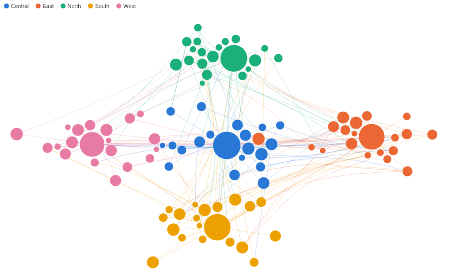
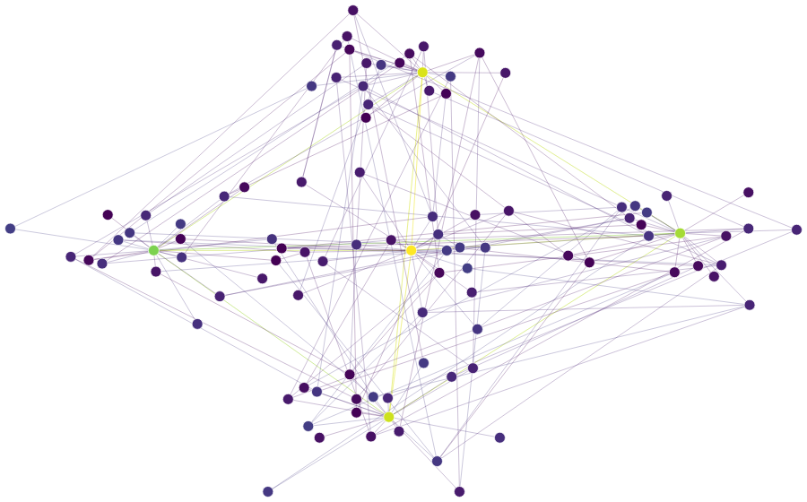
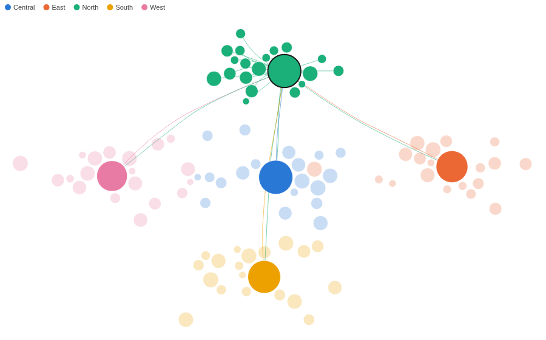

# Force Coordinate Graph

A network kept where your data puts it. Nodes at their own coordinates, links bundled into the flows they make.

## The problem it solves

A network drawn by a force layout puts nodes wherever the forces settle, so a depot in the north can end up in the south of the picture, and the layout changes with every filter. When the positions already mean something (a map location, a score, a layout worked out once in the workflow), the graph should keep them. But draw hundreds of links as straight lines between fixed points and they cross into a mesh where no flow can be followed.

The Force Coordinate Graph places every node at its own X and Y, pushes overlapping nodes slightly apart, and bundles links that run the same way into shared curves. In the illustrative carrier above (invented figures), 100 depots sit at their map positions: each depot sends to its regional hub, the five hubs trade heavily with each other, and the direct routes between regions merge into a few visible corridors. Below, the same network with straight links, coloured by capacity on a colour scale:

## Where it earns its place

Omniscope's built-in Network view lays out most networks well, and its Manual layout can also place nodes at X and Y values from the data. Use this view when the positions are fixed and there are too many links to read as straight lines: it bundles links that run the same way into flows and pushes overlapping nodes apart.

The examples below are illustrative.

| Team | Nodes at | Links |
|---|---|---|
| Logistics | Depots on a map | Routes, weighted by shipments |
| Telecoms | Exchanges or sites | Traffic between them |
| Customer analytics | Customers placed by a similarity score | Referrals |
| Research | Papers placed by topic | Citations |

## How to use it in Omniscope

1. Bring the data into a workflow with one record per link (and one per node with an empty link), plus each node's coordinates.
2. Connect it to a Report block, add a view and choose **Force Coordinate Graph**.
3. Set **From node** and **To node**, for example Depot and Linked depot, then **X position** and **Y position**, for example the mean of East (km) and North (km).
4. Optionally set **Colour** (a category with the Singleton function, or a number), **Size** and **Link weight**.
5. Hover a node to see its own links; click it to select it in the rest of the report.

## Why do this in Omniscope

- **Coordinates from the workflow.** The X and Y positions can be computed in the same workflow that feeds the report (a map projection, a clustering score), and the graph follows when that step changes, with no layout to export and redraw elsewhere.
- **Link weights you can check.** Link thickness and which links are kept come from Omniscope's own aggregation of the records (the sum of Shipments per route here), so they match a table of the same data and update on every refresh.
- **A depot is a filter.** Clicking a node selects it in the other views of the report, so its routes, volumes and history sit next to the picture.
- **Open code.** It is a custom view: the colours, sizing and drawing are in one HTML file that can be changed in the View Designer, and the bundling code is a separate script beside it.

## Data and options

One record per link and one per node, with the node's coordinates; up to 5,000 nodes.

| Option | What it does |
|---|---|
| From node, To node | The two ends of a record's link; To node empty for a node-only record |
| X position, Y position | Where the node sits |
| Keep nodes apart | Push overlapping nodes slightly aside |
| Colour, Size, Tooltip, Image URL | How each node looks |
| Link weight | Line thickness, and which links are kept first |
| Bundle links, Links shown | Curved bundles or straight lines; how many links to draw |
| Pane X, Pane Y | One graph per value |

## Tested

Mock harness: 100 nodes and 209 bundled links from the sample data, the colour key, a colour scale from a number, straight links, the tooltip's figures, hover showing one node's links, selecting a depot and clearing by clicking it again and by clicking empty space, filtering to one region (colours unchanged), a lower Links shown with its note, a 260 by 180 pane (every node inside it), 3,000 nodes with 6,000 links (the 1,000 heaviest bundled), empty data, and unset options.

