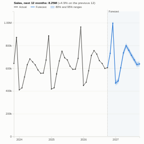

#  Forecast

A time-series forecast with ranges and a built-in accuracy check. The view aggregates a measure by day, week, month, quarter or year on the server, fits Holt-Winters exponential smoothing in the browser (level, trend and a repeating seasonal pattern, chosen automatically), and draws the forecast with 80% and 95% ranges. A backtest shows what the same method would have forecast for the most recent periods, and how its error compares with simply repeating last season.

## Use case

Sales and demand planning, budgeting, staffing and capacity, stock and purchasing, cash flow, website traffic, call volumes. Anywhere a regular series needs a quick, explainable forecast that updates with the data and can be sliced by region, product or channel.

## Data

Records with a date and a measure. The view runs one aggregated query: the measure (for example sum of Sales or record count) per period. Missing periods are filled by interpolation and reported. Make sure the last period is complete, since a partial month at the end pulls the forecast down. Filters from other views apply, so the forecast is re-fitted for any slice.

## Settings

- **Dated by**: the date field.
- **Forecast**: the measure, e.g. sum of Sales.
- **Period**: day, week, month (default), quarter or year. This also sets the seasonal cycle: 7 days, 52 weeks, 12 months or 4 quarters.
- **Periods ahead**: forecast horizon (default 12).
- **Season**: automatic, additive (the seasonal swing stays the same size) or multiplicative (it grows with the level).
- **Seasonal**: turn off for series with no repeating pattern.
- **Show backtest**: draw the backtest forecast over the most recent history.
- **History shown**: number of past periods drawn (the model always uses all history).

## How it works

Holt-Winters exponential smoothing with a damped or linear trend. The smoothing parameters, the trend damping and the seasonal form are chosen by a grid search that minimises the one-step-ahead error on the history. The ranges come from the spread of those one-step errors, widened with the horizon using the standard approximation for this model; they assume the past pattern continues and do not allow for shocks. Seasonality needs at least two full cycles plus two periods of history; with less the view fits a trend only.

## Interaction

Hover anywhere for the actual, the backtest forecast or the forecast and its ranges. Click a past period to select it, so other views show what happened in it; click again or click empty space to clear. The panel lists the forecast for each period with its 80% range.

## Motion

When the view first draws, and when its data, options or filters change, the history and forecast lines draw from left to right. Hovering and selecting do not replay it. The animation is skipped when the viewer's system asks for reduced motion.

## Third-party libraries

Loaded from the jsDelivr CDN when the view opens, so the browser showing the report needs internet access:

- [D3](https://d3js.org) 7.9.0, ISC licence

## About this view

This view carries the `visokio-agents` tag. It is one of a set of community examples built by Visokio's agents, to extend Omniscope's core views with popular, specialist and more unusual use cases, and to show what anyone, people or agents, can build on Omniscope. It is tested by automated tests and was run on a real Omniscope server. It was not reviewed by Omniscope's core team, so it is not on a par with Omniscope's core views, which have years of manual, functional and unit tests behind them.

The sample data in `sample-data/` is invented for the demo.
