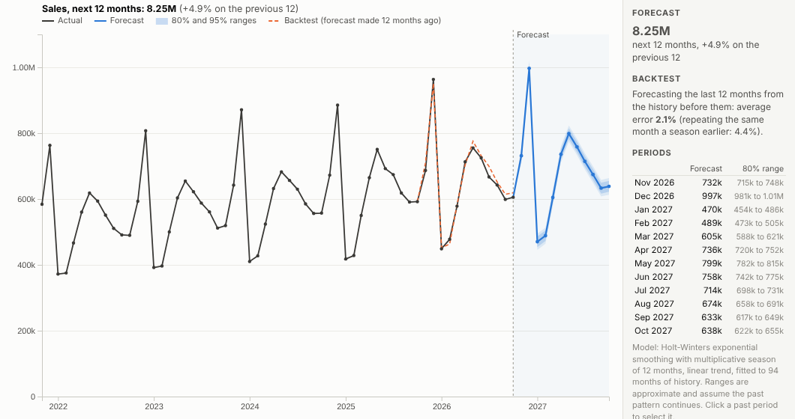
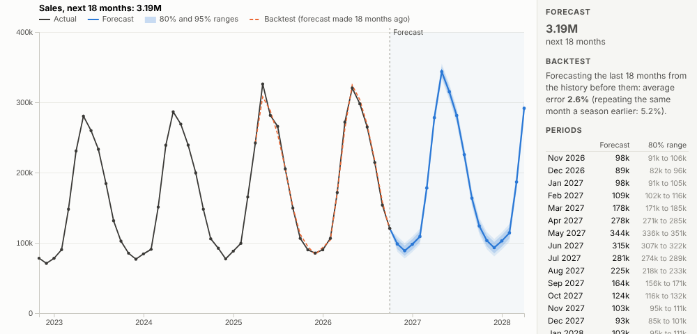
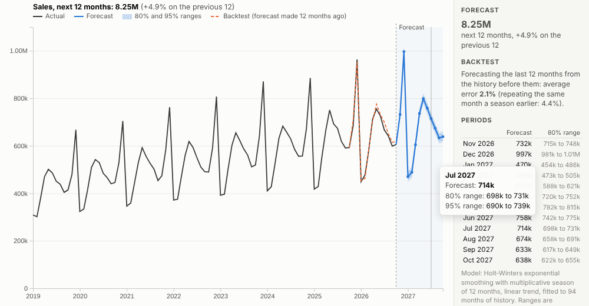
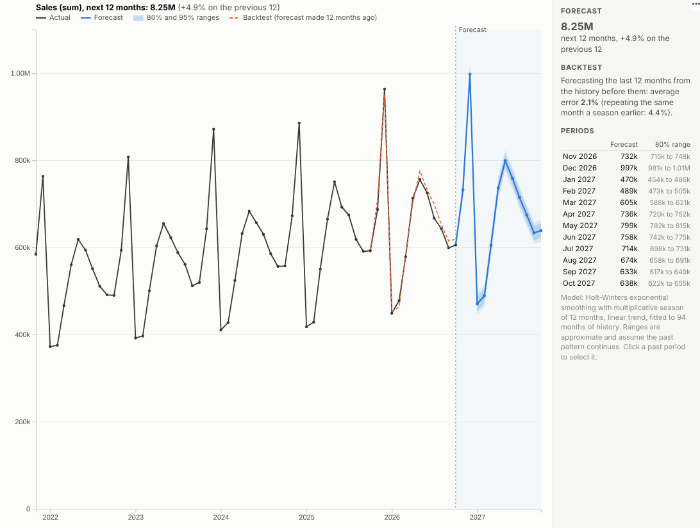

# Forecast

Where is this heading? A forecast for any measure in your data, with ranges, seasonality and a built-in check of how accurate it would have been, live in an Omniscope report.

## The problem it solves

Every planning conversation needs a forecast: next quarter's sales, next month's call volumes, stock for the peak season. Most dashboards show history only, and forecasts are produced elsewhere, in spreadsheets with hand-built formulas or by a data science team, so they are slow to update and hard to slice by region or product. And a single forecast line without a range hides how uncertain it is.

The Forecast view fits a forecast in the report itself, from the same data as the rest of the dashboard. It picks up the trend and the seasonal pattern, draws 80% and 95% ranges, and runs a backtest: what the same method would have forecast for the last year, compared with what actually happened. In the illustrative sales history above, the backtest error is about 2% a month, half the error of simply repeating the same month from the year before. Filter to one category and the forecast is re-fitted for it:

## Where it earns its place

The examples below are illustrative.

| Team | Series | Decision |
|---|---|---|
| Sales and finance | Monthly sales or revenue | Budget, targets, cash planning |
| Supply chain | Weekly demand by product | Purchasing and stock levels |
| Operations | Daily calls, visits or orders | Staffing and shifts |
| Marketing | Weekly traffic or leads | Campaign planning and pacing |
| Facilities and energy | Monthly consumption | Contracts and budgets |

## How to use it in Omniscope

1. Bring the history into a workflow with a date and a measure (transactions are fine; the view aggregates them).
2. Connect it to a Report block, add a view and choose **Forecast**.
3. Set **Dated by** and **Forecast** (for example sum of Sales), and choose the **Period**.
4. Set **Periods ahead**, and use **History shown** to focus the chart on recent years.
5. Use filters in other views (region, product, channel) to forecast any slice.

## Why do this in Omniscope

- **Re-fitted on refresh.** The forecast is fitted again whenever the workflow loads new data, for example on a schedule, and whenever a filter picks one category or region, so there is no model file to maintain by hand.
- **Backtest on show.** 80% and 95% ranges and a backtest on the last year show how well the method did; in tests its error beat repeating last season, with identical results on a real Omniscope server.
- **Aggregation by the engine.** Transactions are summed to periods on the server (tested with 400,000 daily transactions aggregated to weeks).
- **Explainable and open.** Holt-Winters exponential smoothing is described in plain language in the panel, and the source can be adapted if you prefer another method.

## Data and options

A date and a measure.

| Option | What it does |
|---|---|
| Dated by | The date field |
| Forecast | The measure to forecast |
| Period | Day, week, month, quarter or year (and its season) |
| Periods ahead | Forecast horizon |
| Season | Automatic, additive or multiplicative |
| Seasonal | Off for series without a repeating pattern |
| Show backtest | Forecast of the most recent periods, for accuracy |
| History shown | Past periods drawn |

Tested with 400,000 daily transactions aggregated to weeks.

## Tested

- Mock harness: monthly and daily seasonality detected, backtest error below that of repeating last season, seasonal peaks in the right months, hover, selection, clearing, filtering to one region, a narrow layout, a short series (trend only), empty data, unconfigured options, and 400,000 records.
- Real Omniscope server: installed through the Edit View API and configured in a report; identical forecast and backtest.

