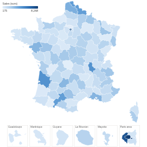

#  France Choropleth

A map of the French departments, each coloured by a measure: lighter for lower values, darker for higher. The 96 metropolitan departments are drawn in their place, the five overseas departments (Guadeloupe, Martinique, Guyane, La Réunion, Mayotte) in boxes under the map, and Paris with its three neighbouring departments again, enlarged, in a last box.

## Use case

Any figure that varies by department: sales or customers per department, survey results, service coverage, incidents, average prices or delivery times. It answers "where is it high, where is it low" at a glance, and filters the rest of the report when a department is clicked.

## Data

One or more records per department, with a field holding the department's name or its INSEE code. Names are matched without regard to accents, case, spaces or punctuation, and "St"/"Ste" are read as "Saint"/"Sainte", so "Cote d'Or", "Côte-d'Or" and "COTE D OR" all match; codes may drop the leading zero ("1" for "01"). Values that match no department are listed in a note under the map.

The measure is aggregated by Omniscope per department, so the records can be individual orders, visits or responses.

## Settings

- **Department field**: the field holding department names (Ain, Côte-d'Or) or codes (01, 2A, 974).
- **Colour**: the measure that colours each department, for example the sum of Sales or the mean of Satisfaction.
- **Pane X**, **Pane Y** (optional): one map per value, side by side or one above the other.

## How the colours are worked out

The colour scale runs from the lowest to the highest value among the departments on the map, from light to dark blue; the key in the top-left corner gives both ends. Departments with no value are grey (the "No data" key appears when there are some). When every department has the same value they all take the middle colour.

## Interaction

Hover a department for its name, code and value. Click a department to select its records in the rest of the report (other departments fade); click it again, or click empty space, to clear the selection.

## Department outlines

The outlines are in `regions_fr.json`, made by `basemap/make_basemap.py` from the [france-geojson](https://github.com/gregoiredavid/france-geojson) project by Grégoire David. Its outlines come from IGN's ADMIN EXPRESS COG (2018 edition) and its names and codes from INSEE's Code officiel géographique. Both are published under the [Licence Ouverte / Open Licence](https://www.etalab.gouv.fr/licence-ouverte-open-licence) of Etalab, which allows reuse, including commercial reuse, with attribution of the source. The script projects the outlines (Lambert-93), simplifies them while keeping shared borders matched, and places the overseas departments and the enlarged Paris area in boxes.

Source: IGN, ADMIN EXPRESS COG 2018; INSEE, Code officiel géographique; via france-geojson. Licence Ouverte / Open Licence (Etalab).

## Third-party libraries

None: the view draws its own SVG and needs nothing beyond Omniscope's custom view API and its own `regions_fr.json`, so it also works without internet access.

The sample data in `sample-data/` is invented for the demo.
