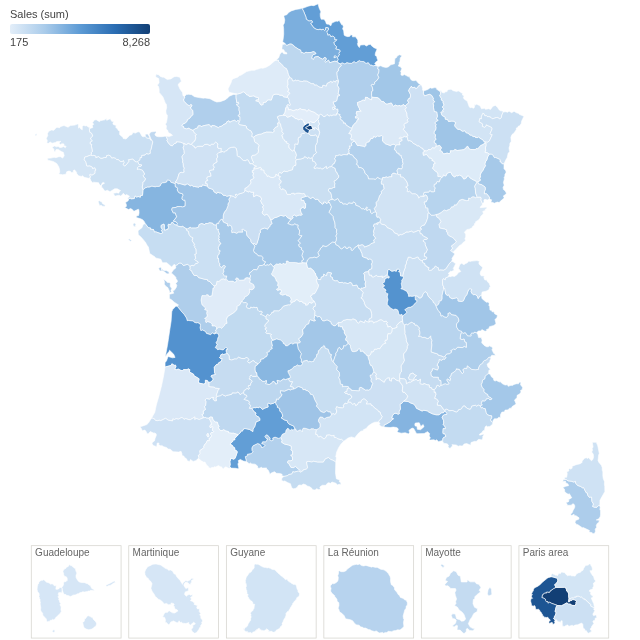
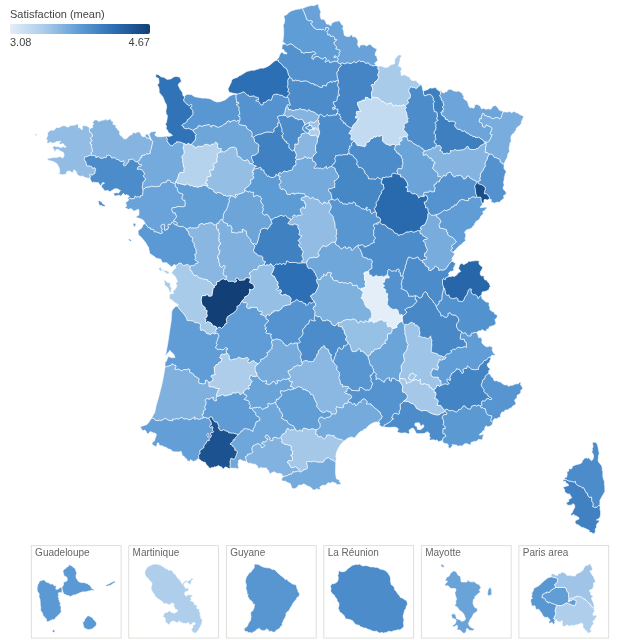
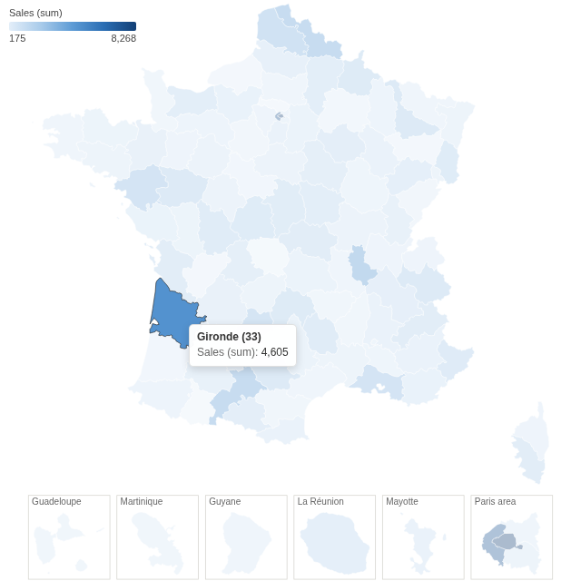

# France Choropleth

Every French department coloured by a figure from your data, overseas departments and Paris included, with a click to filter the report to one department.

## The problem it solves

Figures broken down by department are common in France, and a table of 101 rows hides the pattern: is the north stronger than the south, does one department stand out from its neighbours? A choropleth map shows that at once, but it needs department outlines, a projection that looks right, and the overseas departments somewhere visible.

The France Choropleth view has all of that built in. Point it at a field holding department names or codes, choose a measure, and each department is coloured by its value. In the illustrative orders above (invented figures), the departments of the large cities lead; below, the same orders are matched by INSEE code and coloured by the mean satisfaction score:

## Where it earns its place

Omniscope's Choropleth view, and the Map view with a GeoJSON or shapefile you supply and join to the data, can also colour areas. This view is the quicker route when the areas are French departments: the outlines are included, overseas departments and the Paris area sit in their own boxes so they can be seen and clicked, and loose spellings and codes match without a join.

The examples below are illustrative.

| Team | Department field | Colour |
|---|---|---|
| Sales | Customer's department | Sum of sales, number of customers |
| Customer service | Department of the request | Mean satisfaction, number of complaints |
| Logistics | Delivery department | Mean delivery time |
| Public sector | Department | Coverage rate, incidents per 1,000 residents |

## How to use it in Omniscope

1. Bring the data into a workflow with a field holding department names or codes, and connect it to a Report block.
2. Add a view and choose **France Choropleth**.
3. Set **Department field**, for example Department, and **Colour**, for example the sum of Sales.
4. Check the note under the map: it lists any values that did not match a department.
5. Click a department to filter the other views to it; click again or click empty space to clear.

## Why do this in Omniscope

- **No boundary file to find or join.** The 101 department outlines, with their INSEE codes, travel with the view; your workflow only needs a column of names or codes, and the note under the map names any value that did not match.
- **The same figures as a table of the data.** Each department's colour comes from Omniscope's aggregation of the workflow's output, the same sum or mean a table grouped by department would show, recomputed on every refresh.
- **One department filters the dashboard.** Clicking a department selects its records, so the other views in the report show that department's detail.
- **Open to change.** The view is one HTML file and a JSON file of outlines: in the View Designer you can change the colour ramp, and the included script that builds the outlines can be adapted to draw regions instead of departments.

## Data and options

A field of department names or codes, and a measure.

| Option | What it does |
|---|---|
| Department field | Department names or INSEE codes; loose spellings match |
| Colour | The measure that colours each department |
| Pane X, Pane Y | Optional: one map per value |

## Tested

Mock harness: the sum of sales per department checked against the source data (101 departments, total 157,894.98), matching by name and by INSEE code, older spellings and codes without the leading zero ("Seine St Denis", "Corse du Sud", "Cote d'Or", "1") and a value that matches nothing, hover and the tooltip, selecting a department (in the map and in the Paris box), clicking again and clicking empty space to clear, filtering to one region (four departments, the rest grey), a field that matches no department, a 180 by 140 pane, 30,300 records, empty data and unconfigured options.
