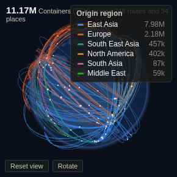

#  Globe Flows

Origin-to-destination flows drawn as arcs on an interactive 3D globe (three.js). Arc thickness shows the size of each flow, colour shows the origin, destination or any category, and pulses travel along the largest routes. Drag to turn the globe, scroll to zoom.

## Use case

Showing where things move: trade and shipping lanes, supplier-to-plant logistics, international payments, passenger or freight routes, website traffic by country, migration. It answers "where does it come from, where does it go, and which routes matter" at a glance, and works as an opening view for a report or a screen in a control room.

## Data

One row per flow, or several rows per origin and destination pair (aggregated). You need names for the origin and destination and their latitude and longitude in decimal degrees. If the data only has place names, add coordinates in the workflow first (for example with the Geocode block or a lookup table).

## Settings

- **Origin / Destination**: names of the two ends. Selection filters on these fields.
- **Origin latitude / Origin longitude / Destination latitude / Destination longitude**: coordinates. Only averaging-type functions are offered (mean, median, min, max, single value), so repeated rows do not distort positions.
- **Flow size**: optional measure, for example the sum of Containers or Amount. Without it each pair counts once.
- **Colour by field**: optional category (for example Origin region or Product); otherwise **Colour flows by** origin, destination or a single colour. Eight colours are used; the rest are grey. Colours stay with their category when filtering.
- **Flows to draw**: the largest N flows (default 400; up to 3,000).
- **Label places**: label the N busiest places (overlapping labels are hidden).
- **Animate flows**, **Auto rotate**.

## Interaction

Hover a route or a place for its volume. Click a route to select it (shift-click to add more), a place to select all flows in or out of it, or a legend entry to select that category. Other views filter or highlight to match; click empty space to clear. Requires WebGL. Land outlines are loaded from the world-atlas package on jsDelivr; without internet access the globe shows a plain graticule.

## Motion

When the view first draws, and when its data, options or filters change, the flow arcs draw out from their origins, then the moving pulses start. Hovering and selecting do not replay it. The animation is skipped when the viewer's system asks for reduced motion.

## Third-party libraries

Loaded from the jsDelivr CDN when the view opens, so the browser showing the report needs internet access:

- [three.js](https://threejs.org) 0.147.0, MIT licence
- [D3](https://d3js.org) 7.9.0, ISC licence
- [TopoJSON client](https://github.com/topojson/topojson-client) 3.1.0, ISC licence
- [World Atlas (land outline at 1:110m, from Natural Earth, public domain)](https://github.com/topojson/world-atlas) 2.0.2, ISC licence

## About this view

This view carries the `visokio-agents` tag. It is one of a set of community examples built by Visokio's agents, to extend Omniscope's core views with popular, specialist and more unusual use cases, and to show what anyone, people or agents, can build on Omniscope. It is tested by automated tests and was run on a real Omniscope server. It was not reviewed by Omniscope's core team, so it is not on a par with Omniscope's core views, which have years of manual, functional and unit tests behind them.

The sample data in `sample-data/` is invented for the demo.
