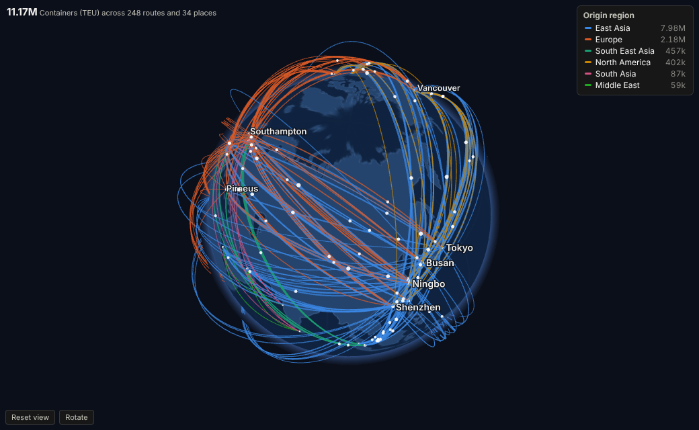
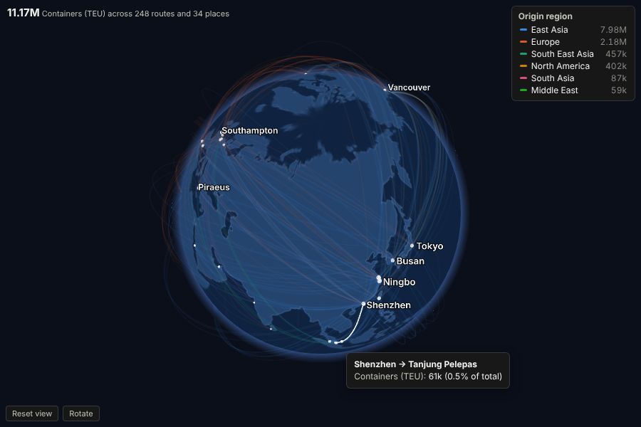
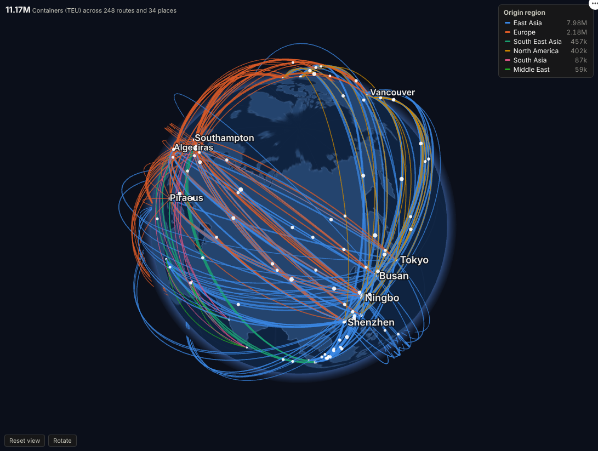

# Globe Flows

Put your supply chain, trade lanes or payment corridors on a living globe: every route drawn to scale, coloured by region, and one click from the records behind it.

## The problem it solves

Flow data is everywhere (shipments, transfers, journeys, orders between sites), and it is hard to read as a table. A flat map with lines gets crowded and distorts long routes; a Sankey loses the geography. Executives and customers want to see the network: where volume concentrates, which lanes are growing, how exposed a business is to one region or one port.

Globe Flows draws each origin-to-destination flow as an arc on a 3D globe, thickness by volume and colour by region or any category, with pulses moving along the largest routes. Viewers turn and zoom the globe themselves. Hovering gives exact volumes, and clicking a route, a port or a region selects those records for every other view in the report.

## Where it earns its place

The examples below are illustrative.

| Industry | Flows | Typical question |
|---|---|---|
| Logistics and shipping | Containers or tonnes between ports, depots or hubs | Which lanes carry the volume, and how exposed are we to one corridor? |
| Manufacturing and supply chain | Parts from suppliers to plants | Where do critical components come from, and how far do they travel? |
| Banking and payments | Transfers between countries | Which corridors are growing, and are any unusual for this customer segment? |
| Travel and aviation | Passengers or seats between airports | How does demand on each route compare with capacity? |
| Digital and media | Visitors or orders by country of origin | Where does international demand come from? |

## How to use it in Omniscope

1. Bring the flow data into a workflow. If it has place names only, add coordinates with the **Geocode** block or join a lookup table of locations.
2. Connect it to a Report block, add a view and choose **Globe Flows**.
3. Set **Origin** and **Destination**, the four coordinate measures (mean is the natural choice), and **Flow size** (for example the sum of Containers).
4. Optionally set **Colour by field** (Origin region, product, carrier).
5. Turn and zoom the globe; click a route, place or legend entry to select, and let the rest of the report follow.

## Why do this in Omniscope

- **Coordinates prepared upstream.** Geocoding, joins and aggregation happen in the same workflow, with the Geocode block or a lookup table, so the globe is drawn from tidy data rebuilt the same way on every refresh.
- **Follows the report's filters.** Filter to European destinations or one product and the arcs and pulses redraw for that subset, each category keeping its colour.
- **Lane to shipments.** A click on a route, port or legend entry turns the globe into a filter: the shipments table, the cost chart and the KPI tiles beside it show that lane only.
- **Arcs you can restyle.** It draws up to 3,000 routes, and the arcs, pulses and colours are set in code you can edit.

## Data and options

One row per flow (or several per pair, aggregated). Required: origin and destination names and their coordinates.

| Option | What it does |
|---|---|
| Origin, Destination | Names of the two ends; selection filters on these fields |
| Coordinate measures | Latitude and longitude of each end (mean, median, min, max or single value) |
| Flow size | Thickness of each arc |
| Colour by field, Colour flows by | Category colours (eight, then grey) |
| Flows to draw, Label places, Animate flows, Auto rotate | Presentation |

Tested with 3,000 routes between 500 places.

## Tested

- Mock harness: 248 routes over 12 months, a selected route, a clicked port, clearing, filtering to European destinations, a small view, colouring by destination, empty data, unconfigured options, and 3,000 routes.
- Real Omniscope server: installed through the Edit View API and configured in a report on the per-route table.

