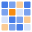
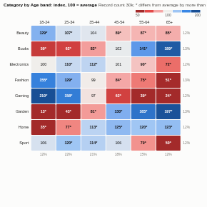

#  Index Heatmap

A cross-tab of two categories shown as index scores, the way market researchers profile customers: 100 means a combination is as common as you would expect if the two were unrelated, 200 means twice as common, 50 half as common. Cells are coloured blue (over-represented) to red (under-represented) on a log scale, and with counts the cells that differ from average by more than chance are marked. Cells can also show the share of each row or column, or the plain value.

## Use case

Customer profiling (which age bands, regions or channels over-index for each product), audience and media planning, survey cross-tabs, product mix by store or region, fault types by machine or site, any "is this combination more common than it should be?" question.

## Data

Two groupings and a measure, aggregated by Omniscope (up to about 60 rows and 40 columns). Record count gives the classic cross-tab, with significance; a sum such as Spend gives the index of value rather than of records.

## Settings

- **Rows**, **Columns**: the two groupings.
- **Measure**: record count, or a sum.
- **Show**: index (default), share of each row, share of each column, or the value. Colour always shows the index.
- **Sort**: by name or by total.
- **Mark significant**: with counts, mark cells whose adjusted standardised residual is beyond 1.96 (about 95% confidence).

## How the index is calculated

Index = the cell's value divided by the value expected if rows and columns were independent (row total times column total divided by the grand total), times 100. The adjusted residual is (observed minus expected) divided by the square root of expected times (1 minus the row share) times (1 minus the column share); with many cells some will pass the threshold by chance, so treat marks as a guide. The margins show each row's and column's share of the total.

## Interaction

Hover a cell for the value, the expected value, the index, the row share against the overall share and the residual. Click a cell to select that combination, or a row or column heading to select it, so other views filter or highlight to match; click again or click empty space to clear.

## Motion

When the view first draws, and when its data, options or filters change, the cells appear in turn. Hovering and selecting do not replay it. The animation is skipped when the viewer's system asks for reduced motion.

## Third-party libraries

Loaded from the jsDelivr CDN when the view opens, so the browser showing the report needs internet access:

- [D3](https://d3js.org) 7.9.0, ISC licence

## About this view

This view carries the `visokio-agents` tag. It is one of a set of community examples built by Visokio's agents, to extend Omniscope's core views with popular, specialist and more unusual use cases, and to show what anyone, people or agents, can build on Omniscope. It is tested by automated tests and was run on a real Omniscope server. It was not reviewed by Omniscope's core team, so it is not on a par with Omniscope's core views, which have years of manual, functional and unit tests behind them.

The sample data in `sample-data/` is invented for the demo.
