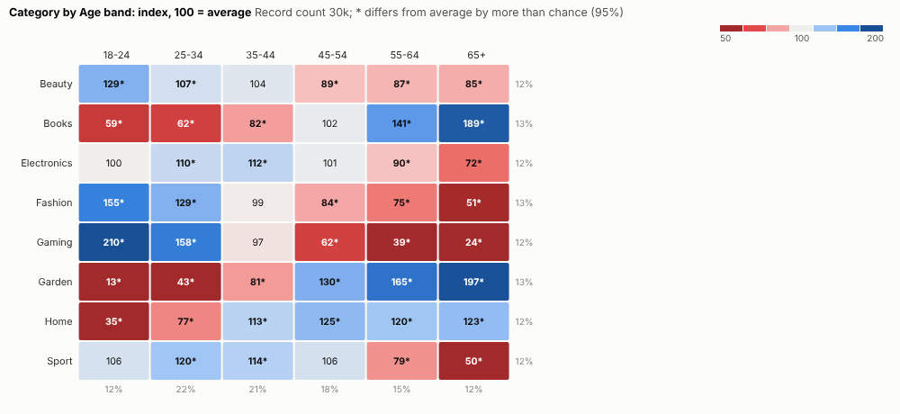
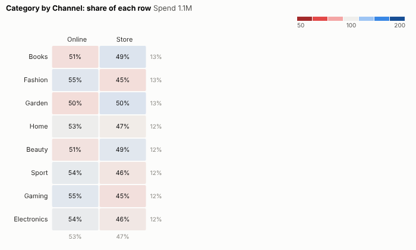
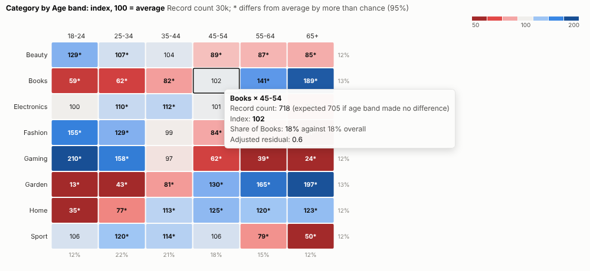
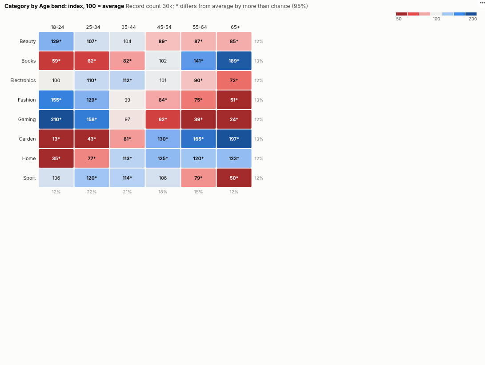

# Index Heatmap

Who over-indexes? A cross-tab that shows at a glance which combinations are more or less common than average, and which differences are real.

## The problem it solves

"Which products do younger customers buy?" A plain cross-tab of counts mostly shows that big groups are big: the most common age band tops every column. Percentages of the row or column help, but the eye still has to compare each cell with the overall average. Market researchers have long solved this with index scores: 100 is average, above 100 over-represented, below under-represented, together with a test of whether a difference is more than chance.

The Index Heatmap view does exactly that from any two categories. In the illustrative purchases above, gaming indexes at 210 among 18 to 24 year olds and garden at 197 among the over-65s, and almost every difference is beyond chance. With spend instead of counts, the same view shows each category's split between online and store:

## Where it earns its place

The examples below are illustrative.

| Team | Rows | Columns |
|---|---|---|
| Marketing and insight | Product category | Age band, region, segment |
| Media planning | Channel or title | Audience group |
| Retail | Product | Store or format |
| Survey research | Answer | Respondent group |
| Operations | Fault type | Machine or site |

## How to use it in Omniscope

1. Bring the records into a workflow with the two categories (and a value, if you want spend rather than counts).
2. Connect it to a Report block, add a view and choose **Index Heatmap**.
3. Set **Rows**, **Columns** and **Measure** (record count for a classic cross-tab).
4. Switch **Show** between index and row or column shares.
5. Click a cell, for example Gaming and 18 to 24, to select those records and profile them elsewhere in the report.

## Why do this in Omniscope

- **Each cell against its own expectation.** The index removes the effect of group sizes, significance marks show which differences to trust, and both agree with an independent calculation in the tests.
- **Any two dimensions.** Swap rows or columns, or switch from counts to spend, and the engine recounts from the filtered data.
- **Cell to customers.** Selecting a cell, such as Gaming and 18 to 24, selects those purchases for the rest of the report.
- **Your own significance rule.** The 1.96 threshold and the residual formula are in the view's code, if your research team uses a different test.

## Data and options

Two groupings and a measure.

| Option | What it does |
|---|---|
| Rows, Columns | The two categories |
| Measure | Record count or a sum |
| Show | Index, row share, column share or value |
| Sort | By name or by total |
| Mark significant | Significance marks for counts |

## Tested

- Mock harness: the index and the adjusted residual checked against an independent calculation, spend with row shares, hover, selecting a cell and a row, clearing, filtering to one region, a narrow layout, too many rows, empty data and unconfigured options.
- Real Omniscope server: installed through the Edit View API and configured in a report.

