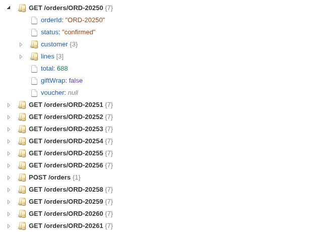
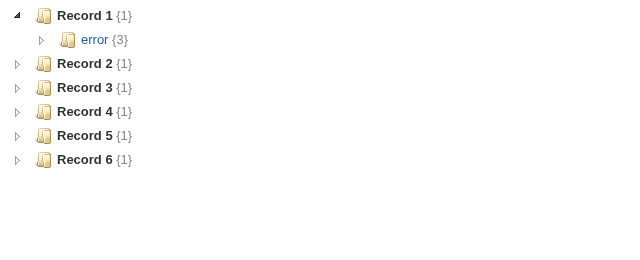
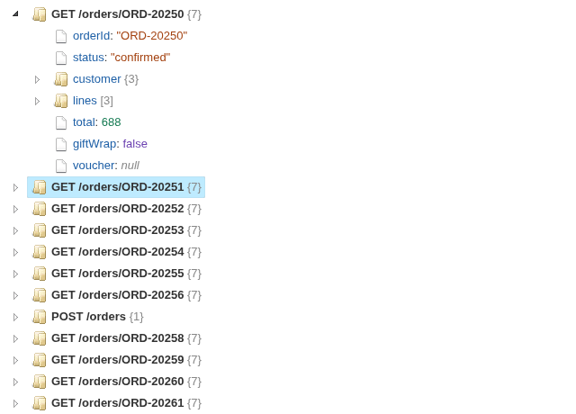

# JSON Tree

JSON stored in a field, opened up as a tree you can click through, one node per record.

## The problem it solves

Data often arrives with JSON inside it: a log of API responses, events from an app, records exported from a document database. In a table each document is one long line of text, so it is hard to see what it contains or how deep it goes, and harder still to compare two of them.

The JSON Tree view parses the field and shows each record as a tree: keys in blue, text in brown, numbers in green, and the size of every object `{7}` and array `[3]`. In the illustrative log above (invented responses from an order service), each response is a node named by its endpoint. Filtered to the failed requests, the error responses stand out by their different shape:

## Where it earns its place

A Table view shows the JSON as text; this view shows its structure. It is a tool for looking inside the data while building a workflow or a support dashboard, before choosing which keys to turn into fields.

The examples below are illustrative.

| Team | JSON field | Record label |
|---|---|---|
| Engineering | API responses, webhook payloads | Endpoint, request ID |
| Product | App events | Event name, session |
| Data | Documents from a document database | Document ID |
| Support | Configuration of a customer's account | Customer ID |

## How to use it in Omniscope

1. Bring the data into a workflow with the JSON in a text field, and connect it to a Report block.
2. Add a view and choose **JSON Tree**.
3. Set **JSON field**, and optionally **Record label**.
4. Filter or select in the other views to bring the records you want into the tree.
5. With Record label set, click a record's node to select its records in the rest of the report.

## Why do this in Omniscope

- **Next to the rest of the record.** The tree follows the report's filters and selections, so picking a status code, a date or a customer in another view brings exactly those documents into the tree.
- **From the workflow, not a copied file.** The documents come straight from the workflow's output, so the tree shows what the workflow actually holds after each refresh, without pasting JSON into a separate viewer.
- **A view you can extend.** It is a short custom view built on jsTree: in the View Designer you could add search, expand-all, or a click that copies a value.

## Data and options

A text field holding JSON.

| Option | What it does |
|---|---|
| JSON field | The text field holding JSON, one document per record |
| Record label | Optional: names each record's node, and makes it selectable |

## Tested

Mock harness: 60 responses, one node per record, object and array sizes; filtering to the failed requests and to one endpoint; selecting a record by its label, clicking again and clicking empty space to clear, opening a nested node; a value holding HTML (shown as text, not run), invalid JSON and an empty value; a 160 by 120 pane (the tree scrolls); 5,000 records (the first 500 shown, with a note); empty data and no JSON field.
