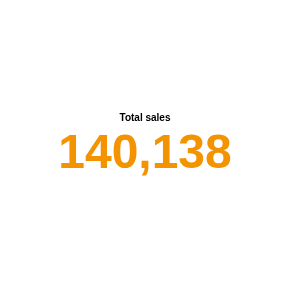

#  KPI

A single headline number with a title: one measure worked out over all the records in the view, for example total sales or the average discount. It follows the report's filters, so the number changes as the viewer filters other views.

It is also the smallest view in this repository, and a readable starting point for writing your own custom view: one HTML file, no libraries, and the auto-query result read through `result.mappings`.

## Use case

Dashboard headlines: total revenue, orders this month, average basket, number of open cases, mean satisfaction score. Put several side by side for a row of key figures.

## Data

Any data with a numeric field to aggregate. The view asks Omniscope for one value (no grouping), so it works with any number of records.

## Settings

- **Measure**: the value to show, for example the sum of Sales, the mean of Discount (%) or Record count.
- **Title text** (optional): the title above the value. If it is empty, the measure's name is shown, for example "Sales (sum)".

## How the number is shown

- 100 and above: rounded to a whole number, with thousands separators (140,138).
- From 1 to 100: up to two decimals (3.69).
- Below 1: three significant digits (0.0342).

Separators follow the viewer's browser language. The value is sized to fill the view, between 14 and 96 pixels high, and shrinks to fit the view's width.

When the measure has no value (no records after filtering, or a sum over empty values) the view shows "No data". Without a measure it shows "Choose a measure".

## Interaction

The view has nothing to select. A click on it clears the selection in the report, as a click on empty space in any view does.

## Third-party libraries

None: the view needs nothing beyond Omniscope's custom view API.

The sample data in `sample-data/` is invented for the demo.
